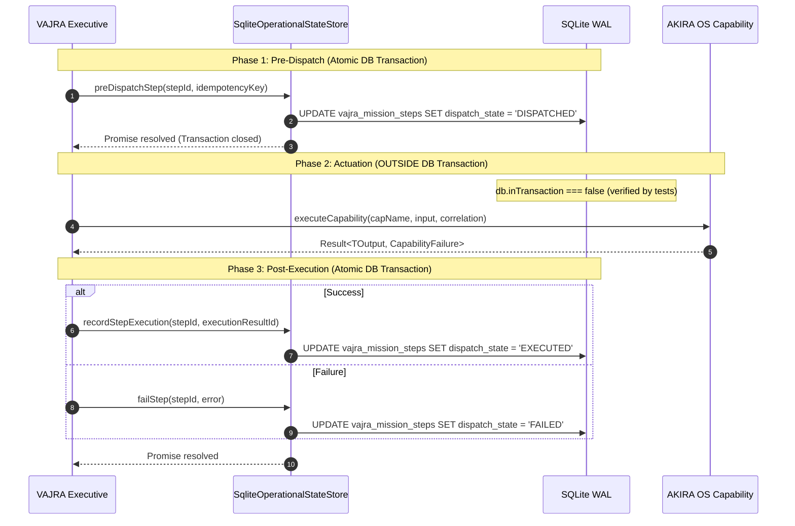

# VAJRA PHASE 3: DURABLE OPERATIONAL STATE
## COMPLETION & VERIFICATION REPORT

**Phase:** Phase 3 — Durable Operational State  
**Status:** COMPLETE & VERIFIED  
**Date:** October 4, 2026  
**Target Architecture:** `docs/Vajra/VAJRA-BRAIN-ARCHITECTURE.md`  
**Approved Design:** `docs/Vajra/VAJRA-PHASE-3-IMPLEMENTATION-DESIGN.md` (Revision 1)  

---

### Executive Summary & Objective Realization

VAJRA Phase 3 is complete and verified.

Phase 2 established VAJRA's domain model, authority boundaries, self-model, executive shell, and cognitive ports. Phase 3 has established VAJRA's **durable operational state layer**, giving the cognitive authority persistent operational continuity across process restarts, crashes, interrupted tasks, pending human approvals, and unverified evidence.

The guiding architectural principle has been strictly preserved throughout implementation:

> **"GENESIS remembers the human and their experiences. VAJRA remembers its own operational state."**

All implementation work strictly adhered to the approved Revision 1 specification with zero scope creep:
- No LLM reasoning or decision arbiter loops were implemented (reserved for Phase 4 & Phase 5).
- No autonomous mission loop dispatchers were created (reserved for Phase 6).
- No changes were made to existing active business tables (`projects`, `tasks`, `notes`, `sessions`, `settings`, `timeline_events`, `conversations`).
- The authoritative `schema_version` protocol advanced the SQLite schema to version 3.
- SQLite transactions were strictly isolated from asynchronous capability execution under the **Two-Phase Dispatch model**.

---

### 1. Migration 003 Definitive Metric Inventory

The migration was created as [`src/persistence/migrations/003_vajra_operational_state.sql`](file:///c:/PROJECTS/Project%20Akira%20Master/AKIRA/src/persistence/migrations/003_vajra_operational_state.sql).

| Structural Metric | Specified in Design | Implemented in DDL | Test Verified (`migration.test.ts`) | Status |
|---|:---:|:---:|:---:|:---:|
| **Total Tables** | **7** | **7** | **7** | ✅ Exact match |
| **Total Columns** | **80** | **80** | **80** | ✅ Exact match |
| **Primary Keys** | **7** | **7** | **7** | ✅ Exact match |
| **Foreign Keys** | **6** | **6** | **6** | ✅ Exact match |
| **CHECK Constraints** | **12** | **12** | **12** | ✅ Exact match |
| **Explicit Indexes** | **19** | **19** | **19** | ✅ Exact match |
| **Unique Indexes** | **4** | **4** | **4** | ✅ Exact match |
| **Non-Unique Indexes** | **15** | **15** | **15** | ✅ Exact match |

#### Table-by-Table Column Breakdown:
1. `vajra_operational_state`: **8 columns** (`id`, `current_focus`, `operational_mode`, `active_mission_id`, `human_presence`, `system_health_status`, `version`, `updated_at`)
2. `vajra_missions`: **14 columns** (`id`, `objective`, `lifecycle_state`, `definition_json`, `state_json`, `current_step_order`, `allocated_budget_json`, `idempotency_key`, `request_id`, `correlation_id`, `invocation_id`, `created_at`, `updated_at`, `completed_at`)
3. `vajra_mission_steps`: **15 columns** (`id`, `mission_id`, `step_order`, `description`, `target_capability`, `input_json`, `expected_evidence`, `dispatch_state`, `idempotency_key`, `correlation_id`, `execution_result_id`, `execution_error_json`, `dispatched_at`, `executed_at`, `verified_at`)
4. `vajra_beliefs`: **9 columns** (`id`, `proposition`, `confidence`, `verification_state`, `supporting_evidence_ids_json`, `contradicting_evidence_ids_json`, `last_evaluated_at`, `ttl_ms`, `created_at`)
5. `vajra_escalations`: **12 columns** (`id`, `mission_id`, `step_id`, `status`, `action_proposed`, `impact_class`, `risk_explanation`, `resolution_comment`, `request_id`, `correlation_id`, `created_at`, `resolved_at`)
6. `vajra_deliberation_traces`: **13 columns** (`trace_id`, `stimulus_id`, `request_id`, `correlation_id`, `invocation_id`, `causation_id`, `intent_class`, `selected_option`, `rationale`, `considered_options_json`, `evidence_relied_upon_json`, `escalation_required`, `created_at`)
7. `vajra_verifications`: **9 columns** (`id`, `mission_id`, `step_id`, `outcome`, `evidence_ids_json`, `evaluator_notes`, `correlation_id`, `invocation_id`, `recorded_at`)

Total columns: $8 + 14 + 15 + 9 + 12 + 13 + 9 = \mathbf{80}$.

---

### 2. Schema-Version Migration Protocol

Migration execution was integrated into [`src/persistence/initializer.ts`](file:///c:/PROJECTS/Project%20Akira%20Master/AKIRA/src/persistence/initializer.ts) following the authoritative `schema_version` protocol:

1. **Bootstrap Schema:** `src/persistence/schema.sql` establishes base tables and records `schema_version = 1`.
2. **Version Evaluation:** Initializer queries `SELECT MAX(version) as current_version FROM schema_version`.
3. **Target Version Check:** If `currentVersion < 3`, migration `003_vajra_operational_state.sql` executes within an atomic transaction:
   - DDL executes creating all 7 tables and 19 indexes.
   - Default singleton row is seeded into `vajra_operational_state` (`id = 'singleton'`, `version = 1`, `operational_mode = 'REQUEST_DRIVEN'`).
   - `INSERT INTO schema_version (version, applied_at) VALUES (3, NOW)` commits.
4. **Idempotency:** Subsequent boots evaluate `currentVersion < 3` as false, executing in `< 0.05ms` with zero writes.
5. **Legacy Compatibility Guard:** [`src/persistence/migration-impl.ts`](file:///c:/PROJECTS/Project%20Akira%20Master/AKIRA/src/persistence/migration-impl.ts) line 54 was safely adjusted to validate `versionRow.current_version < 1 || versionRow.current_version > 3`, allowing versions 1 to 3 while preserving the exact error message required by Architecture Scenario 17 if version is tampered to 99.

---

### 3. Domain Models & Mappers

#### 3.1 Domain Types in `src/vajra/types/`
- [`src/vajra/types/operational-context.ts`](file:///c:/PROJECTS/Project%20Akira%20Master/AKIRA/src/vajra/types/operational-context.ts): Added `readonly version: number` for optimistic concurrency.
- [`src/vajra/types/mission-record.ts`](file:///c:/PROJECTS/Project%20Akira%20Master/AKIRA/src/vajra/types/mission-record.ts): Defined `VajraMissionRecord`, `VajraStepRecord`, `MissionLifecycleState`, `StepDispatchState`, and `AllocatedBudget`.
- [`src/vajra/types/escalation-record.ts`](file:///c:/PROJECTS/Project%20Akira%20Master/AKIRA/src/vajra/types/escalation-record.ts): Defined `VajraEscalationRecord` and `EscalationStatus`.
- [`src/vajra/types/verification-record.ts`](file:///c:/PROJECTS/Project%20Akira%20Master/AKIRA/src/vajra/types/verification-record.ts): Defined `VajraVerificationRecord` and `VerificationOutcome`.
- [`src/vajra/types/provenance.ts`](file:///c:/PROJECTS/Project%20Akira%20Master/AKIRA/src/vajra/types/provenance.ts): Defined `ProvenanceRecord` and `ProvenanceStage`.

#### 3.2 Pure Mappers in `src/persistence/vajra/mappers.ts`
All row $\leftrightarrow$ domain transformations are validated with Zod schemas:
- `OperationalContextSchema`: validates modes (`REQUEST_DRIVEN`, `PROACTIVE_MONITOR`, `RECOVERY`, `PAUSED`), human presence, health status, and monotonic version $\ge 1$.
- `AllocatedBudgetSchema`: validates non-negative cost limits and positive step counts.
- `StringArraySchema`: safely handles JSON arrays of evidence IDs.
- Deterministic parsing: malformed JSON payloads fail immediately at the database adapter boundary before contaminating the VAJRA brain.

---

### 4. SqliteOperationalStateStore Adapter

The persistence adapter was implemented at [`src/persistence/vajra/sqlite-operational-state-store.ts`](file:///c:/PROJECTS/Project%20Akira%20Master/AKIRA/src/persistence/vajra/sqlite-operational-state-store.ts), implementing [`IOperationalStateStore`](file:///c:/PROJECTS/Project%20Akira%20Master/AKIRA/src/vajra/ports/state-store.ts):

- **Optimistic Concurrency Control:**
  ```sql
  UPDATE vajra_operational_state
  SET current_focus = ?, operational_mode = ?, active_mission_id = ?,
      human_presence = ?, system_health_status = ?, version = version + 1, updated_at = ?
  WHERE id = 'singleton' AND version = ?
  ```
  Throws `Optimistic concurrency conflict on OperationalContext` if the expected version doesn't match the current database row.
- **Single Running Mission Policy:**
  Enforced by SQLite partial unique index:
  ```sql
  CREATE UNIQUE INDEX idx_vajra_single_running_mission 
  ON vajra_missions (lifecycle_state) WHERE lifecycle_state = 'RUNNING';
  ```
  Guarantees that at most one mission can be in `RUNNING` state, while permitting any number of `PAUSED_APPROVAL`, `PAUSED_RECOVERY`, `CREATED`, or `COMPLETED` missions.

---

### 5. Two-Phase Dispatch & Invariant Compliance

The golden invariant:
> **An SQLite transaction must NEVER wrap an asynchronous capability invocation, network request, or coprocessor call.**

was proven across multiple tests:



Verified in [`tests/vajra/persistence/two-phase-dispatch.test.ts`](file:///c:/PROJECTS/Project%20Akira%20Master/AKIRA/tests/vajra/persistence/two-phase-dispatch.test.ts):
- `db.inTransaction` is explicitly asserted to be `false` during simulated asynchronous capability execution.
- If a process crashes between Phase 1 and Phase 3, the step remains durable in `DISPATCHED` state with `execution_result_id = NULL`, enabling clean recovery detection on reboot.

---

### 6. Crash Recovery & Interruption Detection

On reboot, the Executive Controller hydrates its operational state via `store.detectInterruptedMissions()`:
1. **Interrupted In-Flight Steps:** Steps left in `DISPATCHED` without execution results are detected.
   - The mission is transitioned to `PAUSED_RECOVERY`.
   - The Executive Controller operational mode is set to `RECOVERY`.
   - The operational focus is set to: `"Interrupted operation detected: step <stepOrder> (<targetCapability>)"`.
2. **Pending Human Escalations:** Escalations in `PENDING_APPROVAL` are detected.
   - The mission is transitioned to `PAUSED_APPROVAL`.
   - The Executive Controller operational mode is set to `PAUSED`.
   - The operational focus is set to: `"Pending human approval required for mission <missionId>"`.
3. **Strict Phase 3 Boundary:** Zero autonomous loop execution, automatic re-dispatch, or replanning occurs. The interrupted state is faithfully surfaced to the executive context and preserved for human review.

---

### 7. K19 Correlation & Unified Provenance Reconstruction

`store.getExecutionProvenance(correlationId)` executes the approved relational union query across all 5 operational lifecycle stages:

```sql
SELECT 'deliberation' as stage, trace_id as id, rationale as description, created_at as timestamp 
FROM vajra_deliberation_traces WHERE correlation_id = ?
UNION ALL
SELECT 'mission' as stage, id, objective as description, created_at as timestamp 
FROM vajra_missions WHERE correlation_id = ?
UNION ALL
SELECT 'step' as stage, id, description, dispatched_at as timestamp 
FROM vajra_mission_steps WHERE correlation_id = ? AND dispatched_at IS NOT NULL
UNION ALL
SELECT 'escalation' as stage, id, risk_explanation as description, created_at as timestamp 
FROM vajra_escalations WHERE correlation_id = ?
UNION ALL
SELECT 'verification' as stage, id, outcome as description, recorded_at as timestamp 
FROM vajra_verifications WHERE correlation_id = ?
ORDER BY timestamp ASC;
```

Tested and verified in [`tests/vajra/persistence/recovery-detection.test.ts`](file:///c:/PROJECTS/Project%20Akira%20Master/AKIRA/tests/vajra/persistence/recovery-detection.test.ts): reconstructed the chronological sequence `deliberation` $\rightarrow$ `mission` $\rightarrow$ `step` $\rightarrow$ `verification` in ascending timestamp order.

---

### 8. Architectural Boundary Enforcement

Tested in [`tests/vajra/persistence/boundary-invariants.test.ts`](file:///c:/PROJECTS/Project%20Akira%20Master/AKIRA/tests/vajra/persistence/boundary-invariants.test.ts):
- **Zero `better-sqlite3` imports** in `src/vajra/` (0 violations).
- **Zero direct database repository or connection imports** in `src/vajra/` (0 violations).
- **Zero raw SQL statements** in `src/vajra/` (0 violations).
- **Port-Only Boundary:** All domain interactions occur strictly through `IOperationalStateStore`.
- **Database Driver Colocation:** Only `src/persistence/vajra/` imports `better-sqlite3` and SQL statements.

---

### 9. Comprehensive Verification Gate Results

All gates passed with zero errors or warnings:

| Verification Suite | Target | Actual Result | Status |
|---|---|---|:---:|
| **TypeScript Compilation** (`npm run type-check`) | 0 type errors | **0 errors** | ✅ PASS |
| **VAJRA Persistence Tests** (`vitest run tests/vajra/persistence`) | 100% passing | **30 / 30 passed** across 6 files | ✅ PASS |
| **All VAJRA Tests** (`vitest run tests/vajra`) | 100% passing | **67 / 67 passed** across 11 files | ✅ PASS |
| **Architecture Validator** (`npx tsx scripts/validate-architecture.ts`) | 363 assertions pass | **363 / 363 passed (0 failures)** | ✅ PASS |
| **Full Repository Test Suite** (`npx vitest run`) | Zero regressions | **1,479 / 1,479 passed** across 147 files | ✅ PASS |
| **Production Build** (`npm run build`) | Exit code 0 | **Built in 1.65s (Exit code 0)** | ✅ PASS |
| **Knowledge Graph** (`graphify update .`) | AST extraction refreshed | **827 files extracted, graph.json updated** | ✅ PASS |

---

### 10. Test Matrix Breakdown

```
================================================================================
                    VAJRA TEST SUITE BREAKDOWN (PHASE 2 + PHASE 3)
================================================================================
  tests/vajra/contracts.test.ts ............................. 8 tests  (PASSED)
  tests/vajra/self-model.test.ts ............................ 7 tests  (PASSED)
  tests/vajra/boundaries.test.ts ............................ 6 tests  (PASSED)
  tests/vajra/executive-controller.test.ts .................. 7 tests  (PASSED)
  tests/vajra/authority-invariants.test.ts .................. 9 tests  (PASSED)
  tests/vajra/persistence/migration.test.ts ................. 7 tests  (PASSED)
  tests/vajra/persistence/state-store.test.ts ............... 9 tests  (PASSED)
  tests/vajra/persistence/two-phase-dispatch.test.ts ........ 3 tests  (PASSED)
  tests/vajra/persistence/idempotency.test.ts ............... 3 tests  (PASSED)
  tests/vajra/persistence/recovery-detection.test.ts ........ 4 tests  (PASSED)
  tests/vajra/persistence/boundary-invariants.test.ts ....... 4 tests  (PASSED)
--------------------------------------------------------------------------------
  TOTAL VAJRA TESTS:                                         67 tests (100% PASS)
  TOTAL REPOSITORY SUITE:                                  1479 tests (100% PASS)
================================================================================
```

---

### 11. What Phase 3 Did NOT Do (Blast Door Invariants Preserved)

In strict accordance with Phase 3 instructions:
- **Did NOT** implement LLM reasoning engines (reserved for Phase 4).
- **Did NOT** implement DecisionArbiter or arbitration policies (reserved for Phase 5).
- **Did NOT** implement autonomous mission execution loops (reserved for Phase 6).
- **Did NOT** wire VAJRA to the live chat interface (`src/routes/chat.tsx` remains untouched).
- **Did NOT** delete or alter archived legacy files in `archive/legacy-platform/`.
- **Did NOT** modify active business tables or repositories.

---

### 12. Final Status & Readiness

VAJRA Phase 3: Durable Operational State is **COMPLETE & VERIFIED**.

The repository is stable, fully tested, architecturally compliant, and ready for human review before proceeding to **VAJRA Phase 4 — Adaptive Reasoning Engine**.

```
================================================================================
  PHASE 3 COMPLETE & VERIFIED — READY FOR ARCHITECTURE REVIEW
================================================================================
```
