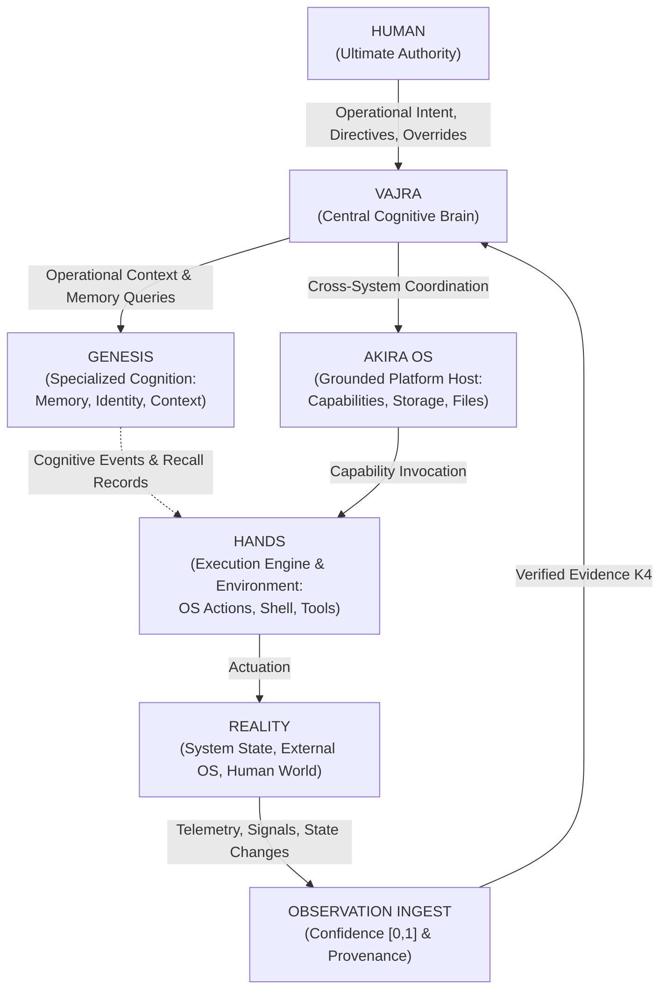
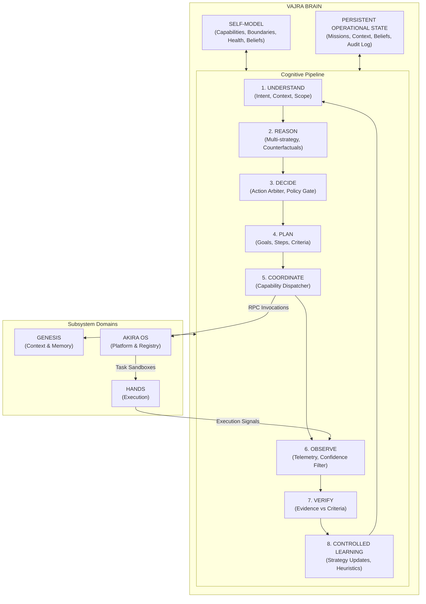
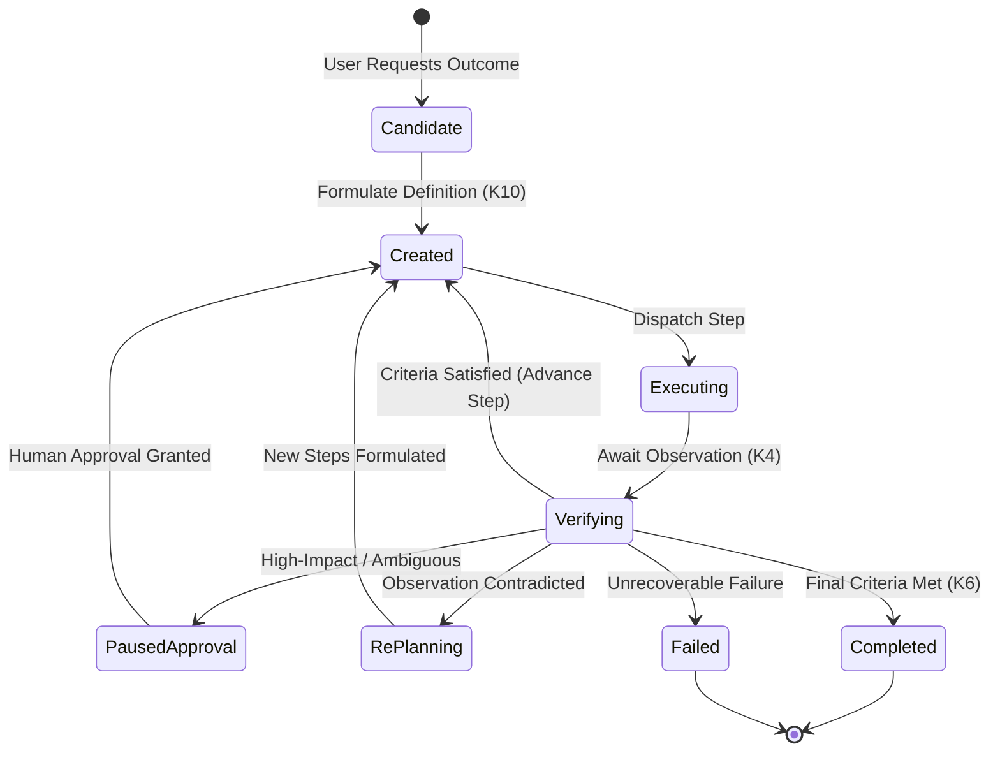
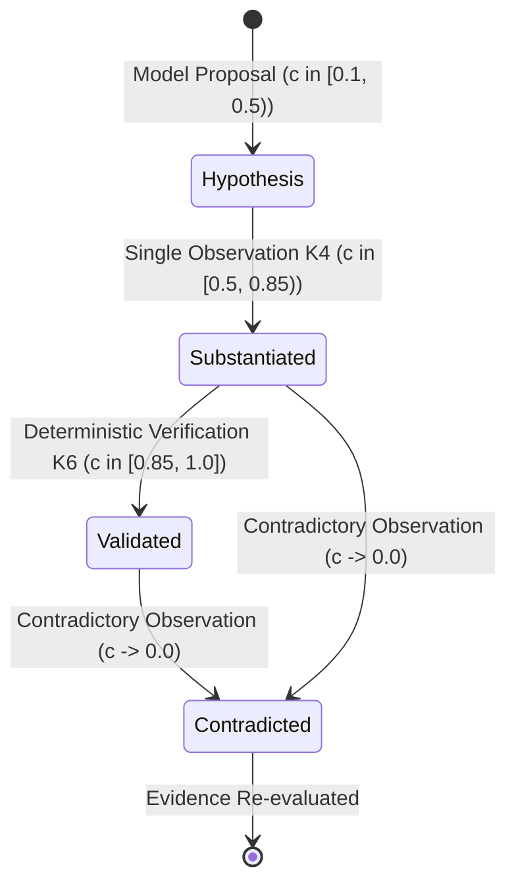
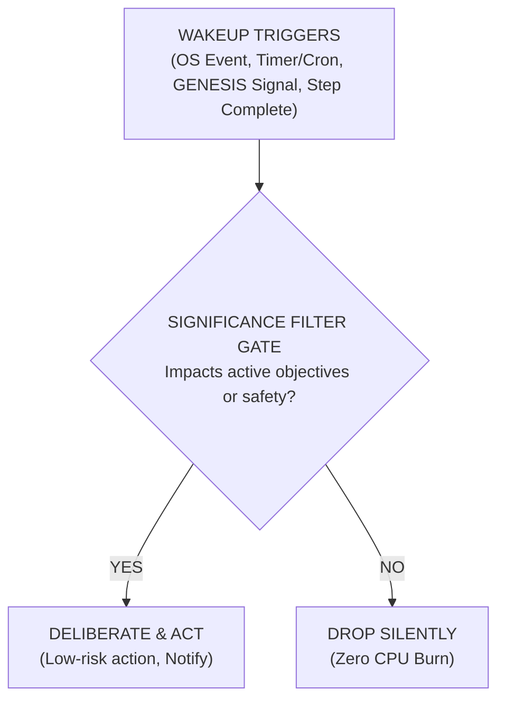
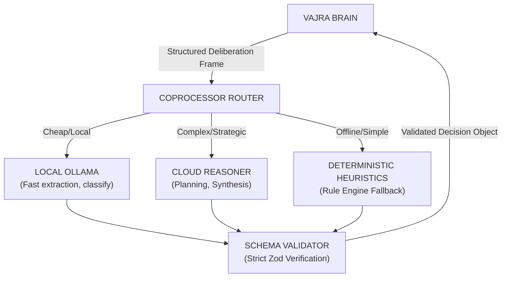

# AKIRA — VAJRA ARCHITECTURE SPECIFICATION
## The Central Cognitive-Control Authority (Brain)
*First-Principles Architecture Design Document*
*Status: Authoritative Architecture Specification*

---

# PART I: FOUNDATIONAL ARCHITECTURE & BOUNDARIES



---

## 1. Authoritative VAJRA Definition

**VAJRA** is AKIRA’s central Brain and cognitive-control authority. It is the single system entity responsible for global operational intent, multi-system deliberation, cross-domain coordination, strategic planning, verification, and autonomous executive decision-making.

The authority hierarchy is strictly:
$$\text{Human} \longrightarrow \text{VAJRA} \longrightarrow [\text{GENESIS} \mid \text{AKIRA OS} \mid \text{HANDS} \mid \text{Capabilities}]$$

- **Human has ultimate authority:** The user sets goals, defines constraints, and holds unconditional veto/override authority.
- **VAJRA has global/cross-system authority:** VAJRA owns all consequential decisions across systems. Specialized systems cannot independently alter global objectives, strategies, or cross-system state.
- **Specialized systems retain internal implementation autonomy:**
  - **GENESIS** makes internal cognitive decisions (memory graph indexing, association ranking, narrative clustering). It reports discoveries to VAJRA, but does not independently decide to mutate projects.
  - **AKIRA OS** makes internal platform decisions (SQLite transaction boundaries, capability validation, filesystem indexing). It enforces contracts, but does not decide which operational goals to execute.
  - **HANDS** makes execution-level safety decisions (process sandboxing, pipe buffering, timeout kills). It does not decide what goals to pursue.
- **VAJRA is NOT an execution engine:** It does not mutate files, run shell commands, or query databases directly.
- **VAJRA is NOT a mission runner:** The Mission Subsystem is one structured operational pattern among several available to VAJRA.
- **VAJRA is NOT an LLM wrapper:** The model is a reasoning coprocessor and swappable instrument, not VAJRA's identity, memory, or state.

---

## 2. Core Architectural Principles

1. **Human Supremacy:** The Human possesses unconditional, ultimate authority. VAJRA may advise, warn, counter-propose, and pause for confirmation, but it never overrides an explicit, validated human constraint or directive.
2. **Global Authority vs. Local Autonomy:** VAJRA owns all consequential cross-system decisions. Specialized systems retain local implementation autonomy within their domains.
3. **Model Decoupling:** VAJRA is completely decoupled from any single LLM. The cognitive architecture (state machines, belief graphs, invariant validators, decision policies) is deterministic, durable, and model-agnostic.
4. **Separation of Execution, Observation, and Verification:**
   - **Execution** (HANDS / Capabilities) produces an execution `Result<T>`. Execution success never implies goal completion.
   - **Observation** captures reality signals, producing an immutable `Observation` tagged with confidence in $[0, 1]$ and explicit provenance.
   - **Verification** is a cognitive judgment performed exclusively by VAJRA by comparing accumulated observations against completion criteria.
5. **Epistemic Humility & First-Class Uncertainty:** VAJRA does not operate in binary booleans. Every belief, fact, and model deduction has an explicit confidence score, provenance chain, and verification state.
6. **Bounded, Explainable Autonomy:** Autonomy is never open-ended. Proactive execution operates within strict capability tiers, financial/resource budgets, and irreversible-action blast doors. Every autonomous decision must leave a traceable, explainable audit trail.
7. **Operational Continuity Across Crashes:** Operational state (active missions, unverified beliefs, pending decisions, self-model health) is durably journaled to local SQLite storage. A crash or process reboot restores VAJRA to its exact cognitive state without requiring re-prompting or asking the human *"What were we doing?"*.

---

## 3. Authority Hierarchy & Invariant Boundaries

```
[Level 0] HUMAN
  │  • Absolute goal-setting authority
  │  • Absolute veto, override, and cancellation power
  │  • Owner of irreversible actions and system-level authority boundaries
  ▼
[Level 1] VAJRA (Global Cognitive Brain)
  │  • Global goal interpretation and multi-step strategy
  │  • Cross-system orchestration (GENESIS ↔ AKIRA OS ↔ HANDS)
  │  • Autonomous action within authorized bounds
  │  • Capability dispatch authority and verification judgment
  │  • Proactive initiative, escalation, and self-model maintenance
  ▼
[Level 2] SPECIALIZED DOMAIN AUTHORITIES
  ├── GENESIS (Cognitive Memory Authority)
  │     • Autonomous memory formation, association, and retrieval ranking
  │     • Autonomous context packaging for prompts
  │     • NO independent authority to dispatch side-effects or alter global missions
  ├── AKIRA OS (Platform Host Authority)
  │     • Autonomous capability lifecycle, indexing, and SQLite transactions
  │     • Strict enforcement of capability descriptors, schemas, and Rule N1/N2/N3
  │     • NO independent authority to choose which operational task to execute
  └── HANDS (Actuation & Execution Authority)
        • Autonomous execution-level safety (process isolation, timeouts, pipe buffering)
        • NO independent authority to initiate tasks or select goals
```

---

## 4. System Boundary Diagram



---

# PART II: INTERNAL BRAIN ARCHITECTURE & COGNITIVE SUBSYSTEMS

## 5. Subsystem Taxonomy & Responsibilities

VAJRA is partitioned into 10 deterministic, cooperating subsystems:

| Subsystem | Core Architectural Responsibility |
|---|---|
| **1. Executive Controller** | Lifecycle management, boot orchestration, reactive wakeup, cooperative multitasking scheduler. |
| **2. Understanding Engine** | Ingests raw inputs (Human, System, Event), classifies pragmatic intent, resolves constraints and scope. |
| **3. Reasoning Engine** | Evaluates premises, generates hypotheses, models counterfactuals, dispatches structured tasks to LLM coprocessors. |
| **4. Decision Arbiter** | Selects discrete operational pathways (Answer, Mission, Escalate, Wait, Proactive Act) via bounded policies. |
| **5. Planning Engine** | Decomposes high-level objectives into validated, bounded mission steps and fallback branches. |
| **6. Coordination Dispatcher** | Translates planned steps into capability calls; mediates invocation via the canonical AKIRA OS CapabilityRegistry. |
| **7. Observation Receiver** | Captures external and internal feedback, standardizes telemetry into Contract K4 Observations with confidence. |
| **8. Verification Evaluator** | Evaluates accumulated evidence against completion criteria; issues Contract K6 VerificationRecords/Results. |
| **9. Self-Model & State Host** | Maintains dynamic, durable awareness of AKIRA's limits, available capabilities, health, and ongoing commitments. |
| **10. Bounded Learning Engine** | Incrementally adjusts strategy weights, heuristics, and failure prevention rules without dynamic code mutation. |

---

## 6. Persistent State Model

VAJRA's operational state is stored in dedicated, atomic SQLite tables managed exclusively by VAJRA (`vajra_operational_state`, `vajra_missions`, `vajra_beliefs`, `vajra_audit_log`):

```
                              VAJRA PERSISTENT STATE SCHEMA
┌───────────────────────────────────────────────────────────────────────────────────────────┐
│ 1. Operational Context (Single Active Record)                                            │
│    ├── current_focus: string ("Migrating SQLite schema", "Awaiting human review")        │
│    ├── operational_mode: "REQUEST_DRIVEN" | "PROACTIVE_MONITOR" | "RECOVERY"            │
│    ├── active_mission_id: string | null                                                  │
│    ├── human_presence: "FOCUSED_ACTIVE" | "IDLE" | "AWAY"                                │
│    └── system_health_status: "NOMINAL" | "DEGRADED" | "CRITICAL"                         │
├───────────────────────────────────────────────────────────────────────────────────────────┤
│ 2. Belief & Epistemic Store (Key-Value / Graph in SQLite)                                │
│    ├── belief_id: UUID                                                                   │
│    ├── proposition: string ("HANDS is functioning without sandbox violations")           │
│    ├── confidence: float (0.0 to 1.0)                                                    │
│    ├── verification_state: "UNVERIFIED" | "VERIFIED" | "CONTRADICTED" | "STALE"          │
│    ├── supporting_evidence_ids: string[] (References Observation K4 IDs)                 │
│    ├── last_evaluated_at: ISO-8601 Timestamp                                             │
│    └── ttl_ms: integer | null                                                            │
├───────────────────────────────────────────────────────────────────────────────────────────┤
│ 3. Active Mission Ledger (Phase 3E Schema Extension)                                     │
│    ├── mission_id: UUID                                                                  │
│    ├── definition: JSON (Frozen MissionDefinition K10)                                   │
│    ├── state: JSON (Frozen MissionState K10)                                             │
│    ├── lifecycle_state: "CREATED" | "RUNNING" | "PAUSED_APPROVAL" | "COMPLETED" | "FAILED"│
│    ├── step_cursor: integer (Current executing step index)                               │
│    ├── idempotency_key: string (Guarantees at-most-once execution across crashes)       │
│    └── allocated_budget: JSON ({ max_duration_ms, max_cost_cents, max_retries })        │
├───────────────────────────────────────────────────────────────────────────────────────────┤
│ 4. Operational Audit Ledger (Immutable Append-Only Log)                                 │
│    ├── log_id: UUID                                                                      │
│    ├── correlation_metadata: JSON (Contract K19)                                         │
│    ├── event_type: "DECISION_MADE" | "ESCALATION_TRIGGERED" | "STEP_VERIFIED"            │
│    ├── rationale: string (Deterministic explanation of decision path)                    │
│    └── snapshot_state_id: UUID                                                           │
└───────────────────────────────────────────────────────────────────────────────────────────┘
```

---

## 7. Dynamic Self-Model Architecture

The **Self-Model** is VAJRA’s structured, real-time awareness of its own boundaries, current load, and functional topology:

1. **Structural Identity:**
   - Invariant Boundary: *"I am the central brain; I cannot execute commands directly."*
   - Hierarchy Map: $\text{Human} > \text{VAJRA} > [\text{GENESIS}, \text{AKIRA OS}, \text{HANDS}]$.
2. **Capability & Topology Map:**
   - Known Capabilities: `Map<CapabilityName, { status, cost, latency, tier, isAvailable }>`
   - Subsystem Liveness: GENESIS (Online), AKIRA OS (Online), HANDS (Status monitored).
   - Circuit Breakers: Active trips and degradations tracked in real time.
3. **Authority & Policy Envelope:**
   - Maximum Autonomous Cost: $\$0.10$ per autonomous run without prompt.
   - Prohibited Actions: `[Delete DB, Push to remote repo, Wipe disk, Send external HTTP]`.
   - Escalation Triggers: `[Ambiguity > 0.40 on high-impact steps, Verification failure]`.
4. **Epistemic Awareness:**
   - Known Unknowns: Explicit inventory of unverified assumptions regarding current environment.
   - Model Confidence: Current calibration reliability of underlying LLM provider.

---

## 8. Cognitive Pipeline & Deliberation Loop

$$\text{Understand} \to \text{Reason} \to \text{Decide} \to \text{Plan} \to \text{Coordinate} \to \text{Observe} \to \text{Verify} \to \text{Learn} \to \text{Decide}$$

The cognitive loop is executed through cooperative, non-blocking asynchronous turns:
1. **Understand:** Parse pragmatic intent, correlate with active objectives, determine if stimulus warrants Conversation or Mission.
2. **Reason:** Query GENESIS for relevant context/memories. Formulate hypotheses, synthesize evidence, evaluate risks and counterfactuals.
3. **Decide:** Select action kind (`Answer` | `Plan Mission` | `Escalate` | `Wait`). Check self-model constraints and authority boundary.
4. **Plan:** If Mission: Construct DAG-free linear steps (Contract K10). Define explicit, measurable completion criteria (Contract K6).
5. **Coordinate:** Dispatch capability invocation to AKIRA OS / HANDS. Pass immutable correlation context (Contract K19).
6. **Observe:** Capture execution `Result` (Contract K5) and system telemetry. Tag with confidence $[0,1]$ and provenance $\to$ `Observation` (Contract K4).
7. **Verify:** Evaluate observations against completion criteria. Generate `VerificationRecord` & determine terminal status (Contract K6).
8. **Update State:** Persist mission state, update beliefs, log audit trail. Adjust strategy heuristic weights (Controlled Learning).

---

# PART III: DECISION, PLANNING & OPERATIONAL SUBSYSTEMS

## 9. Decision Architecture & Action Arbitration

VAJRA’s **Decision Arbiter** operates on an explicit **Operational Policy Envelope**. When presented with a cognitive premise, it evaluates four orthogonal dimensions before choosing an action:

| Dimension | Value Range | Threshold Condition | Operational Consequence |
|---|---|---|---|
| **1. Impact Class** | Low / Medium / High | Reversible read/local vs. Irreversible mutation | Autonomous execution allowed vs. Escalation mandatory |
| **2. Epistemic Confidence** | High ($\ge 0.85$) vs. Low ($< 0.85$) | Evidence substantiated vs. Missing observations | Proceed with plan vs. Dispatch verification query |
| **3. Cost Class** | Local Cheap vs. External $\$$ | Zero marginal cost vs. Exceeds session budget | Immediate invocation vs. Request human confirmation |
| **4. Intent Type** | Informational vs. Outcome-based | Query / explanation vs. State mutation desired | Immediate conversational turn vs. Transition to Mission Branch |

### The Disagreement Protocol
When the human proposes an action that VAJRA evaluates as flawed:
1. **VAJRA does NOT silently disobey.**
2. **VAJRA does NOT blindly execute destructive commands.**
3. **Protocol Sequence:**
   $$\text{Acknowledge Intent} \longrightarrow \text{State Disagreement with Evidence} \longrightarrow \text{Offer Superior Counter-Proposal} \longrightarrow \text{Await Explicit Human Resolution}$$
4. If the human reaffirms: *"Do X anyway"*, VAJRA validates whether $X$ violates hard safety bounds (e.g. disk corruption, security breach). If safe, it executes with logged human override provenance; if destructive, it rejects with category `safety_invariant_violation`.

---

## 10. Planning Architecture

Planning in VAJRA produces structured operational sequences without brittle execution graphs:
- **Declarative, Not Imperative:** Plans are compiled into frozen `MissionDefinition` (Contract K10) instances containing bounded `MissionStep` objects.
- **DAG Independence:** In accordance with frozen contract invariants, individual steps do not contain complex DAG dependency trees (`dependsOn`, `predecessors`). VAJRA’s reasoning engine evaluates prerequisites dynamically at runtime.
- **Dynamic Replanning Barrier:** If a step fails or produces unexpected observations:
  1. The step is marked failed in the `MissionState`.
  2. The mission execution is paused.
  3. The Planning Engine is re-invoked with the new `Observation` set to synthesize an updated plan or abort gracefully.

---

## 11. Capability Selection & Routing

VAJRA selects capabilities using the canonical AKIRA OS `CapabilityRegistry`:
1. **Schema-Gated Inspection:** VAJRA inspects candidate descriptors registered in AKIRA OS (`kind`, `costClass`, `activationTier`, `executionCharacteristics`).
2. **Permission Check:** VAJRA verifies `descriptor.permissions.allowVajra === true`.
3. **Cost/Idempotency Optimization:**
   - If an operation is read-only and idempotent $\to$ select Tier 1 Local Query.
   - If an operation carries side-effects $\to$ verify idempotency tokens and step logs before issuing Command.
4. **Invocation Mediation:** Invocations pass strictly through AKIRA OS host RPC boundaries (Rule N1, N2, N3). VAJRA never reaches behind the registry to talk to databases or OS drivers directly.

---

## 12. Mission Subsystem Architecture

The **Mission Subsystem** is an operational engine encapsulated within VAJRA, responsible for the multi-step execution lifecycle:



- **Mission vs. Conversation Boundary:** A chat turn is ephemeral and conversational. A mission is durable, serialized to disk, transactional, and survives system restarts.
- **Execution Invariant:** Execution of a capability $\neq$ mission step completion. Step completion is only achieved when the Verification Evaluator matches collected Observations against the step’s `expectedEvidence`.

---

# PART IV: EVIDENCE, VERIFICATION & UNCERTAINTY

## 13. Epistemic Uncertainty & Evidence Model

VAJRA models knowledge using an explicit **Epistemic Evidence Model**:

$$\text{Belief} = \langle \text{Proposition } P, \text{Confidence } c \in [0, 1], \text{Evidence } \mathcal{E}, \text{Provenance } \mathcal{S}, \text{Timestamp } t \rangle$$



- **Conflict Resolution:** If two observations contradict each other (e.g. Process exited 0 vs. Health check port unavailable):
  1. Confidence is immediately demoted to `UNRESOLVED_CONTRADICTION`.
  2. VAJRA refuses to mark the task completed.
  3. VAJRA schedules an active verification query (ping health endpoint) or escalates to human.

---

## 14. Observation & Verification Architecture

Implemented via frozen Foundation Contracts **K4** and **K6**:
1. **Observation Acquisition (Contract K4):**
   - Telemetry from HANDS, capability results from AKIRA OS, or signals from GENESIS are mapped to pure `Observation` objects:
     ```typescript
     interface Observation<T = unknown> {
       readonly id: string;
       readonly source: string;
       readonly correlation: CorrelationMetadata;
       readonly data: T;
       readonly confidence: number; // Invariant: must be in [0, 1]
       readonly provenance: ObservationProvenance;
       readonly recordedAt: string;
     }
     ```
2. **Verification Judgment (Contract K6):**
   - The Verification Evaluator compares accumulated `Observation` records against the `CompletionCriteria` in the `MissionDefinition`.
   - Produces a frozen `VerificationRecord`:
     $$\text{VerificationRecord} \implies \{\text{outcome: } \texttt{"criteria\_satisfied"} \mid \texttt{"criteria\_not\_satisfied"} \mid \texttt{"inconclusive"}, \text{evidenceIds: } [\dots]\}$$
   - Only upon `criteria_satisfied` may VAJRA construct a successful `MissionResult` (Contract K6, Invariant I9).

---

# PART V: AUTONOMY, PROACTIVITY & LIFECYCLE

## 15. Proactive Initiative & Wakeup Architecture

VAJRA is designed for bounded, non-intrusive proactivity:



### Prevention of Runaway Agent Loops
To guarantee that proactive behavior never degenerates into an unconstrained, costly loop:
1. **Strict Leaky-Bucket Rate Limiter:** Maximum 5 proactive autonomous deliberative cycles per hour when the user is idle.
2. **Autonomous Spend Cap:** Hard ceiling of $\$0.05$ / hour in autonomous model tokens without explicit human authorization.
3. **Step Budget:** Every autonomous sequence has an immutable `maxSteps` (default: 3) constraint.
4. **No Self-Re-Triggering:** A proactive action cannot schedule another proactive action without an intervening external trigger or human response.

---

## 16. Human Escalation Architecture

When an action crosses authority boundaries, VAJRA transitions into an **Escalation Suspended** state:
1. **Packaging the Escalation Frame:** Operational context, specific requested action, exact capability to invoke, risks identified, and potential alternatives.
2. **Publishing the Escalation:** Emits a `vajra.escalation.required` event via AKIRA OS IPC to the UI.
3. **Persistence:** The active mission is saved with state `PAUSED_APPROVAL` in SQLite.
4. **UI Presentation:** The frontend renders a non-blocking confirmation dialog showing the decision justification and risk rating.
5. **Resume on Resolution:** Upon human submission (`APPROVE` | `REJECT`), the background engine reloads the mission from SQLite, validates the approval signature, and resumes execution.

---

# PART VI: EXTERNAL SYSTEM INTERFACES

## 17. System Interface Boundaries

| System | VAJRA Outbound Authority | System Inbound to VAJRA |
|---|---|---|
| **GENESIS** | • Query historical memory & episodic evidence<br>• Request context package for user prompt<br>• Query identity / user trait observations | • Notify cognitive discovery<br>• Emit relationship pattern<br>• Propose insight candidate |
| **AKIRA OS** | • Query registered capability catalog<br>• Dispatch capability invocation via RPC<br>• Open transactional persistence sessions | • Deliver capability Result<br>• Stream system telemetry<br>• Signal filesystem events |
| **HANDS** | • Authorize execution sandbox session<br>• Define timeout & cancellation tokens<br>• Command process kill | • Stream process stdout/stderr<br>• Signal process termination<br>• Report security alerts |
| **Model Providers** | • Dispatch structured reasoning prompt schema<br>• Enforce token limits and temperature<br>• Select model tier (Local cheap vs. Cloud reasoning) | • Return structured JSON deliberation output |

### The Boundary with GENESIS
- GENESIS owns *what AKIRA knows and remembers*.
- VAJRA owns *what AKIRA decides and does*.
- VAJRA treats GENESIS as an elite internal memory and identity intelligence agency. When VAJRA needs to know *"Did the user mention prefering Python over Node for CLI scripts?"*, it queries GENESIS. GENESIS returns the evidence; VAJRA uses that evidence to formulate the plan.

---

## 18. Model-Provider Abstraction Architecture

VAJRA is completely decoupled from model providers:



- If an LLM returns invalid JSON or fails to adhere to the schema, it is handled as a coprocessor error, retried once, or fallen back to deterministic heuristics. The LLM never hallucinates direct system actions.

---

# PART VII: PERSISTENCE, LIFECYCLE & CRASH RECOVERY

## 19. Durability & Idempotent Crash Recovery

VAJRA operates with guaranteed recovery across unannounced process termination:

```
                            CRASH RECOVERY SEQUENCE
                            
         [NODE.JS PROCESS CRASHES MID-STEP]
                 │
                 ▼
         [APPLICATION RESTARTS] (__root.tsx -> Node Desktop Host)
                 │
                 ├── 1. SQLite Database Initialized (WAL mode verified)
                 ├── 2. Capability Registry Initialized (Capabilities registered)
                 │
                 ▼
         [VAJRA BOOT HYDRATION]
                 │
                 ├── Scan `vajra_missions` table WHERE lifecycle_state = 'RUNNING'
                 │
                 ├── Case A: Step was dispatched, but no execution Result was logged
                 │     └── Capability is idempotent? 
                 │           ├── YES ──▶ Re-dispatch step with identical idempotency token
                 │           └── NO  ──▶ Query system Observation to inspect actual state
                 │
                 ├── Case B: Step execution Result exists, but VerificationRecord missing
                 │     └── Query observations ──▶ Re-run Verification Evaluator
                 │
                 └── Case C: Human escalation was pending
                       └── Restore state to PAUSED_APPROVAL ──▶ Re-mount UI prompt
```

- **Idempotency Enforcement:** Every capability dispatch carries an immutable `idempotencyKey` synthesized from:
  $$\text{idempotencyKey} = \text{hash}(\text{missionId} + \text{stepOrder} + \text{inputHash})$$
  Capabilities in AKIRA OS check this key in the database before applying mutations.

---

# PART VIII: CONTROLLED LEARNING & AUDITABILITY

## 20. Bounded Learning Model

VAJRA learns without self-modification:
- **No Dynamic Code Generation:** VAJRA never writes code to alter its own source files, routing logic, or decision trees.
- **Parametric Heuristic Adaptation:**
  - *Strategy Deprecation:* If a strategy (e.g., `DirectRegexSearchStrategy`) fails 3 times consecutively on a task category, its selection weight is reduced in favor of alternative strategies.
  - *Failure Fingerprinting:* When an execution fails due to a known environment quirk (e.g., Node version incompatibility), a bounded constraint is added to the Operational State Store:
    $$\text{Constraint: } \{\text{target: } \texttt{"tool.x"}, \text{precondition: } \texttt{"node\_version < 20"}, \text{action: } \texttt{"reject"}\}$$
  - *User Preference Calibration:* When a human corrects a proposed plan, the correction is journaled both as a VAJRA operational constraint and forwarded to GENESIS as an enduring identity trait.

---

## 21. Decision Traceability & Explainability

Every decision made by VAJRA produces a structured, human-readable **Deliberation Trace**:

```json
{
  "traceId": "trace-delib-84920",
  "correlationId": "corr-step-004",
  "stimulus": "User request: 'Deploy Akira to staging'",
  "deliberation": {
    "intentClass": "OperationalOutcome",
    "consideredOptions": [
      { "action": "run_deploy_script", "risk": "High", "confidence": 0.88 },
      { "action": "validate_build_first", "risk": "Low", "confidence": 0.99 }
    ],
    "selectedOption": "validate_build_first",
    "rationale": "High-impact action requires local validation before triggering external deployment.",
    "evidenceReliedUpon": ["obs-build-clean", "obs-tests-pass"],
    "authorityCheck": {
      "requiresEscalation": false,
      "budgetRemaining": "$1.40"
    }
  },
  "timestamp": "2026-10-04T12:35:00.000Z"
}
```

The user can ask at any time: *"Why did you do that?"* and VAJRA retrieves the exact deterministic trace record rather than fabricating an ex-post LLM explanation.

---

# PART IX: MATRICES: AUTHORITY & DATA OWNERSHIP

## 22. Authority Matrix

| Action / Operation | Human | VAJRA | GENESIS | AKIRA OS | HANDS |
|---|:---:|:---:|:---:|:---:|:---:|
| **Change Global Objective** | ✅ | ❌ | ❌ | ❌ | ❌ |
| **Overrule Proposed Strategy** | ✅ | ❌ | ❌ | ❌ | ❌ |
| **Select & Plan Mission Steps** | 👁️ | ✅ | ❌ | ❌ | ❌ |
| **Decide Proactive Notification** | 👁️ | ✅ | ❌ | ❌ | ❌ |
| **Authorize High-Impact Mutation** | ✅ | ❌ | ❌ | ❌ | ❌ |
| **Authorize Low-Risk Local Step** | 👁️ | ✅ | ❌ | ❌ | ❌ |
| **Form Long-term Episodic Memory** | 👁️ | ❌ | ✅ | ❌ | ❌ |
| **Index Workspace Repositories** | 👁️ | ❌ | ❌ | ✅ | ❌ |
| **Execute Subprocess in OS** | ❌ | ❌ | ❌ | ❌ | ✅ |
| **Verify Mission Completion** | 👁️ | ✅ | ❌ | ❌ | ❌ |

*Legend: ✅ = Primary Authority, 👁️ = Observes/Notified, ❌ = Strictly Prohibited*

---

## 23. Data Ownership Matrix

| Data Domain | Authoritative Owner | Storage Engine | Invalidation Policy |
|---|---|---|---|
| **Active Mission & Step State** | VAJRA | SQLite | Mission termination |
| **Belief Store & Hypotheses** | VAJRA | SQLite (In-Memory) | Contradiction / TTL |
| **Deliberation Audit Log** | VAJRA | SQLite Append-Only | Permanent / Immutable |
| **Episodic & Narrative Memories** | GENESIS | SQLite FTS / Rel | Retention policies |
| **User Identity Observations** | GENESIS | SQLite | User correction |
| **Capability Descriptors** | AKIRA OS | In-Memory Registry | Host boot reload |
| **Workspace Tasks, Notes, Files** | AKIRA OS | SQLite / Disk | Explicit user action |
| **Raw Telemetry & Process Pipes** | HANDS | OS Buffer | Process exit |

---

# PART X: SCENARIO VERIFICATION WALKTHROUGHS

To prove the architectural robustness of VAJRA from first principles, we evaluate the 18 mandatory scenarios:

### Scenario 1: User asks a simple factual question ("What is a PID controller?")
1. **Understand:** Understanding Engine classifies stimulus as `InformationalQuery` (no state mutation requested).
2. **Reason:** Checks if personalized context is needed. None needed.
3. **Decide:** Dispatches request to the fast conversational coprocessor. No mission created.
4. **Respond:** Returns clean explanation directly to the chat stream.

### Scenario 2: User asks for a multi-step engineering task ("Fix PID bug, test, show results")
1. **Understand:** Classified as `OperationalOutcome`. Requires multiple dependent actions.
2. **Decide:** Transitions from Conversation to **Mission Subsystem**.
3. **Plan:** Planning Engine generates `MissionDefinition`: Step 1 (Analyze code), Step 2 (Apply fix via capability), Step 3 (Run test suite), Step 4 (Verify output).
4. **Execute & Verify:** Coordinates steps sequentially through AKIRA OS capabilities; verifies each step via Observation ingest; delivers final verified `MissionResult` to human.

### Scenario 3: GENESIS discovers an important memory unexpectedly
1. **Signal:** GENESIS emits an internal event: `genesis.memory.pattern_detected` ("User has exams next week").
2. **Ingest:** VAJRA captures event via its reactive listener.
3. **Significance Gate:** Evaluates whether this warrants operational changes.
4. **Action:** VAJRA updates its Operational State: schedules a gentle proactive reminder for the morning and flags study-related workspace tasks as high priority. GENESIS does *not* touch the project tasks independently.

### Scenario 4: A capability becomes unavailable during a mission
1. **Execution:** Step 2 attempts to invoke `git.push`.
2. **Signal:** AKIRA OS returns `Result.failure({ category: "capability_unavailable" })`.
3. **Self-Model Update:** VAJRA's Self-Model marks `git.push` as `UNAVAILABLE`.
4. **Re-plan:** Mission pauses. Planning Engine evaluates if an alternative path exists (e.g. create local patch). If yes, updates plan; if no, escalates to human with explanation.

### Scenario 5: HANDS fails halfway through an operation
1. **Signal:** Subprocess in HANDS exits with code 137 (OOM Kill).
2. **Observation:** Observation Ingest logs Contract K4 `Observation` with failure details.
3. **Verification:** Verification Evaluator marks step outcome `criteria_not_satisfied`.
4. **Handle:** VAJRA rolls back uncommitted changes via AKIRA OS rollback capability, logs diagnostic trace, and informs user of exact resource exhaustion.

### Scenario 6: Execution appears successful but evidence is incomplete
1. **Execution:** Build tool exits with return code 0.
2. **Observation:** Captured `Result.ok()`.
3. **Verification Check:** Verification criteria specifies: `requiredEvidence: ["obs-test-suite-pass", "obs-binary-generated"]`.
4. **Result:** Binary is found, but test-suite observation is missing. Verification outcome is `inconclusive`.
5. **Decide:** VAJRA refuses to complete mission; dispatches an active test query to acquire the missing evidence.

### Scenario 7: VAJRA discovers its original plan is wrong
1. **Observe:** Step 1 inspects repository and discovers project is written in Go, not Rust as assumed.
2. **Epistemic Update:** Previous belief contradicts reality; belief updated with confidence 1.0.
3. **Abort Step Cycle:** Remaining planned Rust-specific steps are invalidated.
4. **Replan:** Generates new Go-based `MissionDefinition`, notifies user of discovery, and proceeds smoothly.

### Scenario 8: VAJRA disagrees with the user's proposed approach
1. **Stimulus:** Human says: *"Delete the node_modules folder and force push to main."*
2. **Reason:** High probability of build break and repository corruption.
3. **Protocol:** VAJRA responds: *"I understand you want to resolve the dependency conflict. Force pushing to main will destroy 3 unmerged team commits. I recommend creating a recovery branch instead."*
4. **Human says:** *"Do it anyway."*
5. **Enforce:** Force-push is flagged as an irreversible high-impact operation. VAJRA requests explicit 2-factor confirmation toast in UI. If confirmed, logs explicit override and dispatches.

### Scenario 9: A proactive event occurs while the user is not interacting
1. **Event:** Filesystem watcher signals a background download completed.
2. **Significance Gate:** Evaluates user state: `User: Away`.
3. **Decision Policy:** Policy dictates non-urgent events during `Away` status must not send intrusive audio alerts or ping external channels.
4. **Action:** Appends item to the "While you were away" summary queue in SQLite; returns to sleep.

### Scenario 10: VAJRA restarts after a crash
1. **Boot:** Node host boots. VAJRA loads `vajra_missions` from SQLite.
2. **Inspection:** Finds Mission M-101 in state `RUNNING` at step 3.
3. **Recovery:** Step 3 carried an idempotency token. Queries AKIRA OS for any observation tagged with that token.
4. **Resolution:** Observation exists (file was written). VAJRA skips re-running step 3, verifies it, and seamlessly begins step 4 without user intervention.

### Scenario 11: The underlying LLM provider is replaced (Gemini $\to$ Claude)
1. **Switch:** Settings changes provider configuration.
2. **Continuity:** VAJRA’s persistent state, active missions, self-model, and beliefs remain completely identical in SQLite.
3. **Execution:** Next deliberation turn formats structured JSON schema for Claude. Claude returns validated JSON. VAJRA continues operational flow with zero amnesia.

### Scenario 12: VAJRA needs information from GENESIS
1. **Requirement:** VAJRA needs to tailor a communication plan to the user's technical background.
2. **Query:** Dispatches query to `genesis.identityService.getObservations()`.
3. **Response:** GENESIS returns validated traits (`expertise: systems_engineering`, `verbosity_preference: terse`).
4. **Application:** VAJRA formats its communication tersely and technically.

### Scenario 13: VAJRA needs information from AKIRA OS
1. **Requirement:** VAJRA needs to verify available disk space before downloading an asset.
2. **Query:** Dispatches query capability `os.system.disk_info` via CapabilityRegistry.
3. **Response:** AKIRA OS returns structured `Result<{ free_bytes: 42000000000 }>`.
4. **Application:** VAJRA confirms sufficient space and advances to download step.

### Scenario 14: VAJRA wants to perform a low-risk autonomous action
1. **Situation:** Background log files exceed size quota.
2. **Evaluation:** Impact class: `Low`. Reversibility: `High` (logs are rotated, not deleted). Confidence: `0.98`. Cost: `$0.00`.
3. **Decision:** Action is within the autonomous policy envelope.
4. **Execution:** Dispatches log rotation capability autonomously; records decision in audit ledger.

### Scenario 15: VAJRA encounters a high-impact irreversible action
1. **Situation:** Plan requires dropping a legacy database table.
2. **Evaluation:** Impact class: `High`. Reversibility: `Zero`.
3. **Decision:** Action breaches autonomous authority boundary.
4. **Escalation:** Halts execution, sets mission state to `PAUSED_APPROVAL`, sends structured escalation payload to human UI with diff and impact analysis.

### Scenario 16: Two pieces of evidence contradict each other
1. **Situation:** Git status capability reports clean working tree; filesystem telemetry reports uncommitted modified file.
2. **Reason:** Discrepancy indicates untracked file or git ignore mismatch.
3. **Epistemic State:** Confidence set to `CONTRADICTORY_EVIDENCE`.
4. **Action:** VAJRA issues an explicit reconciliation query (`git status -uall`) to resolve the ambiguity before making decisions.

### Scenario 17: Mission succeeds but user's actual objective remains unsatisfied
1. **Situation:** Mission was *"Search for email from Alice"*. Step completed, 0 emails found.
2. **Verification:** Step verification: `criteria_satisfied` (search ran correctly and proved 0 results).
3. **Executive Deliberation:** The mission succeeded, but the human's higher goal (*finding the info*) is unsatisfied.
4. **Action:** VAJRA does not simply say *"Done"*. It suggests: *"Search for Alice yielded no results. Would you like me to broaden the query to all messages from last week or check spam?"*

### Scenario 18: VAJRA learns that a strategy repeatedly fails
1. **Situation:** Attempting to query an external endpoint with Strategy `DirectFetch` fails 3 times due to CORS/Proxy restrictions.
2. **Controlled Learning:** Strategy registry decreases heuristic priority for `DirectFetch` under similar URL patterns; increments priority of `ProxyFetch`.
3. **Continuity:** Future plans automatically route through `ProxyFetch` without requiring user debugging or modifying codebase files.

---

# PART XI: REPOSITORY ALIGNMENT & MIGRATION

## 24. Existing Codebase Alignment & Dispositions

| Repository Path | Current Status | Architectural Disposition |
|---|---|---|
| `src/akira-os/capabilities/*` | Active canonical host | **KEEP AS-IS (DO NOT TOUCH)** |
| `src/contracts/results/*` | Active Contracts K1, K5 | **KEEP AS-IS (DO NOT TOUCH)** |
| `src/contracts/events/*` | Contract K4 (Observation) | **KEEP AS-IS (DO NOT TOUCH)** |
| `src/contracts/mission/*` | Contracts K10, K12, K19 | **KEEP AS-IS (DO NOT TOUCH)** |
| `src/contracts/capabilities/*` | Contracts K6, K8, K14 | **KEEP AS-IS (DO NOT TOUCH)** |
| `src/persistence/*` | SQLite WAL Repositories | **KEEP AS-IS (DO NOT TOUCH)** |
| `src/runtime/` | Legacy dead module loader | **REMOVE / ARCHIVE** |
| `src/sdk/` | Legacy client API | **REMOVE / ARCHIVE** |
| `src/compatibility/` | Legacy adapter bridge | **REMOVE / ARCHIVE** |
| `src/genesis/planning/` | Dormant in-memory planner | **REMOVE / ARCHIVE** |
| `src/genesis/reasoning/` | Dormant strategies | **ADAPT TO VAJRA** |
| `src/genesis/decision/` | Dormant action engine | **ADAPT TO VAJRA** |
| `src/genesis/context/initiative` | Conversational tone service | **PRESERVE IN GENESIS** |

### What Should NOT Be Implemented Yet:
1. **Do NOT build autonomous multi-agent loops.**
2. **Do NOT build dynamic code-writing / self-rewriting capabilities.**
3. **Do NOT build web-browser execution runtimes.**
4. **Do NOT create speculative external plugin sandboxes.**

---

# PART XII: ARCHITECTURAL RISKS & UNRESOLVED DECISIONS

## 25. Explicit Architectural Risks

1. **LLM Schema Drift:** Models can occasionally generate subtly malformed JSON despite strict prompting.  
   *Mitigation:* Strict Zod validation barriers; automatic re-parse passes; deterministic fallback rules.
2. **Cost Overruns in Proactive Loops:** Background deliberation can consume tokens uncontrollably if triggers fire frequently.  
   *Mitigation:* Hardware leaky-bucket limiter (max 5 deliberative runs/hour idle) and hard dollar budget caps.
3. **Zombie Execution Across Restarts:** If an external process runs while AKIRA is crashed, it might finish unobserved.  
   *Mitigation:* Process PID tracking in SQLite; reconciliation scans on boot before dispatching new work.

---

## 26. Explicit Unresolved Decisions

1. **Decision D-V1: Placement of VAJRA Directory**  
   *Option A:* `src/vajra/` at the repository root. (Recommended — cleanly demarcates the brain).  
   *Option B:* Inside `src/core/vajra/`.
2. **Decision D-V2: Coprocessor Dispatch Protocol**  
   *Option A:* Direct server-side SDK calls to Google/Anthropic APIs.  
   *Option B:* Routed through an internal local proxy daemon.
3. **Decision D-V3: Self-Model Storage Format**  
   *Option A:* Pure JSON document column in SQLite `vajra_operational_state`. (Recommended — simple, transactional).  
   *Option B:* Fully normalized relational tables for each self-model dimension.

---

# PART XIII: FINAL FROZEN CANDIDATE ARCHITECTURE

The architectural baseline for **VAJRA** is hereby established:

1. **Hierarchy:** $\text{Human} \longrightarrow \text{VAJRA} \longrightarrow [\text{GENESIS}, \text{AKIRA OS}, \text{HANDS}, \text{Capabilities}]$.
2. **Role:** Central cognitive-control authority, executive planner, and verification arbiter.
3. **Separation:** Decoupled from execution (HANDS), decoupled from platform storage (AKIRA OS), decoupled from episodic memory (GENESIS), and decoupled from specific LLM providers.
4. **State:** Durable, deterministic operational state journaled in SQLite, surviving reboots and crashes.
5. **Autonomy:** Bounded, evidence-driven, explainable, and respectful of human supremacy.
