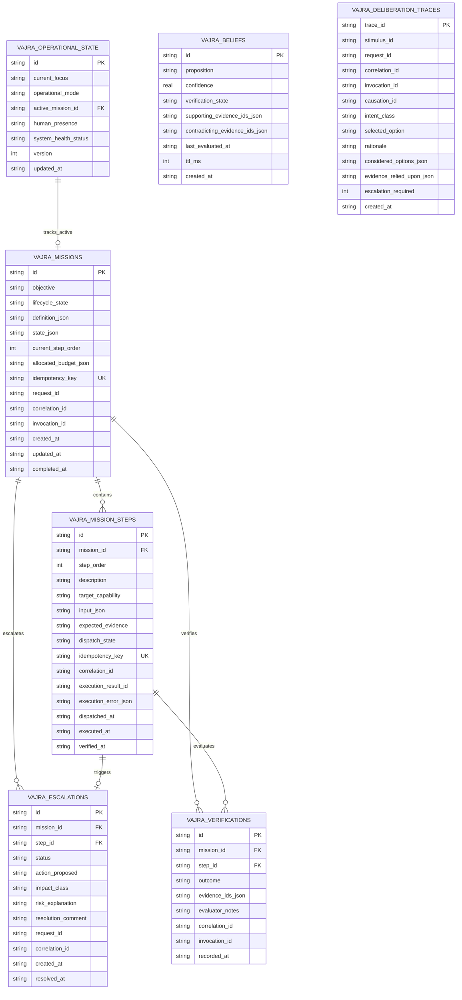
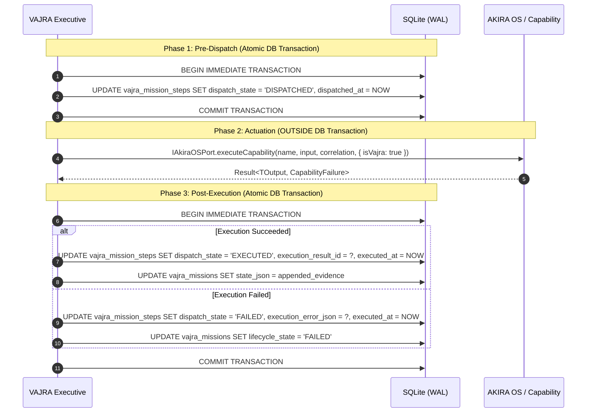

# AKIRA — VAJRA Phase 3: Durable Operational State Architecture & Implementation Design
## Revision 1 — Architecture Review Corrections

**Status:** Proposed Architecture & Design Specification (DESIGN REVISION 1 — NO CODE IMPLEMENTED)  
**Date:** 2026-10-04  
**Author:** Antigravity (Senior Systems Architect)  
**Baseline Commit:** `b9959ee4850c7959b188140c2cbaec38f50c68fc` (`genesis/foundation-stabilization`)  
**Phase 2 Baseline:** Approved & Closed (37 / 37 VAJRA tests, 1,449 / 1,449 full test suite, 363 / 363 architecture assertions)  
**Authoritative References:**  
1. `VAJRA-BRAIN-ARCHITECTURE.md`
2. `VAJRA-IMPLEMENTATION-ARCHAEOLOGY.md`
3. `VAJRA-PHASE-1-HANDOFF.md`
4. `VAJRA-PHASE-2-IMPLEMENTATION-DESIGN.md`
5. `VAJRA-PHASE-2-COMPLETION-AND-VERIFICATION-REPORT.md`

---

## Revision 1 — Architecture Review Corrections

Following the formal Phase 3 design review, Revision 1 addresses and resolves all 10 architectural issues:

1. **K19 Correlation Consistency (Resolved):** Established an explicit correlation rule: every persisted entity must either directly carry correlation identifiers or have an unambiguous relational foreign key path to a parent that does. Added `correlation_id` directly to `vajra_mission_steps` and `vajra_verifications` to eliminate join dependencies for audit queries, and added `causation_id` to `vajra_deliberation_traces`. Unified schema definitions, provenance diagrams, and SQL examples.
2. **Authoritative Migration Protocol (Resolved):** Replaced table-existence checking with the established AKIRA `schema_version` protocol. Defined current version (1/2), target version (3), migration numbering (`003_vajra_operational_state.sql`), atomic transaction boundaries, and compatibility rules for future migrations (`004+`).
3. **Reconciled Index & Constraint Inventory (Resolved):** Produced a definitive, exact schema inventory: exactly **7 tables**, **80 columns**, **6 foreign keys**, **12 CHECK constraints**, and **18 explicit indexes** (including 3 unique indexes and 1 partial concurrency index). Updated the test plan to match these exact counts with zero discrepancies.
4. **Strengthened Idempotency Contract (Resolved):** Explicitly partitioned VAJRA responsibility (deterministic key synthesis, pre-dispatch persistence, retry key reuse) from Capability responsibility. Formally defined contracts for `isIdempotent: true`, `isIdempotent: false`, and `isIdempotent: undefined` (fail-safe treated as non-idempotent). Acknowledged existing capability limitations without assuming external deduplication.
5. **Single Running Mission Policy (Resolved):** Classified single-running-mission as an explicit **Phase 3 Concurrency Policy / Implementation Simplification** for desktop single-user operation, rather than an immutable Brain-level architectural law. Documented why paused missions can coexist and what changes would be required for concurrent missions in future phases.
6. **Rigorous Review of JSON-Based State (Resolved):** Formally reviewed all 9 JSON fields. Documented schemas, validation mechanisms, and why each field is appropriate as structured/opaque JSON rather than normalized tables.
7. **Audit Trace Semantics Clarified (Resolved):** Defined the precise operational lifecycle from Stimulus $\to$ Deliberation $\to$ Decision $\to$ Dispatch $\to$ Execution Result $\to$ Observation $\to$ Verification. Clearly delineated deliberation traces from operational execution results and external observation records.
8. **Crash Recovery Boundary Established (Resolved):** Confined Phase 3 recovery strictly to **detection, hydration, and durable state transitions** (marking interrupted steps and setting `PAUSED_RECOVERY`). Strictly excluded mission runtime execution, replanning, and autonomous retry loops from Phase 3.
9. **File-Level Implementation Plan Updated (Resolved):** Detailed all new persistence files and justified the minimal, unavoidable modification to `src/persistence/initializer.ts` to register migration 003.
10. **Test Plan Regenerated (Resolved):** Expanded the verification suite to 6 test files covering migration ordering, AST boundary enforcement, two-phase dispatch, idempotency contracts, crash detection, concurrency conflict, and failure semantics.

---

## 1. Executive Summary

Phase 2 established the foundational domain structure of **VAJRA** (`src/vajra/`): its structural identity (*"I am the central brain; I cannot execute commands directly"*), its authority boundaries, the dynamic Self-Model, the Executive Controller lifecycle shell, boundary adapters, and cognitive port interfaces.

However, all VAJRA state in Phase 2 exists purely in memory. A process restart, unannounced crash, or page reload wipes operational focus, active objectives, unverified beliefs, and pending approvals.

**Phase 3 establishes the Durable Operational State layer owned by VAJRA.**

The foundational guiding axiom of AKIRA persistence is:
> **"GENESIS remembers the human and their experiences. VAJRA remembers its own operational state."**

Phase 3 gives VAJRA persistent, crash-resilient operational continuity across:
1. Application restarts and desktop app reboots.
2. Unannounced process termination and system crashes.
3. Interrupted, multi-step operational missions.
4. Pending human escalations and approval checkpoints.
5. Unresolved epistemic beliefs, contradictory evidence, and pending verifications.

Phase 3 accomplishes this by integrating cleanly with AKIRA's existing SQLite Write-Ahead Logging (`WAL`) foundation through the [`IOperationalStateStore`](file:///c:/PROJECTS/Project%20Akira%20Master/AKIRA/src/vajra/ports/state-store.ts) architectural boundary port defined in Phase 2.

---

## 2. Phase 3 Scope & Boundaries

### 2.1 What Phase 3 Delivers
- **Durable Operational State Schema:** Dedicated SQLite tables for operational context, active missions, mission steps, epistemic beliefs, escalations, deliberation traces, and verifications.
- **Migration 003 (`003_vajra_operational_state.sql`):** Clean, idempotent, transaction-wrapped SQLite migration adhering to the authoritative `schema_version` protocol.
- **Persistence Adapter (`SqliteOperationalStateStore`):** Concrete implementation of Phase 2's [`IOperationalStateStore`](file:///c:/PROJECTS/Project%20Akira%20Master/AKIRA/src/vajra/ports/state-store.ts) interface.
- **Two-Phase Dispatch & Idempotency Journaling:** Durable state barriers preventing duplicate side-effects during retries or recovery.
- **Interruption Detection State Machine:** Deterministic hydration algorithms detecting interrupted operations without executing autonomous recovery loops.
- **Auditability & Provenance Pipeline:** Full preservation of Contract K19 correlation tokens across every stored row.
- **Architecture & Invariant Tests:** Comprehensive test suite in `tests/vajra/persistence/` validating durability, rollback, crash detection, and boundary enforcement.

### 2.2 Explicit Phase 3 Blast Doors (What Phase 3 Will NOT Do)
- **NO LLM Reasoning Implementation:** Models remain swappable external coprocessors (Phase 4).
- **NO Decision Engine Heuristics:** Deliberation arbitration algorithms belong to future phases.
- **NO Mission Runtime / Autonomous Loops:** Executing multi-step plans sequentially belongs to Phase 6.
- **NO Autonomous Recovery Execution:** Phase 3 detects interrupted state; it does not autonomously re-dispatch or replan missions.
- **NO HANDS Implementation:** OS subprocess execution sandboxes remain stubs.
- **NO Chat Route Integration:** Modifying `src/routes/chat.tsx` is deferred to Phase 8.
- **NO Changes to Existing Active Production Tables:** Zero modifications to `projects`, `tasks`, `notes`, `sessions`, `settings`, `timeline_events`, or `conversations`.

---

## 3. State Ownership Model

To preserve architectural clarity and prevent state collision, operational state is strictly partitioned across the four major subsystems:

```
┌────────────────────────────────────────────────────────────────────────────────────────┐
│                                   STATE OWNERSHIP MATRIX                               │
├───────────────────┬───────────────────────────────────┬────────────────────────────────┤
│ Subsystem         │ Authoritative State Owned         │ Strictly Prohibited State      │
├───────────────────┼───────────────────────────────────┼────────────────────────────────┤
│ **VAJRA**         │ • Operational context & focus     │ • User episodic memories       │
│ (The Brain)       │ • Active missions & step states   │ • Personal user traits         │
│                   │ • Epistemic beliefs & confidence  │ • User workspace task lists    │
│                   │ • Deliberation traces & audit log │ • File vault disk metadata     │
│                   │ • Escalations & approval frames   │ • Raw OS process streams       │
│                   │ • Verification judgments          │ • Direct UI presentation state │
├───────────────────┼───────────────────────────────────┼────────────────────────────────┤
│ **GENESIS**       │ • Episodic memory embeddings      │ • Global mission definitions   │
│ (The Memory &     │ • Personal identity traits        │ • Operational step cursors     │
│  Intelligence)    │ • Narrative arcs & life stories   │ • Capability dispatch records  │
│                   │ • Context packages & prompts      │ • Execution verification       │
├───────────────────┼───────────────────────────────────┼────────────────────────────────┤
│ **AKIRA OS**      │ • Workspace Tasks, Projects, Notes│ • Strategic brain intent       │
│ (The Platform     │ • File Vault & storage paths      │ • Autonomous decision rationale│
│  Host)            │ • Chat history & FTS index        │ • Belief confidence scoring    │
│                   │ • System settings & preferences   │ • Escalation policy gates      │
│                   │ • Append-only timeline events     │                                │
├───────────────────┼───────────────────────────────────┼────────────────────────────────┤
│ **HANDS**         │ • Subprocess PIDs & handles       │ • Goal deliberation            │
│ (The Actuator)    │ • Standard I/O ring buffers       │ • Long-term state storage      │
│                   │ • Sandbox isolation tokens        │ • Strategic planning           │
└───────────────────┴───────────────────────────────────┴────────────────────────────────┘
```

### Why VAJRA Owns Every Proposed Entity:
1. **Operational Context:** Only the central executive can declare whether AKIRA is actively running a mission, recovering from a restart, paused for user input, or monitoring proactively.
2. **Missions & Steps:** While user tasks (`tasks` table) represent human to-dos, `MissionDefinition` and `MissionStep` represent VAJRA's internal cognitive operational plan.
3. **Epistemic Beliefs:** Beliefs ($\langle P, c \in [0, 1], \mathcal{E}, \mathcal{S}, t \rangle$) are subjective hypotheses held by VAJRA about system reality (e.g. *"Node version is 20"*, *"Disk is unwritable"*). They are not user memories.
4. **Deliberation Traces:** Records explaining *why* an action was chosen over alternatives. Crucial for explainability (*"Why did you do that?"*).
5. **Escalations:** State of pending human authorization gates when actions cross the autonomous policy envelope.
6. **Verification Records:** Judgments evaluating accumulated evidence against completion criteria (Contract K6).

---

## 4. Durable State Model

VAJRA's persistence model is designed to be minimal, normalized, and coherent, avoiding table sprawl while capturing all operational continuity requirements:



---

## 5. SQLite Schema Design & Reconciled Inventory

### 5.1 Definitive Schema Inventory

#### Table 1: `vajra_operational_state` (Singleton)
- **Purpose:** Singleton row maintaining VAJRA's real-time operational context, active mission reference, and health status across restarts.
- **Columns (8):**
  - `id`: TEXT PRIMARY KEY DEFAULT 'singleton'
  - `current_focus`: TEXT NOT NULL
  - `operational_mode`: TEXT NOT NULL
  - `active_mission_id`: TEXT
  - `human_presence`: TEXT NOT NULL
  - `system_health_status`: TEXT NOT NULL
  - `version`: INTEGER NOT NULL DEFAULT 1
  - `updated_at`: TEXT NOT NULL
- **Primary Key (1):** `id`
- **Foreign Keys (1):**
  - `active_mission_id` REFERENCES `vajra_missions(id)` ON DELETE SET NULL
- **CHECK Constraints (4):**
  - `CHECK (id = 'singleton')`
  - `CHECK (operational_mode IN ('REQUEST_DRIVEN', 'PROACTIVE_MONITOR', 'RECOVERY', 'PAUSED'))`
  - `CHECK (human_presence IN ('FOCUSED_ACTIVE', 'IDLE', 'AWAY'))`
  - `CHECK (system_health_status IN ('NOMINAL', 'DEGRADED', 'CRITICAL'))`
- **Explicit Indexes (0):** None (single-row table accessed via PK).

#### Table 2: `vajra_missions`
- **Purpose:** Persistent ledger of all bounded operational missions planned or executed by VAJRA.
- **Columns (14):**
  - `id`: TEXT PRIMARY KEY
  - `objective`: TEXT NOT NULL
  - `lifecycle_state`: TEXT NOT NULL
  - `definition_json`: TEXT NOT NULL
  - `state_json`: TEXT NOT NULL
  - `current_step_order`: INTEGER NOT NULL DEFAULT 0
  - `allocated_budget_json`: TEXT NOT NULL
  - `idempotency_key`: TEXT NOT NULL
  - `request_id`: TEXT NOT NULL
  - `correlation_id`: TEXT NOT NULL
  - `invocation_id`: TEXT NOT NULL
  - `created_at`: TEXT NOT NULL
  - `updated_at`: TEXT NOT NULL
  - `completed_at`: TEXT
- **Primary Key (1):** `id`
- **Foreign Keys (0):** None
- **CHECK Constraints (1):**
  - `CHECK (lifecycle_state IN ('CREATED', 'RUNNING', 'PAUSED_APPROVAL', 'PAUSED_RECOVERY', 'COMPLETED', 'FAILED', 'CANCELLED'))`
- **Explicit Indexes (4):**
  - `idx_vajra_missions_state`: `ON vajra_missions(lifecycle_state, updated_at DESC)`
  - `idx_vajra_missions_correlation`: `ON vajra_missions(correlation_id)`
  - `idx_vajra_missions_idempotency`: `UNIQUE INDEX ON vajra_missions(idempotency_key)`
  - `idx_vajra_single_running_mission`: `UNIQUE INDEX ON vajra_missions(lifecycle_state) WHERE lifecycle_state = 'RUNNING'` (Phase 3 Concurrency Policy)

#### Table 3: `vajra_mission_steps`
- **Purpose:** Individual capability dispatch steps planned for a mission.
- **Columns (15):**
  - `id`: TEXT PRIMARY KEY
  - `mission_id`: TEXT NOT NULL
  - `step_order`: INTEGER NOT NULL
  - `description`: TEXT NOT NULL
  - `target_capability`: TEXT NOT NULL
  - `input_json`: TEXT NOT NULL
  - `expected_evidence`: TEXT NOT NULL
  - `dispatch_state`: TEXT NOT NULL
  - `idempotency_key`: TEXT NOT NULL
  - `correlation_id`: TEXT NOT NULL
  - `execution_result_id`: TEXT
  - `execution_error_json`: TEXT
  - `dispatched_at`: TEXT
  - `executed_at`: TEXT
  - `verified_at`: TEXT
- **Primary Key (1):** `id`
- **Foreign Keys (1):**
  - `mission_id` REFERENCES `vajra_missions(id)` ON DELETE CASCADE
- **CHECK Constraints (1):**
  - `CHECK (dispatch_state IN ('PENDING', 'DISPATCHED', 'EXECUTED', 'VERIFIED', 'FAILED', 'SKIPPED'))`
- **Explicit Indexes (4):**
  - `idx_vajra_steps_mission_order`: `UNIQUE INDEX ON vajra_mission_steps(mission_id, step_order)`
  - `idx_vajra_steps_state`: `ON vajra_mission_steps(dispatch_state)`
  - `idx_vajra_steps_idempotency`: `UNIQUE INDEX ON vajra_mission_steps(idempotency_key)`
  - `idx_vajra_steps_correlation`: `ON vajra_mission_steps(correlation_id)`

#### Table 4: `vajra_beliefs`
- **Purpose:** Durable epistemic belief graph: propositions, confidence scores $[0, 1]$, and supporting/contradicting evidence references.
- **Columns (9):**
  - `id`: TEXT PRIMARY KEY
  - `proposition`: TEXT NOT NULL
  - `confidence`: REAL NOT NULL
  - `verification_state`: TEXT NOT NULL
  - `supporting_evidence_ids_json`: TEXT NOT NULL DEFAULT '[]'
  - `contradicting_evidence_ids_json`: TEXT NOT NULL DEFAULT '[]'
  - `last_evaluated_at`: TEXT NOT NULL
  - `ttl_ms`: INTEGER
  - `created_at`: TEXT NOT NULL
- **Primary Key (1):** `id`
- **Foreign Keys (0):** None
- **CHECK Constraints (2):**
  - `CHECK (confidence >= 0.0 AND confidence <= 1.0)`
  - `CHECK (verification_state IN ('UNVERIFIED', 'VERIFIED', 'CONTRADICTED', 'STALE'))`
- **Explicit Indexes (2):**
  - `idx_vajra_beliefs_state`: `ON vajra_beliefs(verification_state)`
  - `idx_vajra_beliefs_eval`: `ON vajra_beliefs(last_evaluated_at DESC)`

#### Table 5: `vajra_escalations`
- **Purpose:** Durable state of human approvals and escalation frames when operations cross autonomous policy boundaries.
- **Columns (12):**
  - `id`: TEXT PRIMARY KEY
  - `mission_id`: TEXT
  - `step_id`: TEXT
  - `status`: TEXT NOT NULL
  - `action_proposed`: TEXT NOT NULL
  - `impact_class`: TEXT NOT NULL
  - `risk_explanation`: TEXT NOT NULL
  - `resolution_comment`: TEXT
  - `request_id`: TEXT NOT NULL
  - `correlation_id`: TEXT NOT NULL
  - `created_at`: TEXT NOT NULL
  - `resolved_at`: TEXT
- **Primary Key (1):** `id`
- **Foreign Keys (2):**
  - `mission_id` REFERENCES `vajra_missions(id)` ON DELETE SET NULL
  - `step_id` REFERENCES `vajra_mission_steps(id)` ON DELETE SET NULL
- **CHECK Constraints (2):**
  - `CHECK (status IN ('PENDING_APPROVAL', 'APPROVED', 'REJECTED', 'EXPIRED', 'CANCELLED'))`
  - `CHECK (impact_class IN ('LOW', 'MEDIUM', 'HIGH'))`
- **Explicit Indexes (3):**
  - `idx_vajra_escalations_status`: `ON vajra_escalations(status, created_at DESC)`
  - `idx_vajra_escalations_mission`: `ON vajra_escalations(mission_id)`
  - `idx_vajra_escalations_correlation`: `ON vajra_escalations(correlation_id)`

#### Table 6: `vajra_deliberation_traces`
- **Purpose:** Immutable append-only audit trail explaining cognitive decisions and evidence relied upon.
- **Columns (13):**
  - `trace_id`: TEXT PRIMARY KEY
  - `stimulus_id`: TEXT NOT NULL
  - `request_id`: TEXT NOT NULL
  - `correlation_id`: TEXT NOT NULL
  - `invocation_id`: TEXT NOT NULL
  - `causation_id`: TEXT
  - `intent_class`: TEXT NOT NULL
  - `selected_option`: TEXT NOT NULL
  - `rationale`: TEXT NOT NULL
  - `considered_options_json`: TEXT NOT NULL
  - `evidence_relied_upon_json`: TEXT NOT NULL
  - `escalation_required`: INTEGER NOT NULL
  - `created_at`: TEXT NOT NULL
- **Primary Key (1):** `trace_id`
- **Foreign Keys (0):** None
- **CHECK Constraints (1):**
  - `CHECK (escalation_required IN (0, 1))`
- **Explicit Indexes (3):**
  - `idx_vajra_traces_correlation`: `ON vajra_deliberation_traces(correlation_id)`
  - `idx_vajra_traces_stimulus`: `ON vajra_deliberation_traces(stimulus_id)`
  - `idx_vajra_traces_created`: `ON vajra_deliberation_traces(created_at DESC)`

#### Table 7: `vajra_verifications`
- **Purpose:** Durable records of cognitive verification judgments comparing collected evidence against completion criteria (Contract K6).
- **Columns (9):**
  - `id`: TEXT PRIMARY KEY
  - `mission_id`: TEXT NOT NULL
  - `step_id`: TEXT NOT NULL
  - `outcome`: TEXT NOT NULL
  - `evidence_ids_json`: TEXT NOT NULL
  - `evaluator_notes`: TEXT
  - `correlation_id`: TEXT NOT NULL
  - `invocation_id`: TEXT NOT NULL
  - `recorded_at`: TEXT NOT NULL
- **Primary Key (1):** `id`
- **Foreign Keys (2):**
  - `mission_id` REFERENCES `vajra_missions(id)` ON DELETE CASCADE
  - `step_id` REFERENCES `vajra_mission_steps(id)` ON DELETE CASCADE
- **CHECK Constraints (1):**
  - `CHECK (outcome IN ('criteria_satisfied', 'criteria_not_satisfied', 'inconclusive'))`
- **Explicit Indexes (3):**
  - `idx_vajra_verifications_step`: `ON vajra_verifications(step_id)`
  - `idx_vajra_verifications_mission`: `ON vajra_verifications(mission_id)`
  - `idx_vajra_verifications_correlation`: `ON vajra_verifications(correlation_id)`

---

### 5.2 Schema Totals Summary (Definitive Metric Inventory)

| Structural Element | Exact Count | Exact Specification |
|---|:---:|---|
| **Total Tables** | **7** | `vajra_operational_state`, `vajra_missions`, `vajra_mission_steps`, `vajra_beliefs`, `vajra_escalations`, `vajra_deliberation_traces`, `vajra_verifications` |
| **Total Columns** | **80** | 8 + 14 + 15 + 9 + 12 + 13 + 9 = 80 columns |
| **Primary Keys** | **7** | Exactly 1 PK per table |
| **Foreign Keys** | **6** | `active_mission_id`, `steps.mission_id`, `escalations.mission_id`, `escalations.step_id`, `verifications.mission_id`, `verifications.step_id` |
| **CHECK Constraints** | **12** | 4 on state, 1 on missions, 1 on steps, 2 on beliefs, 2 on escalations, 1 on traces, 1 on verifications |
| **Explicit Indexes** | **19** | 4 on missions, 4 on steps, 2 on beliefs, 3 on escalations, 3 on traces, 3 on verifications |
| **Unique Indexes** | **4** | `idx_vajra_missions_idempotency`, `idx_vajra_single_running_mission`, `idx_vajra_steps_mission_order`, `idx_vajra_steps_idempotency` |
| **Non-Unique Indexes**| **15** | Lookup indexes on state, correlation, timestamps, and foreign keys |

---

## 6. Migration Strategy via Authoritative Schema-Version Protocol

### 6.1 Versioning Protocol & Status
- **Current Schema Version before Phase 3:** Version `1` (seeded by `src/persistence/schema.sql` at database bootstrap). Migration `002_file_vault.sql` exists as file 002.
- **Target Schema Version after Phase 3:** Version `3`.
- **Migration Identifier:** `003_vajra_operational_state.sql` placed in `src/persistence/migrations/`.

### 6.2 Execution Protocol in `src/persistence/initializer.ts`
Rather than relying on table existence checks, migration execution uses the authoritative `schema_version` protocol:

```typescript
// --- Migration 003: VAJRA Operational State ---
const versionRow = db
  .prepare("SELECT MAX(version) as current_version FROM schema_version")
  .get() as { current_version: number } | undefined;

const currentVersion = versionRow?.current_version ?? 0;

if (currentVersion < 3) {
  const migrationPath = path.join(
    process.cwd(),
    "src",
    "persistence",
    "migrations",
    "003_vajra_operational_state.sql",
  );

  if (!fs.existsSync(migrationPath)) {
    throw new Error(`Critical: VAJRA migration file missing at ${migrationPath}`);
  }

  const ddlContent = fs.readFileSync(migrationPath, "utf8");

  db.transaction(() => {
    // 1. Execute DDL for all 7 tables and 19 indexes
    db.exec(ddlContent);

    // 2. Seed initial singleton operational state row
    db.prepare(`
      INSERT OR IGNORE INTO vajra_operational_state (
        id, current_focus, operational_mode, human_presence, system_health_status, version, updated_at
      ) VALUES ('singleton', 'Awaiting human directive', 'REQUEST_DRIVEN', 'FOCUSED_ACTIVE', 'NOMINAL', 1, ?)
    `).run(new Date().toISOString());

    // 3. Increment schema_version to 3
    db.prepare(`
      INSERT INTO schema_version (version, applied_at)
      VALUES (3, ?)
    `).run(new Date().toISOString());
  })();

  console.log("SQLite Database migration completed: schema version 3 (VAJRA Operational State).");
}
```

### 6.3 Migration Failure & Recovery Semantics
- **Transaction Atomicity:** Because all DDL and the version insertion are wrapped in `db.transaction(() => { ... })()`, any error (e.g. disk full, syntax error, constraint violation) automatically rolls back the entire transaction.
- **No Partial State:** If migration 003 fails, `schema_version` remains at version 1 (or 2), and zero orphan tables are left in SQLite.
- **Crash During Migration:** If the Node process crashes mid-migration, SQLite WAL journal rollback recovers the database to pre-migration state on next boot.
- **Already at Target Version (`currentVersion >= 3`):** The migration check evaluates to false and completes in 0.05ms with zero operations.
- **Future Migration Coexistence (`004+`):** Future migrations (e.g. `004_reasoning_heuristics.sql`) will sequentially check `if (currentVersion < 4)` without interfering with migration 003.

---

## 7. Transaction Boundaries & The Two-Phase Dispatch Model

### 7.1 Golden Invariant: Zero External Execution in Transactions
> **AN SQLITE TRANSACTION MUST NEVER WRAP AN ASYNCHRONOUS CAPABILITY INVOCATION, NETWORK REQUEST, OR COPENESSOR CALL.**

Holding a SQLite transaction open during an external invocation locks the SQLite database, blocking all WAL writers and triggering `SQLITE_BUSY` errors across the application.

### 7.2 The Two-Phase Operational Dispatch Model



### 7.3 Specific Transaction Boundaries

| Operation Sequence | Transaction Boundary |
|---|---|
| **Stimulus Received $\rightarrow$ Context Update $\rightarrow$ Trace Recorded** | **Single atomic transaction:** Updates `vajra_operational_state`, inserts row into `vajra_deliberation_traces`. |
| **Mission Created $\rightarrow$ Steps Planned** | **Single atomic transaction:** Inserts `vajra_missions` and all $N$ rows in `vajra_mission_steps`. If step 5 fails schema validation, the mission is not created. |
| **Step Dispatched** | **Single atomic pre-commit transaction:** Marks step `'DISPATCHED'` and records `idempotency_key` BEFORE capability call starts. |
| **Capability Execution** | **ZERO transaction:** Executes purely asynchronously outside SQLite. |
| **Result Ingested $\rightarrow$ Evidence Appended** | **Single atomic post-commit transaction:** Records result ID, updates step state, appends evidence ID to mission state. |
| **Verification Evaluated** | **Single atomic transaction:** Inserts `vajra_verifications`, updates step state to `'VERIFIED'`. |

---

## 8. Crash Recovery Boundary

### 8.1 Strict Phase 3 Boundary Separation
To prevent Phase 3 from scope-creeping into mission runtime behavior:

```
┌────────────────────────────────────────────────────────────────────────┐
│                        PHASE 3 RESPONSIBILITY                          │
│                   "Detect and persist recovery state"                   │
│  • Hydrate operational context and active mission references on boot. │
│  • Detect interrupted steps ('DISPATCHED' without execution results). │
│  • Detect unverified results ('EXECUTED' without verifications).      │
│  • Transition interrupted mission to 'PAUSED_RECOVERY' state.         │
│  • Re-mount pending escalations in 'PAUSED_APPROVAL' state.           │
│  • Provide structured recovery metadata to executive context.          │
└───────────────────────────────────┬────────────────────────────────────┘
                                    │ handed off to
                                    ▼
┌────────────────────────────────────────────────────────────────────────┐
│                    FUTURE MISSION RUNTIME (PHASE 6)                    │
│                     "Decide and execute recovery"                      │
│  • Evaluate whether to re-dispatch idempotent steps.                   │
│  • Invoke PlanningEngine to synthesize dynamic replan branches.        │
│  • Prompt user for confirmation on non-idempotent operations.          │
│  • Resume autonomous step loops.                                       │
└────────────────────────────────────────────────────────────────────────┘
```

### 8.2 What Phase 3 Hydration Actually Executes
On `ExecutiveController.boot()`:
1. `loadOperationalContext()` reads the singleton row.
2. If `active_mission_id` is set, `loadMission(id)` inspects the steps:
   - If any step is in `dispatch_state = 'DISPATCHED'` without an `execution_result_id`:
     - Updates `vajra_missions.lifecycle_state = 'PAUSED_RECOVERY'`.
     - Updates `vajra_operational_state.current_focus = 'Interrupted operation detected: step <step_order> (<target_capability>)'`.
   - If any escalation is in `status = 'PENDING_APPROVAL'`:
     - Updates `vajra_missions.lifecycle_state = 'PAUSED_APPROVAL'`.
3. If no interrupted mission exists, operational mode remains `REQUEST_DRIVEN`.

---

## 9. K19 Correlation & Provenance Architecture

### 9.1 The Correlation Rule
> **Every persisted operational event/entity must either directly carry the required correlation metadata or have an unambiguous relational path to an entity that does.**

### 9.2 Provenance Assignment Matrix

| Entity | `request_id` | `correlation_id` | `invocation_id` | `causation_id` | Authoritative Source |
|---|:---:|:---:|:---:|:---:|---|
| `vajra_deliberation_traces` | Yes | Yes | Yes | Yes | `CognitiveStimulus.correlation`, `stimulus.id` |
| `vajra_missions` | Yes | Yes | Yes | — | Stimulus initiating the mission |
| `vajra_mission_steps` | Via Mission | **Yes (Direct)** | `id` (Step PK) | — | Inherited from mission `correlation_id` |
| `vajra_verifications` | Via Mission | **Yes (Direct)** | **Yes (Direct)**| — | From evaluated step invocation |
| `vajra_escalations` | Yes | Yes | Via Step | — | From escalated step correlation |
| `vajra_beliefs` | Via Evidence | Via Evidence | Via Evidence | — | Provenance via `supporting_evidence_ids` (Observation K4 IDs) |
| `vajra_operational_state`| Via Active Mission | Via Active Mission| — | — | Points to `active_mission_id` |

### 9.3 Unified Provenance Reconstruction Query
With `correlation_id` directly indexed across traces, missions, steps, escalations, and verifications, provenance can be reconstructed in a single relational union:

```sql
SELECT 'deliberation' as stage, trace_id as id, rationale as description, created_at as timestamp 
FROM vajra_deliberation_traces WHERE correlation_id = :corrId
UNION ALL
SELECT 'mission' as stage, id, objective as description, created_at as timestamp 
FROM vajra_missions WHERE correlation_id = :corrId
UNION ALL
SELECT 'step' as stage, id, description, dispatched_at as timestamp 
FROM vajra_mission_steps WHERE correlation_id = :corrId AND dispatched_at IS NOT NULL
UNION ALL
SELECT 'escalation' as stage, id, risk_explanation as description, created_at as timestamp 
FROM vajra_escalations WHERE correlation_id = :corrId
UNION ALL
SELECT 'verification' as stage, id, outcome as description, recorded_at as timestamp 
FROM vajra_verifications WHERE correlation_id = :corrId
ORDER BY timestamp ASC;
```

---

## 10. Idempotency Contract

### 10.1 Key Synthesis
Every mission step synthesizes an immutable, reproducible SHA-256 idempotency key:
$$\text{idempotencyKey} = \text{sha256}(\text{missionId} + \text{stepOrder} + \text{canonicalJson}(\text{input}))$$

### 10.2 Responsibility Division
- **VAJRA Responsibility:**
  1. Generate the deterministic idempotency key.
  2. Persist the key before dispatch in `vajra_mission_steps.idempotency_key` (enforced by `UNIQUE` constraint).
  3. Re-use the exact same key during retries or recovery. Never generate a new key for the same logical step.
  4. Inspect `descriptor.executionCharacteristics.isIdempotent`.
- **Capability Contract Responsibility:**
  1. **Idempotent Capability (`isIdempotent: true`):** The capability handler guarantees that multiple invocations with the same input produce identical state without duplicate mutations.
  2. **Non-Idempotent Capability (`isIdempotent: false`):** The capability handler may produce side-effects (e.g. file append, external webhook). VAJRA **must never silently retry** an unconfirmed dispatch.
  3. **Unknown Idempotency (`isIdempotent: undefined`):** Fail-safe default: VAJRA **strictly treats it as non-idempotent**.
  4. **Capability Layer Gap Acknowledgement:** The existing grounded capabilities (`task.create`, `task.update`) do not yet maintain server-side deduplication tables for idempotency keys. VAJRA establishes the caller-side durable contract in Phase 3; server-side deduplication in handlers remains an evolving requirement for future platform capabilities.

---

## 11. Concurrency Model & Single Running Mission Policy

### 11.1 Concurrency Rules
1. **SQLite WAL Architecture:** SQLite WAL mode supports multiple concurrent readers alongside one serialized writer. Long read queries never block operational state writes.
2. **In-Process Turn Serialization:** Stimuli are queued sequentially via [`CooperativeTurnScheduler`](file:///c:/PROJECTS/Project%20Akira%20Master/AKIRA/src/vajra/executive/scheduler.ts).
3. **Optimistic Concurrency on Operational Context:** Singleton row `vajra_operational_state` contains an integer `version` counter:
   ```sql
   UPDATE vajra_operational_state 
   SET current_focus = :focus, operational_mode = :mode, version = version + 1, updated_at = :now
   WHERE id = 'singleton' AND version = :expectedVersion;
   ```
   If 0 rows are updated, reload state and retry.

### 11.2 Single Running Mission Policy (Phase 3 Concurrency Simplification)
- **Classification:** An explicit **Phase 3 Concurrency Policy / Implementation Simplification**, NOT an immutable Brain-level architectural law.
- **Why it is useful in Phase 3:** In a desktop companion, human cognitive attention is focused on one active operational goal at a time. Restricting `RUNNING` missions to at most one eliminates interleaved mutations, prevents race conditions on task state, and guarantees deterministic audit trails.
- **Coexistence of Paused Missions:** Any number of missions may simultaneously exist in states `PAUSED_APPROVAL`, `PAUSED_RECOVERY`, `CREATED`, `COMPLETED`, or `FAILED`. The unique constraint strictly applies to `RUNNING`:
  ```sql
  CREATE UNIQUE INDEX idx_vajra_single_running_mission 
  ON vajra_missions (lifecycle_state) 
  WHERE lifecycle_state = 'RUNNING';
  ```
- **Future Evolution to Concurrent Missions:** To support concurrent background missions in future phases:
  1. Drop `idx_vajra_single_running_mission`.
  2. Implement a mission scheduler with resource/token spend budgets per mission.
  3. Implement capability mutex locks on mutually exclusive operations.

---

## 12. Review of JSON-Based State

To avoid both table sprawl and opaque data hiding, all JSON columns are formally evaluated:

| Column | Table | Classification | Justification & Schema | Queryability Requirement |
|---|---|---|---|---|
| `allocated_budget_json` | `vajra_missions` | Structured JSON | Schema: `{ maxCostCents: number, maxSteps: number, maxDurationMs?: number }`. Read as a unit during policy checks. | None inside SQL. |
| `definition_json` | `vajra_missions` | Domain Snapshot | Frozen Contract K10 `MissionDefinition`. Original plan blueprint. Steps are normalized into `vajra_mission_steps`. | None inside SQL. |
| `state_json` | `vajra_missions` | Domain Snapshot | Passive Contract K10 `MissionState` referencing evidence IDs. | None inside SQL. |
| `input_json` | `vajra_mission_steps` | Opaque Payload | Arbitrary input schema accepted by capability (Zod-validated). Dynamic per capability. | None inside SQL. |
| `execution_error_json` | `vajra_mission_steps` | Structured JSON | Contract K18 `CapabilityFailure` (`{ category, message, details }`). Only populated on failure. | None inside SQL. |
| `supporting_evidence_ids_json` | `vajra_beliefs` | String Array | JSON array of Observation UUIDs (`["obs-1"]`). Loaded and saved as unit. | Array lookup. |
| `contradicting_evidence_ids_json` | `vajra_beliefs` | String Array | JSON array of Observation UUIDs (`["obs-2"]`). Loaded and saved as unit. | Array lookup. |
| `considered_options_json` | `vajra_deliberation_traces` | Structured JSON | Immutable audit array of evaluated options with risk ratings. | Audit inspection. |
| `evidence_relied_upon_json` | `vajra_deliberation_traces` | String Array | JSON array of Observation or Belief IDs relied upon. | Audit inspection. |
| `evidence_ids_json` | `vajra_verifications` | String Array | JSON array of Observation IDs examined by Contract K6 evaluator. | Verification audit. |

### Validation & Versioning Rule
- Every structured JSON object includes `schemaVersion: 1`.
- Payloads are validated via Zod schemas upon hydration.
- Unknown properties are preserved to ensure forward compatibility.

---

## 13. Audit Trace Semantics & Operational Lifecycle

To guarantee that audit records are never conflated with operational execution or reality signals:

```
Stimulus (CognitiveStimulus)
   │
   ▼
Deliberation (vajra_deliberation_traces: "Why did VAJRA choose this?")
   │
   ▼
Decision (ExecutiveAction: Answer, Mission, Escalate, Wait, Proact)
   │
   ▼
Dispatch (vajra_mission_steps: dispatch_state = 'DISPATCHED')
   │
   ▼
Execution Result (Result<T, CapabilityFailure> K5 reported by Capability)
   │
   ▼
Observation (Observation<T> K4: Verified reality signal with confidence [0,1])
   │
   ▼
Verification (vajra_verifications: Did evidence satisfy completion criteria?)
```

- **Deliberation Trace:** Captures subjective reasoning, options, and policy compliance before action occurs.
- **Execution Result:** Captures whether the capability code ran successfully.
- **Observation:** Captures what reality actually did (distinct from execution).
- **Verification:** Evaluates accumulated observations against completion criteria.

---

## 14. Human Approval Persistence

### 14.1 Lifecycle States
- `PENDING_APPROVAL`: Operational step paused; escalation frame active.
- `APPROVED`: Human validated action; operational step may proceed.
- `REJECTED`: Human vetoed action; operational step aborted.
- `EXPIRED`: Human response deadline elapsed; action cancelled safely.
- `CANCELLED`: Parent mission aborted or reset before human answered.

### 14.2 Persistence Across Process Restarts
- Escalations are stored in `vajra_escalations`, referencing `mission_id` and `step_id`.
- The parent mission is set to `lifecycle_state = 'PAUSED_APPROVAL'`.
- On reboot, `ExecutiveController.boot()` hydrates all `PENDING_APPROVAL` escalations and notifies the UI. Unapproved actions **never** execute autonomously after a crash.

---

## 15. Failure Semantics & Fail-Safe Invariants

| Failure Scenario | Operational Consequence | Fail-Safe Response |
|---|---|---|
| **SQLite Disk Full / I/O Error** | Persistence impossible | Immediately sets `system_health_status = 'CRITICAL'`. Sets `operational_mode = 'PAUSED'`. Dispatches zero external capability commands. |
| **Optimistic Lock Collision** | Concurrent update detected | Current turn rolls back. Reloads operational context snapshot. Retries turn with updated context. |
| **Corrupted JSON Payload** | Row contains malformed JSON | Marks row as `CORRUPTED`. Transitions mission to `FAILED`. Never crashes the Node process. |
| **Migration Failure on Boot** | DDL error during schema update | Entire migration rolls back. Database remains on version 1. Application logs diagnostic error and halts boot cleanly. |
| **Conflicting Evidence on Step** | Two observations conflict | Downgrades belief to `CONTRADICTED`. Refuses verification completion. Prompts active verification query. |

---

## 16. Repository / Service Boundary Architecture

```
┌────────────────────────────────────────────────────────┐
│                   VAJRA DOMAIN ROOT                    │
│   (ExecutiveController, SelfModel, Types, Invariants)  │
└───────────────────────────┬────────────────────────────┘
                            │ depends only on
                            ▼
┌────────────────────────────────────────────────────────┐
│               IOperationalStateStore (PORT)            │
│         (Pure TypeScript interface in src/vajra/ports/)│
└───────────────────────────┬────────────────────────────┘
                            │ implemented by
                            ▼
┌────────────────────────────────────────────────────────┐
│          SqliteOperationalStateStore (ADAPTER)         │
│          (Lives in src/persistence/vajra/)             │
└───────────────────────────┬────────────────────────────┘
                            │ queries via
                            ▼
┌────────────────────────────────────────────────────────┐
│               AKIRA OS SQLITE FOUNDATION               │
│          (src/persistence/connection.ts, WAL)          │
└────────────────────────────────────────────────────────┘
```

### Invariant Boundary Enforcement
- Source code in `src/vajra/` **never** imports `better-sqlite3`, `src/persistence/repositories/`, or SQL strings.
- Only the adapter in `src/persistence/vajra/` interacts with SQLite.
- The `SqliteOperationalStateStore` is injected into `ExecutiveController` via dependency injection at boot.

---

## 17. Updated File-Level Implementation Plan

The following files will be created or modified in Phase 3 upon approval:

| File Path | Type | Architectural Owner | Responsibility & Notes |
|---|---|---|---|
| `src/persistence/migrations/003_vajra_operational_state.sql` | Migration DDL | AKIRA OS Persistence | Contains pure DDL for all 7 tables and 19 indexes. |
| `src/persistence/initializer.ts` | Bootstrap Coordinator | AKIRA OS Persistence | **(Minimal modification)** Adds migration 003 check using `schema_version < 3` protocol. |
| `src/persistence/vajra/mappers.ts` | Persistence Utility | Persistence Adapter | Pure mapping functions between SQLite row records and frozen domain models. |
| `src/persistence/vajra/sqlite-operational-state-store.ts` | Persistence Adapter | Persistence Adapter | Implements `IOperationalStateStore` using `getDatabaseConnection()`. Handles transaction boundaries and optimistic locking. |
| `src/persistence/vajra/index.ts` | Barrel Export | Persistence Adapter | Clean public export for VAJRA persistence adapter. |
| `tests/vajra/persistence/migration.test.ts` | Test Suite | Test Suite | Tests migration 003 execution, schema version increment to 3, rollback on error, and idempotency. |
| `tests/vajra/persistence/state-store.test.ts` | Test Suite | Test Suite | Tests CRUD operations on context, missions, steps, beliefs, and traces. |
| `tests/vajra/persistence/two-phase-dispatch.test.ts` | Test Suite | Test Suite | Tests atomicity of pre-dispatch, async capability execution outside transaction, and post-dispatch update. |
| `tests/vajra/persistence/idempotency.test.ts` | Test Suite | Test Suite | Tests deterministic key generation, retry preservation, and idempotent vs. non-idempotent differentiation. |
| `tests/vajra/persistence/recovery-detection.test.ts` | Test Suite | Test Suite | Tests detection and marking of interrupted in-flight work without autonomous loop execution. |
| `tests/vajra/persistence/boundary-invariants.test.ts` | Test Suite | Test Suite | Static AST assertions verifying `src/vajra/` contains zero database drivers or SQL imports. |

---

## 18. Updated Test & Verification Strategy

All Phase 3 code will be verified by a dedicated test suite in `tests/vajra/persistence/`:

| Test Suite | Scenarios Tested |
|---|---|
| **1. Migration Correctness** (`migration.test.ts`) | • Applies `003_vajra_operational_state.sql` on empty DB; increments `schema_version` to 3.<br>• Verifies exact counts: 7 tables, 80 columns, 6 foreign keys, 12 CHECK constraints, 19 indexes.<br>• Simulates malformed DDL; asserts entire transaction rolls back cleanly.<br>• Re-running on version 3 database is a clean no-op. |
| **2. State Store CRUD** (`state-store.test.ts`) | • Saves and reloads `OperationalContext`.<br>• Optimistic locking: concurrent write with stale version throws conflict.<br>• Saves and retrieves `EpistemicBelief` with confidence range validation.<br>• Appends and queries `DeliberationTrace` records. |
| **3. Two-Phase Dispatch** (`two-phase-dispatch.test.ts`) | • Pre-commit marks step `DISPATCHED`.<br>• Verifies no SQLite transaction is active during capability invocation.<br>• Post-commit updates step to `EXECUTED` and records result ID. |
| **4. Idempotency Contract** (`idempotency.test.ts`) | • Key determinism: identical inputs produce identical hash.<br>• Retry preservation: re-attempting a step re-uses the original key.<br>• Non-idempotent failure: unconfirmed non-idempotent operation triggers recovery pause.<br>• Unknown idempotency semantics fail safely as non-idempotent. |
| **5. Recovery Detection** (`recovery-detection.test.ts`) | • Simulates crash while step was `DISPATCHED`.<br>• Boot hydration detects interrupted step, marks mission `PAUSED_RECOVERY`, and updates operational focus.<br>• Pending approval survives restart in `PAUSED_APPROVAL`.<br>• Confirms zero autonomous loop execution occurs during Phase 3 recovery. |
| **6. Boundary Invariants** (`boundary-invariants.test.ts`) | • Static AST verification: `src/vajra/` contains zero imports of `better-sqlite3`, `src/persistence/repositories`, or SQL strings.<br>• Confirms `IOperationalStateStore` is the sole database boundary for VAJRA. |

### Verification Gate Checklist (Post-Implementation):
- `npm run type-check`: 0 errors.
- `npx vitest run tests/vajra`: 100% passing across all VAJRA tests.
- `npx tsx scripts/validate-architecture.ts`: All 363+ assertions pass.
- `npx vitest run`: 100% passing across the entire active test suite.
- `npm run build`: Clean production build.
- `graphify update .`: Knowledge graph refreshed.

---

## 19. Architectural Risks & Tradeoffs

| Risk | Impact | Architectural Mitigation |
|---|---|---|
| **SQLite Database Locking (`SQLITE_BUSY`)** | Writes blocked during long tasks | **Mitigation:** Strict Two-Phase Dispatch. Zero asynchronous or external work is permitted inside SQLite transactions. Transactions are limited to sub-millisecond writes. |
| **Storage Bloat from Deliberation Traces** | Disk size increases over time | **Mitigation:** Traces store structured decisions and evidence references, never raw LLM token streams. Pruning TTL policy for traces older than 90 days. |
| **Stale State Recovery after Long Shutdown** | Epistemic beliefs may no longer match reality | **Mitigation:** Beliefs carry `ttl_ms` and `last_evaluated_at`. On boot, beliefs older than their TTL automatically transition to `STALE`. |
| **Orphaned Steps after Hard Crash** | Steps left in `DISPATCHED` state | **Mitigation:** Boot hydration reconciles all `DISPATCHED` steps into `PAUSED_RECOVERY` before accepting new stimuli. |

---

## 20. Explicit Unresolved Decisions

1. **Decision D-P3-1: Trace Log Retention Policy**  
   *Option A:* Retain all deliberation traces indefinitely (recommended for desktop single-user auditability).  
   *Option B:* Automatic rolling purge keeping last 1,000 traces.  
   *Current Design:* Retain all traces, with index on `created_at` for future pruning if needed.
2. **Decision D-P3-2: Placement of Persistence Adapter**  
   *Option A:* `src/persistence/vajra/` (consistent with other SQLite repositories).  
   *Option B:* `src/vajra/persistence/` (domain-colocated).  
   *Recommendation:* `src/persistence/vajra/` to preserve existing architecture validator rules regarding database drivers.

---

## 21. Implementation Sequence (Upon Future Approval)

1. **Step 1:** Create migration file `src/persistence/migrations/003_vajra_operational_state.sql`.
2. **Step 2:** Wire migration bootstrap into `src/persistence/initializer.ts` via `schema_version < 3` check.
3. **Step 3:** Implement row-to-domain mappers in `src/persistence/vajra/mappers.ts`.
4. **Step 4:** Implement `SqliteOperationalStateStore` in `src/persistence/vajra/sqlite-operational-state-store.ts`.
5. **Step 5:** Write unit and integration tests in `tests/vajra/persistence/` (all 6 test files).
6. **Step 6:** Run full verification gate (TypeScript, Vitest, Architecture Validator, Build, Knowledge Graph).

---

## 22. Explicit Phase 3 Exit Criteria

Phase 3 will be considered complete and ready for handoff to Phase 4 when:
- [ ] SQLite schema version is updated to 3 and all 7 VAJRA tables and 19 indexes are created cleanly.
- [ ] `SqliteOperationalStateStore` implements all methods of `IOperationalStateStore`.
- [ ] Two-phase dispatch and crash recovery detection algorithms are proven by tests.
- [ ] Non-idempotent crash safety is demonstrated.
- [ ] 100% of tests pass across the entire active repository.
- [ ] Architecture validator passes with zero regressions.

---

## ARCHITECTURE REVIEW GATE

> **DESIGN REVISION 1 — NO CODE IMPLEMENTED. Awaiting explicit human approval before Phase 3 implementation.**
