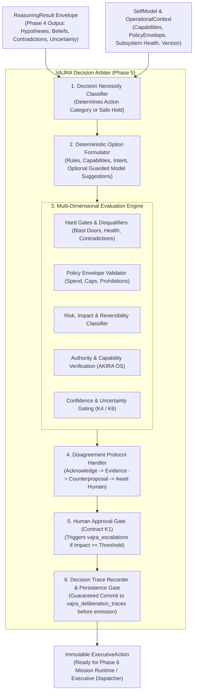

# VAJRA PHASE 5 — DECISION ARBITER
## ARCHITECTURE & IMPLEMENTATION DESIGN DOCUMENT — REVISION 1 (FINAL)

**Status:** FINAL ARCHITECTURAL DESIGN — AWAITING EXPLICIT HUMAN APPROVAL  
**Author:** Antigravity / DeepMind Team  
**Date:** October 4, 2026  
**Target Architecture:** [`docs/Vajra/VAJRA-BRAIN-ARCHITECTURE.md`](file:///c:/PROJECTS/Project%20Akira%20Master/AKIRA/docs/Vajra/VAJRA-BRAIN-ARCHITECTURE.md) (§5, §6, §7, §8, §9, §11, §14)  
**Preceding Phases:** Phase 1 (Legacy Retirement), Phase 2 (Core Domain), Phase 3 (Durable Operational State), Phase 4 (Adaptive Reasoning Engine Revision 1)  
**Succeeding Phases:** Phase 6 (Mission Runtime & Planning), Phase 7 (Full System Integration)  

---

## 1. Executive Summary

Phase 5 establishes the **Decision Arbiter** owned by **VAJRA**, the central cognitive authority of AKIRA.

The authoritative system hierarchy is strictly immutable:
$$\text{Human} \longrightarrow \text{VAJRA} \longrightarrow \{\text{GENESIS}, \text{AKIRA OS}, \text{HANDS}\} \longrightarrow \text{Reality}$$

Within this cognitive hierarchy, the cognitive cycle executes as:
$$\text{Understand} \longrightarrow \text{Reason} \longrightarrow \mathbf{Decide} \longrightarrow \text{Plan} \longrightarrow \text{Coordinate} \longrightarrow \text{Observe} \longrightarrow \text{Verify} \longrightarrow \text{Learn / Update State} \longrightarrow \text{Decide Again}$$

Phase 1 through Phase 4 established the structural, persistence, and epistemic foundations:
- **Phase 1:** Retired dead legacy platform systems into `archive/legacy-platform/` with zero regressions.
- **Phase 2:** Established the core VAJRA domain root, Self-Model, ExecutiveController lifecycle shell, and subsystem boundaries.
- **Phase 3:** Established durable operational persistence across SQLite migrations (`schema_version = 3`), Two-Phase Dispatch transaction isolation, and K19 correlation provenance.
- **Phase 4:** Established the Adaptive Reasoning Engine, delivering the structured, validated epistemic envelope: `ReasoningResult`.

Phase 5 is strictly bounded to the **REASON $\longrightarrow$ DECIDE** cognitive transition:
- **The Core Question Phase 5 Answers:**
  > *"Given what VAJRA currently knows, what should VAJRA do?"*
- **What Phase 5 Does NOT Ask:**
  - It does NOT ask: *"What can the LLM do?"*
  - It does NOT ask: *"What action would the model prefer?"*
  - It does NOT allow external models to become the decision authority.
- **The Core Deliverable of Phase 5:**
  - The Decision Arbiter transforms a Phase 4 `ReasoningResult` into an authoritative, immutable **`ExecutiveAction`**.
  - It evaluates decision necessity, formulates candidate options, verifies capability availability in AKIRA OS, enforces the `PolicyEnvelope`, gates high-impact actions through human approval (Contract K1), and manages the Disagreement Protocol.
- **Critical Authority Boundary Invariant:**
  - Phase 5 is the **FIRST phase allowed to produce `ExecutiveAction`**.
  - However, Phase 5 **DOES NOT EXECUTE** that action, does not spawn processes, does not actuate HANDS, and does not run missions. Execution, mission creation, and step decomposition belong exclusively to **Phase 6 (Mission Runtime & Planning Engine)**.
- **Critical Epistemic Boundary Invariant (Revision 1):**
  - Phase 5 **DOES NOT OWN BELIEF LIFECYCLE TRANSITIONS**. The Decision Arbiter consumes epistemic beliefs read-only. Approving an operational action does NOT imply mutating epistemic beliefs. Belief lifecycle transitions belong strictly to the Verification Evaluator (Subsystem 8) and Executive State Host (Subsystem 9).

---

## 2. Architectural Authority

In any architectural ambiguity or conflict, authority is resolved in strict descending order:
1. `docs/Vajra/VAJRA-BRAIN-ARCHITECTURE.md` (Target Architecture — Supreme Source of Truth)
2. Phase 1 Legacy Retirement Results (`PHASE-1-LEGACY-RETIREMENT-REPORT.md`)
3. Phase 2 VAJRA Core Domain Design & Completion (`VAJRA-PHASE-2-COMPLETION-AND-VERIFICATION-REPORT.md`)
4. Phase 3 Durable Operational State Design & Completion (`VAJRA-PHASE-3-COMPLETION-AND-VERIFICATION-REPORT.md`)
5. Phase 4 Adaptive Reasoning Engine Revision 1 Design & Completion (`VAJRA-PHASE-4-COMPLETION-AND-VERIFICATION-REPORT.md`)
6. Existing frozen repository contracts (`src/contracts/`) and architecture validators (`scripts/validate-architecture.ts`, `tests/vajra/authority-invariants.test.ts`)
7. Previous Phase 5 proposals (Subordinate to all above; corrected by this document)

---

## 3. Repository Archaeology — Second Pass

A comprehensive second-pass audit of the active repository was conducted across `src/vajra/`, `src/genesis/`, `src/contracts/`, `src/persistence/`, `src/akira-os/`, and `tests/`.

### 3.1 Existing Decision Artifacts in `src/vajra/ports/decision.ts`
- **Location:** `src/vajra/ports/decision.ts`
- **Nature:** Contains a Phase 2 placeholder interface:
  ```typescript
  export interface ArbitrationCandidate {
    readonly candidateAction: string;
    readonly riskClass: string;
    readonly expectedOutcome: string;
  }
  export interface IDecisionArbiter {
    arbitrate(
      candidates: readonly ArbitrationCandidate[],
      policy: PolicyEnvelope,
      correlation: CorrelationMetadata,
    ): Promise<Result<ExecutiveAction, string>>;
  }
  ```
- **Archaeological Finding:** In Phase 4 Revision 1, `ArbitrationCandidate` was permanently purged from the Reasoning Engine to maintain cognitive blast doors (Phase 4 produces zero candidate actions). Therefore, `IDecisionArbiter` must no longer accept `candidates`. It must consume `ReasoningResult`, `OperationalContext`, and `SelfModel`, formulating decision options internally.
- **Architectural Action:** **MIGRATE & EVOLVE**. Evolve `IDecisionArbiter` into the canonical Phase 5 contract consuming `ReasoningResult`.

### 3.2 Existing Action Contracts in `src/vajra/types/action.ts`
- **Location:** `src/vajra/types/action.ts`
- **Nature:** Defines `ExecutiveActionKind` (`"answer_conversation" | "execute_mission" | "escalate_to_human" | "wait_and_observe" | "proactive_notification"`) and `ExecutiveAction<TPayload>`.
- **Finding:** Clean and functional, but lacks explicit decision metadata: `decisionId`, `intent`, `authorityLevel`, `policyBasis`, `evidenceBasis`, `riskClass`, `impactClass`, `reversibility`, `requiredCapability`, `approvalState`, `stateVersion`, `expiry`, and `idempotencyKey`.
- **Architectural Action:** **MIGRATE & EXTEND**. Expand `ExecutiveAction` into the canonical, immutable Phase 5 decision contract while preserving backwards compatibility for existing getters.

### 3.3 Existing Human Escalation Infrastructure
- **Location:** `src/vajra/types/escalation-record.ts`, `src/vajra/boundaries/escalation-port.ts`, `src/persistence/vajra/sqlite-operational-state-store.ts` (`vajra_escalations` table)
- **Nature:** Phase 3 established the durable `vajra_escalations` table (12 columns: `id`, `mission_id`, `step_id`, `status`, `action_proposed`, `impact_class`, `risk_explanation`, `resolution_comment`, `request_id`, `correlation_id`, `created_at`, `resolved_at`). Notice that `mission_id` and `step_id` are explicitly nullable!
- **Finding:** The escalation layer already supports standalone human approvals before a mission exists. `IEscalationPort` defines `requestApproval(request)` and `notify(message, level)`.
- **Architectural Action:** **PRESERVE & REUSE**. The Decision Arbiter directly utilizes `IEscalationPort` and `IOperationalStateStore.createEscalation()` for human approval gating. **Zero schema changes required.**

### 3.4 Existing Capability Registry & Host in AKIRA OS
- **Location:** `src/contracts/capabilities/registry.ts`, `src/akira-os/capabilities/host.ts`, `src/vajra/boundaries/akira-os-port.ts`
- **Nature:** `CapabilityRegistry` provides canonical discovery, activation state tracking, and execution mediation for `task.create`, `task.read`, `task.update`, `task.list`, and `recall.search`.
- **Finding:** `IAkiraOSPort.listAvailableCapabilities()` allows VAJRA to inspect descriptors without executing them. Rule N1 / N2 enforces `{ isVajra: true }` caller contexts.
- **Architectural Action:** **PRESERVE IN AKIRA OS**. Phase 5 must NOT construct a secondary capability registry. It queries `SelfModel` and `IAkiraOSPort` to validate capability availability, permissions, and cost classes.

### 3.5 Existing GENESIS Decision Engine Remnants in `src/genesis/decision/`
- **Location:** `src/genesis/decision/` (`engine.ts`, `registry.ts`, `types.ts`)
- **Nature:** Contains a synchronous `DecisionEngine` that consumes `src/genesis/reasoning/` outputs and generates `DecisionCollection` (`"Recommendation" | "Choice" | "Deferral"`) for user lifestyle insights.
- **Finding:** This is **Human Reflection Decisioning** specific to GENESIS memory insights (e.g. recommending habits or reflecting on user journal entries). It does not evaluate system policy, capabilities, or operational missions.
- **Architectural Action:** **PRESERVE IN GENESIS**. Must NOT be imported into VAJRA, nor should VAJRA's operational Decision Arbiter depend on GENESIS decision types.

### 3.6 Existing Phase 3 Persistence Layer
- **Location:** `src/persistence/vajra/`, `src/persistence/migrations/003_vajra_operational_state.sql`
- **Finding:** The existing tables (`vajra_operational_state`, `vajra_beliefs`, `vajra_missions`, `vajra_mission_steps`, `vajra_escalations`, `vajra_deliberation_traces`, `vajra_verifications`) fully accommodate all decision audit trails, escalations, and operational context updates.
- **Architectural Action:** **PRESERVE & UTILIZE**. Phase 5 requires **zero new database tables and zero SQLite schema migrations**.

---

## 4. Reuse / Migrate / Preserve / Retire / Rebuild Matrix

| Component / File Path | Current Status | Classification | Architectural Rationale & Destination |
|---|---|:---:|---|
| `src/genesis/decision/*` | Active in GENESIS | **PRESERVE** | Personal habit reflection. Must remain in GENESIS; never merged into VAJRA. |
| `src/vajra/ports/decision.ts` | Phase 2 stub | **MIGRATE** | Evolve `IDecisionArbiter` from accepting candidate strings to consuming `ReasoningResult`. |
| `src/vajra/types/action.ts` | Phase 2 contract | **MIGRATE & EXTEND** | Expand `ExecutiveAction` to incorporate decision provenance, policy basis, and approval state. |
| `src/vajra/types/policy.ts` | Phase 2 policy | **PRESERVE & REUSE** | Authoritative definition of `PolicyEnvelope`, `ImpactClass`, and `ReversibilityClass`. |
| `src/vajra/self-model/*` | Phase 2 self-model | **PRESERVE & REUSE** | Provides `canExecuteAutonomousAction`, authority boundaries, and subsystem statuses. |
| `src/vajra/types/escalation-record.ts` | Phase 2/3 record | **PRESERVE & REUSE** | Authoritative model for human approval gates in `vajra_escalations`. |
| `src/vajra/boundaries/escalation-port.ts` | Phase 2 boundary | **PRESERVE & REUSE** | Transports human approval requests and notifications. |
| `src/contracts/capabilities/registry.ts` | Active in AKIRA OS | **PRESERVE IN OS** | Canonical capability registry. Phase 5 queries descriptors read-only; never executes. |
| `src/persistence/vajra/*` | Phase 3 adapter | **PRESERVE** | Stores deliberation traces, escalations, and operational context with **zero schema changes**. |
| `src/routes/chat.tsx` | Active UI route | **PRESERVE UNTOUCHED**| Direct chat wiring deferred to Phase 7. Must not be modified in Phase 5. |
| `src/vajra/decision/*` | Does not exist | **REBUILD (NEW)** | Brand-new, clean domain implementation of VAJRA Decision Arbiter. |

---

## 5. Phase 5 Scope & Responsibilities

The Decision Arbiter is the authoritative boundary where **epistemic reasoning becomes operational intent**.

### 5.1 What the Decision Arbiter Owns:
1. **Decision Necessity Determination:** Evaluates whether the situation requires an operational action, a conversational answer, verification, human escalation, or a safe hold.
2. **Decision Option Formulation:** Synthesizes valid, concrete decision candidates from hypotheses, capabilities, mission objectives, and policy rules (without relying on the LLM as an authority).
3. **Multi-Dimensional Option Evaluation:** Evaluates candidates across hard gates, policy constraints, and evaluation factors (intent, confidence, risk, impact, reversibility, cost, authority, capability availability, uncertainty, human involvement).
4. **Policy Envelope Enforcement:** Deterministically verifies options against spend caps, prohibited capabilities, step limits, and autonomy thresholds.
5. **Human Approval Gating (Contract K1):** Triggers `vajra_escalations` and awaits human authorization when impact $\ge$ threshold or policy mandates confirmation.
6. **The Disagreement Protocol:** Enforces the 4-step protocol (Acknowledge $\to$ Disagree with Evidence $\to$ Counter-propose $\to$ Await Resolution) when human directives conflict with verified reality.
7. **Authoritative `ExecutiveAction` Generation:** Formulates an immutable, fully correlated, and explainable `ExecutiveAction`.
8. **Decision Trace Synthesis & Guaranteed Persistence:** Writes an auditable `DeliberationTrace` explaining why the decision was chosen and why alternative options were rejected, committing it to `vajra_deliberation_traces` before releasing the action.

### 5.2 What the Decision Arbiter DOES NOT Own (Revision 1 Corrections):
1. **NO Belief Transition Ownership:** Phase 5 **does not approve or commit belief updates**. Belief state is consumed read-only. Approving an operational action does NOT imply mutating epistemic beliefs.
2. **NO Capability Execution:** The Decision Arbiter never executes capabilities, spawns processes, or actuates HANDS.
3. **NO Mission Planning or Runtime:** The Decision Arbiter decides intent `start_mission`; it does not formulate `MissionDefinition`, decompose steps, or schedule DAGs (reserved for Phase 6).
4. **NO Autonomous Retries:** The Decision Arbiter executes a single decision turn and stops. It has zero autonomous retry loops.

---

## 6. Explicit Non-Goals & Strict Blast Doors

To maintain architectural integrity and prevent premature execution:
- **NO Capability Execution:** The Decision Arbiter must NEVER execute capabilities, call `IAkiraOSPort.executeCapability()`, spawn shell processes, or actuate HANDS.
- **NO Mission Step Decomposition or Planning:** The Decision Arbiter selects `START_MISSION` as an executive intent; it does NOT generate `MissionDefinition` step graphs or task DAGs (reserved for Phase 6).
- **NO Autonomous Execution Loops:** The Decision Arbiter executes a single decision turn and stops. It does NOT retry failed actions or run background polling loops.
- **NO Direct SQLite Connection:** All persistence is mediated through `IOperationalStateStore`. Zero SQL statements or `better-sqlite3` imports.
- **NO Model Decision Authority:** Model coprocessor suggestions are untrusted external inputs; the model NEVER determines the final decision or bypasses policy.
- **NO Silent Unpersisted Decisions:** If the audit trace cannot be committed to SQLite, the decision turn fails immediately; no unpersisted `ExecutiveAction` is released.
- **NO UI Rewiring:** `src/routes/chat.tsx` remains untouched until Phase 7.

---

## 7. Decision Arbiter Architecture



---

## 8. Decision Necessity Model

A reasoning result does not automatically require an action. The Arbiter first classifies decision necessity into a canonical taxonomy:

```
┌────────────────────────────────────────────────────────────────────────────────────────┐
│                              DECISION NECESSITY TAXONOMY                               │
├──────────────────────────────┬─────────────────────────────────────────────────────────┤
│ Necessity Class              │ Operational Semantics                                   │
├──────────────────────────────┼─────────────────────────────────────────────────────────┤
│ NO_ACTION_REQUIRED           │ Stimulus is informational ping; state is nominal.       │
│ ANSWER_CONVERSATION          │ Direct informational response to human (query, status). │
│ REQUEST_CLARIFICATION        │ Ambiguous intent or missing parameters; ask user.       │
│ REQUEST_VERIFICATION         │ Contradiction detected; observation probe needed.       │
│ WAIT_AND_OBSERVE             │ External task in flight; await telemetry or timer tick. │
│ ESCALATE_TO_HUMAN            │ High-impact irreversible action; mandatory approval.    │
│ DISAGREE_AND_COUNTERPROPOSE  │ Human intent conflicts with facts; initiate protocol.   │
│ START_MISSION                │ Multi-step operational objective requiring Phase 6.     │
│ REJECT_SAFETY_VIOLATION      │ Prohibited action or attempt to violate safety bounds.  │
└──────────────────────────────┴─────────────────────────────────────────────────────────┘
```

### Deterministic Necessity Classification Rules:
1. **Critical Health Override:** If `systemHealthStatus === "CRITICAL"`, necessity defaults to `WAIT_AND_OBSERVE` or `ANSWER_CONVERSATION`. No operational mutations permitted.
2. **Epistemic Contradiction:** If `reasoning.contradictions.length > 0` or `uncertaintyLevel === "CRITICAL"`, necessity evaluates to `REQUEST_VERIFICATION` or `REQUEST_CLARIFICATION`. Autonomous mission execution is blocked.
3. **Pure Informational Stimulus:** If stimulus is a conversational question with no state mutation intent, necessity evaluates to `ANSWER_CONVERSATION`.
4. **Prohibited Directive:** If the stimulus requests an action in `policy.prohibitedCapabilities`, necessity evaluates to `REJECT_SAFETY_VIOLATION`.

---

## 9. Decision Option Formulation

Because Phase 4 strictly produces zero candidate actions, Phase 5 synthesizes decision options deterministically:

### 9.1 Option Synthesis Sources:
1. **Deterministic Rule Formulator:** Maps standard stimulus types and health states to known safe operational patterns (e.g. status reply, wait-and-observe).
2. **Capability Availability Formulator:** Matches the parsed intent against available capabilities in `SelfModel.getCapabilities()`.
3. **Verification Formulator:** Converts `ReasoningResult.verificationSuggestions` into concrete observation probe options.
4. **Optional Model Coprocessor Suggestions:** For complex multi-step user requests, the Arbiter may invoke `IModelCoprocessorPort` to suggest candidate options.
   - **Strict Invariant:** Model suggestions are strictly untrusted proposals.
   - The Arbiter runs `OptionSanitizer`: validates Zod schema, checks capability existence in AKIRA OS, rejects prohibited actions, and verifies caller permissions.
   - If the model is offline or returns invalid JSON, the Arbiter drops back to deterministic options without failing.

### 9.2 Candidate Decision Option Contract:
```typescript
export interface DecisionOption {
  readonly id: string;
  readonly kind: ExecutiveActionKind;
  readonly intent: string;
  readonly targetCapability?: string;
  readonly estimatedCostCents: number;
  readonly estimatedSteps: number;
  readonly impactClass: ImpactClass;
  readonly reversibility: ReversibilityClass;
  readonly requiredEvidence: readonly string[];
  readonly rationale: string;
  readonly payload?: unknown;
}
```

---

## 10. Multi-Dimensional Decision Evaluation Model

The Decision Arbiter does NOT collapse decision quality into a single arbitrary scalar score. Instead, it partitions evaluation into **four distinct categories**:

```
┌────────────────────────────────────────────────────────────────────────────────────────┐
│                              THE 4 EVALUATION CATEGORIES                               │
├──────────────────────────┬─────────────────────────────────────────────────────────────┤
│ Category                 │ Evaluation Dimensions Included                              │
├──────────────────────────┼─────────────────────────────────────────────────────────────┤
│ 1. HARD GATES            │ • Absolute Architectural Blast Doors (No DB, Shell bypass)  │
│    (Binary Disqualifiers)│ • System Health State (CRITICAL blocks action)              │
│                          │ • Contradicted Premises (Blocks autonomous action)          │
│                          │ • State Version / Staleness Guard                           │
├──────────────────────────┼─────────────────────────────────────────────────────────────┤
│ 2. POLICY CONSTRAINTS    │ • Spend Caps (maxAutonomousCostCents)                       │
│    (Envelope Rules)      │ • Step Limits (maxAutonomousSteps)                          │
│                          │ • Prohibited Capabilities List                              │
│                          │ • Mandatory Escalation Threshold (irreversibleThreshold)    │
├──────────────────────────┼─────────────────────────────────────────────────────────────┤
│ 3. EVALUATION FACTORS    │ • Intent Alignment (Direct match to objective)              │
│    (Selection Heuristics)│ • Epistemic Confidence vs. Policy minConfidenceThreshold    │
│                          │ • Reversibility Classification (Reversible > Irreversible)  │
│                          │ • Capability Readiness (Tier 0/1 warm vs Tier 2 on-demand)  │
│                          │ • Uncertainty Level (LOW > MEDIUM > HIGH)                   │
├──────────────────────────┼─────────────────────────────────────────────────────────────┤
│ 4. INFORMATIONAL         │ • Deterministic Decision Rationale                          │
│    METADATA (Audit)      │ • Rejected Alternatives & Rejection Reasons                 │
│                          │ • Evidence IDs Relied Upon (Observations K4, Beliefs)       │
│                          │ • Coprocessor Provenance (Tokens, model, cost)              │
└──────────────────────────┴─────────────────────────────────────────────────────────────┘
```

---

## 11. Impact, Risk, and Reversibility Model

```
┌────────────────────────────────────────────────────────────────────────────────────────┐
│                        IMPACT × REVERSIBILITY ARBITRATION MATRIX                       │
├─────────────────────┬──────────────────────┬───────────────────────────────────────────┤
│ Impact Class        │ Reversibility        │ Operational Policy Enforcement            │
├─────────────────────┼──────────────────────┼───────────────────────────────────────────┤
│ INFORMATIONAL       │ FULLY_REVERSIBLE     │ Autonomous immediate execution allowed.   │
│ LOW                 │ FULLY_REVERSIBLE     │ Autonomous execution within step limits.  │
│ LOW                 │ PARTIALLY_REVERSIBLE │ Autonomous execution allowed; trace logged│
│ MEDIUM              │ FULLY_REVERSIBLE     │ Autonomous execution; notify user.        │
│ MEDIUM              │ PARTIALLY_REVERSIBLE │ Autonomous allowed if confidence >= policy│
│ MEDIUM              │ IRREVERSIBLE         │ **Human Confirmation Mandatory (K1)**     │
│ HIGH                │ FULLY / PARTIAL      │ **Human Confirmation Mandatory (K1)**     │
│ HIGH                │ IRREVERSIBLE         │ **Strict Human Approval Gate (K1)**       │
│ CRITICAL            │ ANY                  │ **System Halt & Mandatory Human Escalation│
└─────────────────────┴──────────────────────┴───────────────────────────────────────────┘
```

- **Reversibility Classifications:**
  - `FULLY_REVERSIBLE`: Read queries, in-memory caches, temporary observation probes.
  - `PARTIALLY_REVERSIBLE`: Task status modification, note captures, file creations (can be compensated).
  - `IRREVERSIBLE`: External API dispatches, database drops, permanent deletions, credential updates.

---

## 12. Policy Boundary: Architectural Mechanism vs. Policy Configuration

To resolve **Critical Review #3**, the design strictly separates mechanism from configuration:

### 12.1 Architectural Mechanisms:
- **Evaluation Mechanism:** How thresholds are checked (e.g. `option.cost <= policy.maxAutonomousCostCents`).
- **Policy Origin:** Sourced exclusively from `SelfModel.getPolicy()` (Contract K13).
- **Policy Version Binding:** Every `PolicyEnvelope` must include a version or hash (`policyVersion: string`). The `ExecutiveAction` binds this exact `policyVersion`.
- **Stale Policy Invalidation:** If the policy changes while an escalation is pending, the approval is invalidated (`STALE_POLICY`).
- **Absolute Non-Negotiable Blast Doors:** Direct SQLite access bypass, raw process spawning bypass, capability registry bypass, HANDS bypass.

### 12.2 Policy Configuration (Fields on `PolicyEnvelope`):
- `maxAutonomousCostCents: number` (Default: 10 cents)
- `maxAutonomousSteps: number` (Default: 3 steps)
- `maxAutonomousRatePerHour: number` (Default: 5 wakeups)
- `prohibitedCapabilities: readonly string[]` (Default: `["system.db.wipe", "git.force_push", "os.disk.format", "system.credentials.export"]`)
- `irreversibleActionThreshold: ImpactClass` (Default: `"HIGH"`)
- `minAutonomousConfidence?: number` (Default: 0.85 — read from policy, NOT hardcoded in Arbiter code)
- `approvalTtlMs?: number` (Default: 86,400,000ms / 24 hours — read from policy or escalation request)

---

## 13. Authority Hierarchy & Boundaries

```
                      Level 0: HUMAN
         • Supreme authority, intent setter, veto authority
         • Can authorize high-impact irreversible mutations
         • Cannot force VAJRA to violate absolute system blast doors
                             │
                             ▼
                      Level 1: VAJRA
         • Global cognitive deliberation & Decision Arbiter
         • Decides operational intent & formulates ExecutiveAction
         • Cannot execute commands directly or bypass CapabilityRegistry
                             │
                             ▼
              Level 2: SPECIALIZED DOMAINS
         • GENESIS: Personal memory & reflection
         • AKIRA OS: CapabilityRegistry host & transaction boundaries
         • HANDS: Sandboxed physical process execution
                             │
                             ▼
                      Level 3: REALITY
```

---

## 14. Human Approval Model (Contract K1)

When an option requires human approval, the Decision Arbiter initiates a durable escalation:

```
               Decision Evaluated: Approval Required
                                │
                                ▼
         Create Escalation in vajra_escalations (PENDING_APPROVAL)
                                │
                                ▼
         Emit ExecutiveAction (kind: "escalate_to_human",
               approvalState: "APPROVAL_REQUIRED")
                                │
                                ▼
                    WAITING_FOR_HUMAN_RESOLUTION
                                │
        ┌───────────────────────┼───────────────────────┬────────────────────────┬───────────────┐
        ▼                       ▼                       ▼                        ▼               ▼
  [ APPROVED ]            [ REJECTED ]            [ MODIFIED ]             [ EXPIRED ]     [ STALE ]
(User confirms;         (User declines;         (User changes            (TTL exceeded;   (Context/policy
 state transitions      decision revoked;       parameters; fresh        approval voided;  version changed;
 to APPROVED;           reasoning updated)      arbitration initiated)   re-arbitration)   must re-arbitrate)
 proceed to Phase 6)
```

### Approval Invariants:
1. **Durable Binding:** Approvals are bound to `decisionId`, `actionId`, `contextVersion`, `policyVersion`, `capabilityFingerprint`, `correlation`, `timestamp`, and `scope`.
2. **Context Version Guard:** If `operationalContext.version` advances while waiting for human resolution, the pending approval is marked `STALE` and invalidated.
3. **Policy Version Guard:** If `policyEnvelope` changes while waiting, the approval is marked `STALE` and invalidated.
4. **Single-Use Authorization:** An approval token can only be consumed once. It never grants permanent authorization for future turns.
5. **Absolute Boundary:** Human approval **CANNOT** override absolute architectural safety blast doors (e.g. database wipe).

---

## 15. The Disagreement Protocol

When a human user issues a directive that VAJRA evaluates as flawed, unsafe, or factually contradicted:

> **Core Axiom:**  
> 1. VAJRA does NOT silently disobey.  
> 2. VAJRA does NOT blindly execute destructive commands.

### The 4-Step Protocol Sequence:
$$\text{Acknowledge Intent} \longrightarrow \text{State Disagreement with Evidence} \longrightarrow \text{Offer Superior Counter-Proposal} \longrightarrow \text{Await Explicit Human Resolution}$$

### Preference vs. Safety / Authority Disagreements:
- **Preference Disagreement:** Human prefers an approach that is sub-optimal or risky within allowed bounds (e.g. "Create task without due date"). If the human reaffirms, VAJRA executes the user's preference with logged override provenance.
- **Safety / Policy / Authority Disagreement:** Human requests an action that violates absolute safety blast doors (e.g. "Wipe the SQLite database"). Even if reaffirmed, VAJRA **REFUSES UNCONDITIONALLY** (`REJECT_SAFETY_VIOLATION`). Human preference cannot mutate architectural authority.

---

## 16. Capability Authority Boundary

The Decision Arbiter mediates between cognitive intent and registered system capabilities:

```
  Decision Arbiter
         │
         ▼ (Evaluates required capability against descriptors)
  IAkiraOSPort.listAvailableCapabilities() / SelfModel
         │
         ├── Checks: isAvailable === true
         ├── Checks: allowVajra === true
         ├── Checks: activationTier (Tier 0/1 warm vs Tier 2 on-demand)
         └── Checks: capabilityName NOT in policy.prohibitedCapabilities
         │
         ▼
  ExecutiveAction formulated with requiredCapability: "task.create"
         │
         ▼ (Phase 5 STOPS here; Handed to Phase 6)
  Phase 6 Dispatcher invokes IAkiraOSPort.executeCapability()
```

- **Blast Door:** Phase 5 never calls `executeCapability()`. It verifies that the capability is valid, available, and permitted before specifying it in the `ExecutiveAction`.

---

## 17. Canonical `ExecutiveAction` Contract

The canonical `ExecutiveAction` represents an immutable operational decision:

```typescript
export type ExecutiveActionKind =
  | "answer_conversation"     // Conversational response to human
  | "request_clarification"   // Ask user clarifying question (high uncertainty)
  | "request_verification"    // Dispatch observation probe (epistemic conflict)
  | "start_mission"           // Transition to multi-step mission execution (Phase 6)
  | "escalate_to_human"       // Pause for explicit human confirmation (Contract K1)
  | "disagree_and_counter"    // Initiate Disagreement Protocol with evidence
  | "wait_and_observe"        // Await external event, telemetry, or pending step
  | "reject_safety_violation";// Hard refusal of prohibited or destructive directive

export type DecisionApprovalState =
  | "NONE_REQUIRED"
  | "APPROVAL_REQUIRED"
  | "WAITING_FOR_HUMAN"
  | "APPROVED"
  | "REJECTED"
  | "EXPIRED"
  | "STALE";

export interface ExecutiveAction<TPayload = unknown> {
  readonly id: string;
  readonly decisionId: string;
  readonly kind: ExecutiveActionKind;
  readonly intent: string;
  readonly authorityLevel: 1;
  readonly policyBasis: string;
  readonly policyVersion: string;
  readonly evidenceBasis: readonly string[];
  readonly riskClass: ImpactClass;
  readonly impactClass: ImpactClass;
  readonly reversibility: ReversibilityClass;
  readonly requiredCapability?: string;
  readonly approvalState: DecisionApprovalState;
  readonly escalationId?: string;
  readonly correlation: CorrelationMetadata;
  readonly stateVersion: number;
  readonly expiry?: string;
  readonly idempotencyKey: string;
  readonly payload?: TPayload;
  readonly decidedAt: string;
}
```

---

## 18. Decision Immutability & Lifecycle

Once emitted, an `ExecutiveAction` is **strictly immutable**:
- If circumstances change, the decision is **NEVER mutated in place**.
- Instead, the existing decision is declared `SUPERSEDED`, `INVALIDATED`, or `REVOKED` by appending a new `DeliberationTrace` linked via `causationId`, and a fresh arbitration turn produces a new decision.

```
  EMITTED ──► ACTIVE ──► HANDED_TO_PHASE_6
     │           │
     ▼           ▼
  INVALIDATED  SUPERSEDED (New decision linked via causationId)
```

---

## 19. Decision Persistence Boundary & Zero Schema Migrations

Phase 5 requires **zero new database tables and zero SQLite migrations**:
- **Audit Traces:** Every decision writes a `DeliberationTrace` to `vajra_deliberation_traces` via `IOperationalStateStore.appendAuditTrace()`. The `selected_option` TEXT field stores the full JSON serialized `ExecutiveAction` envelope.
- **Human Escalations:** Decisions requiring human approval write to `vajra_escalations` via `IOperationalStateStore.createEscalation()`. The `action_proposed` TEXT column stores the approval token binding.
- **Operational Focus:** When a decision initiates a mission or pause, `vajra_operational_state` is updated via `IOperationalStateStore.saveOperationalContext()`.
- **Strict Persistence Gate:** If `appendAuditTrace()` or `createEscalation()` fails, the turn fails immediately (`Result.failure("DECISION_PERSISTENCE_FAILED")`). **No unpersisted `ExecutiveAction` is ever released to Phase 6.**

---

## 20. Crash Recovery Semantics

When AKIRA crashes or restarts during decision arbitration:
1. **Crash Before Persistence:** The decision was never committed. Recovery boots in `REQUEST_DRIVEN` mode. No phantom action exists.
2. **Crash While Awaiting Human Approval:** Boot recovery finds `vajra_escalations` in status `PENDING_APPROVAL`. It loads the escalation, pauses the operational context in `mode: "PAUSED"`, and presents the pending gate to the user.
3. **Crash After Persistence (Before Phase 6 Execution):** The emitted action is recorded in `vajra_deliberation_traces`. Phase 6 checks `active_mission_id` in `vajra_operational_state` to determine whether mission execution started.
4. **Duplicate Prevention:** The `idempotencyKey` derived from `(stimulusId, correlationId, contextVersion)` ensures that re-evaluating the same stimulus does not produce duplicate actions.

---

## 21. Concurrency, Invalidation & Versioning

1. **State Version Check:** Decisions capture `stateVersion = operationalContext.version`. If a concurrent write increments the version before decision completion, the decision is marked `STALE_INVALIDATED`.
2. **Policy Version Check:** If `policyEnvelope` changes during deliberation, the decision is marked `STALE_POLICY`.
3. **Late Approvals:** If human approval arrives after the state version or policy version has advanced, the approval is rejected with reason `STALE_STATE_VERSION`, mandating a fresh reasoning turn.
4. **Capability Disappearance:** If a capability is deactivated or unregistered during deliberation, options requiring it are immediately invalidated.

---

## 22. Model Coprocessor Boundary in Decision Making

Model coprocessors (Gemini, OpenRouter, Claude, local Ollama) remain **strictly non-authoritative**:
```
  External Model Coprocessor
             │
             ▼ (Untrusted Suggestion)
  Zod Schema Validation & Option Sanitizer
             │
             ▼
  Deterministic Decision Arbiter
  (PolicyEnvelope, Authority Boundaries, AKIRA OS Capability Checks)
             │
             ▼
  Authoritative ExecutiveAction
```
- **Invariants:**
  - A model response cannot bypass policy.
  - A model response cannot grant itself authority.
  - A model response cannot approve an action.
  - A model response cannot invoke a capability.
  - The architecture is completely model-agnostic.

---

## 23. Structured Decision Trace (`DeliberationTrace`)

Every decision records a human-auditable trace explaining why the option was chosen:

```json
{
  "traceId": "trace-dec-9912",
  "stimulusId": "stim-msg-204",
  "requestId": "req-turn-05",
  "correlationId": "corr-conv-001",
  "invocationId": "inv-dec-12",
  "causationId": "stim-msg-204",
  "intentClass": "operational_decision",
  "selectedOption": "{\"id\":\"act-01\",\"kind\":\"start_mission\",\"intent\":\"Organize tasks\"...}",
  "rationale": "High epistemic confidence (0.92 >= policy 0.85). Capability 'task.create' verified in AKIRA OS. Estimated cost within policy budget. All premises consistent.",
  "consideredOptions": [
    { "action": "start_mission:task_reorganization", "risk": "LOW", "confidence": 0.92 },
    { "action": "answer_conversation:decline", "risk": "LOW", "confidence": 0.15 }
  ],
  "evidenceReliedUpon": ["belief-node-v20", "obs-tasks-read"],
  "escalationRequired": false,
  "timestamp": "2026-10-04T17:55:00.000Z"
}
```

---

## 24. K19 Provenance & Traceability

Every decision preserves the unified correlation chain:
$$\text{Stimulus } (K19) \longrightarrow \text{ReasoningResult} \longrightarrow \text{DecisionArbiter} \longrightarrow \text{ExecutiveAction} \longrightarrow \text{AuditTrace} \longrightarrow \text{Phase 6 Mission}$$
- `requestId`, `correlationId`, `invocationId`, and `causationId` are strictly propagated.

---

## 25. Failure Semantics & Fail-Safe Matrix

| Failure Mode | Direct Consequence | Immediate Fail-Safe Action |
|---|---|---|
| **Insufficient Evidence / High Uncertainty** | Epistemic foundation weak | Emit `request_clarification` or `wait_and_observe`. Block autonomous action. |
| **Contradictory Evidence Detected** | Active premise disputed | Emit `request_verification` with probe suggestions. |
| **Required Capability Unavailable / Missing** | Capability cannot be dispatched | Emit `answer_conversation` explaining missing capability. |
| **Policy Violation (Spend / Prohibited)** | Candidate violates envelope | Hard reject option. If human requested, invoke Disagreement Protocol. |
| **Expired / Stale Human Approval** | Approval token invalid | Mark escalation `EXPIRED` or `STALE`. Require fresh arbitration turn. |
| **State Version Mismatch Mid-Turn** | State changed during decision | Mark decision `STALE_INVALIDATED`. Return control immediately to caller. |
| **Persistence Failure (`stateStore` error)** | Provenance cannot be guaranteed | Fail decision turn (`DECISION_PERSISTENCE_FAILED`). Do NOT release action. |
| **Model Coprocessor Unavailable / Malformed** | Suggestion pipeline fails | Fall back to pure deterministic option formulation. |
| **Safety Boundary Violation Directive** | Attempt to breach blast doors | Unconditionally refuse via `REJECT_SAFETY_VIOLATION`. |

---

## 26. Absolute Safety & Authority Boundaries

Certain operations can **NEVER be authorized by VAJRA**, even with human override or reasoning confidence:

```
                            ABSOLUTE PROHIBITION BLAST DOORS
┌────────────────────────────────────────────────────────────────────────────────────────┐
│ 1. Direct SQLite database drops, raw schema deletions, or database file wipes.         │
│ 2. Arbitrary shell command execution without sandboxed capability descriptors.         │
│ 3. Force-pushing repository branches or deleting remote git histories.                 │
│ 4. Plaintext credential exports or unauthorized exfiltration of user tokens.           │
│ 5. Disabling or modifying VAJRA's core structural identity or Level 1 invariants.     │
│ 6. Bypassing AKIRA OS CapabilityRegistry permission checks ({ isVajra: true }).        │
└────────────────────────────────────────────────────────────────────────────────────────┘
```
If a human directive attempts any of these:
$$\text{Arbiter Response} \longrightarrow \text{REJECT\_SAFETY\_VIOLATION} \quad (\text{Zero Execution})$$

---

## 27. Phase 6 Handoff Contract

Phase 5 concludes by handing off the `ExecutiveAction` to Phase 6 (Mission Runtime & Planning Engine):
- **What Phase 5 Emits:** An immutable `ExecutiveAction` where `kind === "start_mission"`, specifying high-level intent, target domain, policy bounds, required capabilities, and idempotency keys.
- **What Phase 6 Receives & Executes:**
  1. The Planning Engine decomposes the intent into declarative `MissionDefinition` and `MissionStep` objects (Contract K10).
  2. The Mission Runtime creates the mission record in `vajra_missions` via Two-Phase Dispatch.
  3. The Coordination Dispatcher executes individual steps via `IAkiraOSPort.executeCapability()`.
- **Phase 5 Clean Exit:** The Decision Arbiter terminates its turn upon emitting the `ExecutiveAction`. It does not create or execute missions.

---

## 28. Exact File-Level Implementation Plan

When approved for implementation, Phase 5 will introduce or modify the following files:

| File Path | Type | Owner | Responsibility & Notes |
|---|---|---|---|
| `src/vajra/decision/types.ts` | Types & Schemas | VAJRA Decision | Defines `DecisionNecessityClass`, `DecisionOption`, `ExecutiveActionKind`, `DecisionApprovalState`, `ExecutiveAction`, and evaluation schemas. |
| `src/vajra/decision/evaluator.ts` | Evaluation Service | VAJRA Decision | Evaluates options across hard gates, policy constraints, and evaluation factors without numeric reduction. |
| `src/vajra/decision/option-formulator.ts` | Option Service | VAJRA Decision | Formulates decision options from rules, capabilities, verification suggestions, and guarded coprocessor proposals. |
| `src/vajra/decision/disagreement.ts` | Protocol Service | VAJRA Decision | Manages the 4-step Disagreement Protocol, preference overrides, and safety refusals. |
| `src/vajra/decision/approval-manager.ts` | Escalation Manager | VAJRA Decision | Manages human approval gates, state/policy version validation, and escalation records via `IEscalationPort` and state store. |
| `src/vajra/decision/arbiter.ts` | Core Engine | VAJRA Decision | Implements `IDecisionArbiter`. Orchestrates necessity classification, option formulation, evaluation, persistence gating, and `ExecutiveAction` emission. |
| `src/vajra/ports/decision.ts` | Port Contract | VAJRA Ports | **(Modified)** Updates `IDecisionArbiter` to consume `ReasoningResult` and return `Result<ExecutiveAction, string>`. |
| `src/vajra/types/action.ts` | Type Contract | VAJRA Types | **(Modified)** Expands `ExecutiveAction` with full decision metadata while preserving backwards compatibility. |
| `src/vajra/decision/index.ts` | Barrel Export | VAJRA Decision | Clean public exports for the decision subsystem. |

---

## 29. Test Architecture & Verification Matrix

Phase 5 will be verified by a dedicated test suite in `tests/vajra/decision/`:

| Test Suite | Coverage Scenarios |
|---|---|
| `necessity.test.ts` | • Classifies `ANSWER_CONVERSATION` for informational queries.<br>• Classifies `REQUEST_VERIFICATION` when contradictions present.<br>• Classifies `WAIT_AND_OBSERVE` on CRITICAL health.<br>• Classifies `START_MISSION` for valid operational requests. |
| `option-formulator.test.ts` | • Generates options from rules and available capabilities.<br>• Discards model suggestions targeting non-existent or prohibited capabilities.<br>• Generates verification probes from reasoning verification suggestions. |
| `evaluator.test.ts` | • Evaluates options across hard gates, policy constraints, and factors.<br>• Enforces spend caps and step limits.<br>• Classifies impact (`LOW`, `MEDIUM`, `HIGH`) and reversibility (`FULLY`, `PARTIAL`, `IRREVERSIBLE`). |
| `approval-manager.test.ts` | • Initiates escalation in `vajra_escalations` when impact $\ge$ threshold.<br>• Invalidates approval when `contextVersion` or `policyVersion` advances (`STALE`).<br>• Enforces approval expiry (TTL).<br>• Handles human rejection and modification cleanly. |
| `disagreement.test.ts` | • Formulates 4-step disagreement payload when human intent contradicts facts.<br>• Allows safe human preference override with logged provenance.<br>• Hard-blocks absolute safety violations (e.g. database drop) even upon reaffirmation. |
| `persistence-failure.test.ts` | • Proves that if audit trace or escalation persistence fails, the decision turn fails immediately and zero `ExecutiveAction` is emitted. |
| `arbiter.test.ts` | • End-to-end deliberation to `ExecutiveAction`.<br>• Persists auditable `DeliberationTrace` with full action envelope.<br>• Invariant: Proves zero belief mutations occur in Decision Arbiter.<br>• Invariant: Proves zero capability executions or process spawns occur. |
| `boundary-invariants.test.ts` | • AST audit: `src/vajra/decision/` imports zero SQLite drivers, filesystem mutators, child processes, or HANDS executors. |

---

## 30. Verification Gates (Post-Implementation Requirements)

Prior to Phase 5 acceptance:
- [ ] `npm run type-check`: 0 errors.
- [ ] `npx vitest run tests/vajra`: 100% passing across all VAJRA test suites.
- [ ] `npx tsx scripts/validate-architecture.ts`: All 363+ assertions pass with 0 failures.
- [ ] `npx vitest run`: 100% passing across all repository test suites (1,512+ tests).
- [ ] `npm run build`: Clean production build.
- [ ] `graphify update .`: AST extraction refreshed.

---

## 31. Authority Invariants

```
                                AUTHORITY BLAST DOORS
┌────────────────────────────────────────────────────────────────────────────────────────┐
│ 1. Phase 5 CANNOT execute capabilities, spawn processes, or actuate HANDS.             │
│ 2. Phase 5 CANNOT perform mission step decomposition or DAG planning (Phase 6).        │
│ 3. Phase 5 CANNOT directly connect to SQLite or run raw SQL statements.                │
│ 4. Phase 5 CANNOT execute autonomous retry loops or background polling.                │
│ 5. Phase 5 CANNOT mutate or approve epistemic beliefs (Beliefs are read-only).         │
│ 6. Model coprocessor suggestions are untrusted evidence, NEVER decision authority.     │
│ 7. High-impact irreversible actions MANDATE explicit human approval (Contract K1).     │
│ 8. Human overrides CANNOT force VAJRA to violate absolute safety blast doors.          │
│ 9. Emitted ExecutiveAction objects are strictly immutable.                             │
│ 10. Persistence failure HALTS decision emission (Zero unpersisted decisions).          │
└────────────────────────────────────────────────────────────────────────────────────────┘
```

---

## 32. Open Architectural Questions

1. **Question Q-P5-1: Escalation Timeout Duration for Unattended Operation**  
   *Context:* When VAJRA runs on an unattended desktop and encounters an escalation, how long should the gate remain open before timing out?  
   *Resolution in Revision 1:* Configurable via `policyEnvelope.approvalTtlMs`, defaulting to 24 hours (`86,400,000ms`). When expired, transition status to `EXPIRED` without taking destructive actions.
2. **Question Q-P5-2: Granularity of Disagreement Counterproposals**  
   *Context:* Should the Disagreement Protocol generate exactly one optimal counterproposal or present a choice of multiple viable alternatives?  
   *Resolution in Revision 1:* Present a single primary recommended counterproposal accompanied by up to two alternative safe choices in the payload metadata.
3. **Question Q-P5-3: Handling Human Rejection of Necessary Verification**  
   *Context:* If VAJRA requests verification for a contradicted premise and the human rejects the verification probe, what should the Arbiter do?  
   *Resolution in Revision 1:* Revert to safe hold (`WAIT_AND_OBSERVE` or `ANSWER_CONVERSATION`), log that the premise remains unverified, and refuse autonomous actions that depend on that disputed premise.

---

## 33. Final Recommendation

Proceed with Phase 5 implementation following the exact file-level plan, evaluation framework, approval state machine, and test architecture upon explicit human review and approval.

---

DESIGN ONLY — NO CODE IMPLEMENTED.  
AWAITING EXPLICIT HUMAN APPROVAL.
