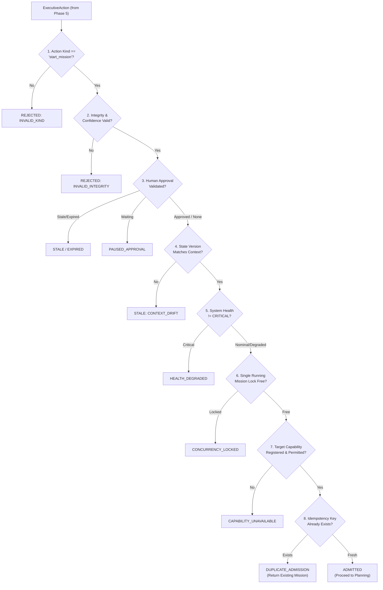
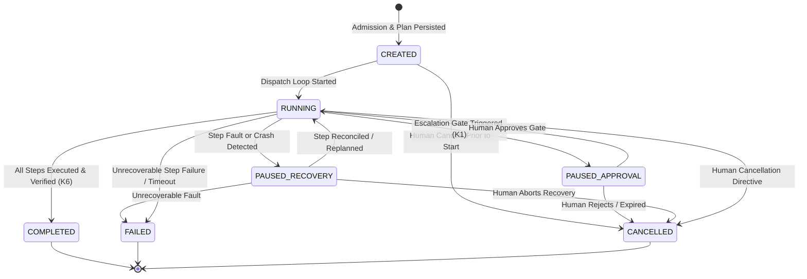
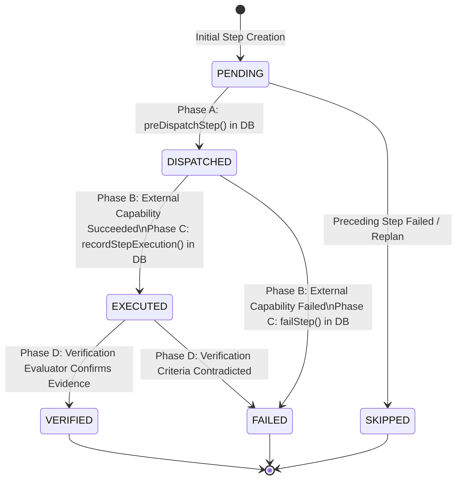
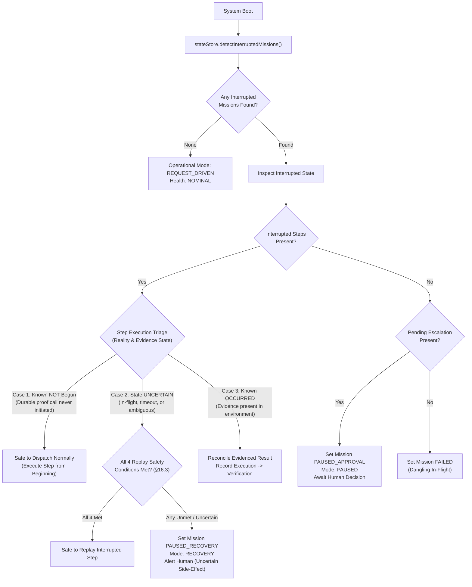

# AKIRA — VAJRA PHASE 6 IMPLEMENTATION DESIGN
## Mission Runtime & Planning Engine
*First-Principles Architecture Specification & Controlled Execution Boundary*  
*Document Version: 1.1.0-REVISION-1.1.1*  
*Status: DESIGN ONLY — AWAITING EXPLICIT HUMAN APPROVAL*

---

```
                       AUTHORITATIVE COGNITIVE LIFECYCLE
                                     Human
                                       │ (Ultimate Authority)
                                       ▼
                                     VAJRA
   ┌───────────────────────────────────┴───────────────────────────────────┐
   │ Understand ──► Reason ──► Decide ──► [PLAN & COORDINATE] ──► Observe  │
   │ (Phase 2)      (Phase 4)  (Phase 5)      (PHASE 6)          & Verify  │
   │                                              │              (Phase 7) │
   └──────────────────────────────────────────────┼────────────────────────┘
                                                  ▼
                                       GENESIS / AKIRA OS / HANDS
                                                  │
                                                  ▼
                                               Reality
```

---

## 1. Executive Summary

VAJRA is the central cognitive-control authority of AKIRA. Previous architecture phases established:
- **Phase 1:** Complete legacy retirement and deduplication.
- **Phase 2:** VAJRA core domain boundaries, self-model, and port abstractions.
- **Phase 3:** Durable operational state persistence in SQLite (missions, steps, beliefs, traces, escalations, verifications).
- **Phase 4:** Adaptive reasoning engine with multi-strategy hypothesis formulation and state-staleness protection.
- **Phase 5:** Authoritative Decision Arbiter producing immutable `ExecutiveAction` records gated by policy and human approval.

**Phase 6** establishes the **Mission Runtime & Planning Engine**. It bridges the cognitive divide between **Decision** and **Execution**:
- **Phase 5 answered:** *"Given what VAJRA currently knows, what should VAJRA do?"*
- **Phase 6 answers:** *"Given VAJRA's authoritative `ExecutiveAction`, how should that intent be compiled into a controlled, verifiable mission and executed without authority leakage, uncontrolled loops, or crash vulnerability?"*

Phase 6 implements:
1. **Mission Admission Gateway:** A deterministic barrier that validates incoming `ExecutiveAction` instances against state staleness, approval validity, capability availability, concurrency locks, and idempotency.
2. **Planning Engine (`IPlanningEngine`):** Compiles admitted intent into frozen, bounded `MissionDefinition` instances composed of strictly ordered, linear `MissionStep[]` sequences (DAG-free, in full alignment with Contract K10).
3. **Mission Runtime & Two-Phase Dispatcher:** Executes steps sequentially through canonical AKIRA OS capability boundaries (`IAkiraOSPort` / `CapabilityRegistry`), strictly preserving the Phase 3 two-phase commit invariant: *no external side effects inside database transactions*.
4. **Crash Recovery & Reconciliation Manager:** Recovers interrupted in-flight work on startup, triaging recovery into three explicit execution reality cases and freezing uncertain side-effects into `PAUSED_RECOVERY` for human resolution.
5. **Observation & Verification Handoff:** Decouples execution success from mission completion, ensuring that only verified evidence (Contract K6) advances or completes a mission.
6. **Zero Database Migrations:** 100% of Phase 6 persistence needs are satisfied by the existing Phase 3 schema (`003_vajra_operational_state.sql`).

### 1.1 Revision History & Architectural Correction Summary
- **v1.0.0-PROPOSED:** Baseline Phase 6 architecture specification covering all 32 core sections.
- **v1.1.0-REVISION-1:** Initial review pass incorporating timeout uncertainty, canonical `start_mission`, replanning authority bounds, and planning failure isolation.
- **v1.1.0-REVISION-1.1:** Contract-grounded correction pass: eliminated broad idempotency-only replay; removed stale safe-hold planner fallback; removed unsupported `AbortSignal` claims in favor of timeout uncertainty semantics; grounded observation confidence in Contract K4.
- **v1.1.0-REVISION-1.1.1 (Current):** Targeted clarification pass:
  1. **Crash Point 3 & Triaged Recovery Model (§15.2, §18):** Formalized three distinct recovery reality cases: (a) *Known not begun* $\to$ safe to dispatch normally; (b) *State uncertain* $\to$ mandatory Four-Condition Replay Safety Gate; (c) *Known occurred* $\to$ reconcile evidenced result into verification.
  2. **Retry vs. Replay Terminology (§16, §17):** Explicitly distinguished *Retry* (re-invoking after definite failure with positive proof zero side effects occurred) from *Replay* (re-invoking when previous external execution may already have occurred). Clarified that the four-condition gate governs uncertain replay without weakening bounded retry limits.

---

## 2. Phase 6 Objective

The primary objective of Phase 6 is to deliver a deterministic, crash-safe, and authority-bounded mission execution subsystem for VAJRA.

The lifecycle flow governed by Phase 6 is:
$$\text{ExecutiveAction} \longrightarrow \text{Admission} \longrightarrow \text{Planning} \longrightarrow \text{MissionDefinition} \longrightarrow \text{MissionStep[]} \longrightarrow \text{Runtime Dispatch} \longrightarrow \text{Execution Result} \longrightarrow \text{Verification Handoff}$$

### Core Invariants
1. **Determinism of Authority:** Mission planning and dispatch never reinterpret, replace, or silently override the decision emitted by Phase 5.
2. **Capability Integrity:** Every operational step must resolve to a valid descriptor in AKIRA OS `CapabilityRegistry`. Direct execution of shell commands, process spawning, or filesystem mutation from VAJRA domain code is strictly prohibited.
3. **Two-Phase Crash Durability:** Step dispatch state must be durably committed as `DISPATCHED` in SQLite *before* external actuation begins, and updated to `EXECUTED` or `FAILED` *after* actuation finishes.
4. **No Autonomous Infinite Loops:** Planning and execution are strictly bounded by step counts, spend budgets, and single-attempt ceilings. Autonomous retries are permitted only once and strictly for idempotent read operations.
5. **Zero Schema Migrations:** Phase 6 introduces zero SQLite schema migrations, building entirely upon the verified Phase 3 persistence foundation.

---

## 3. Repository Archaeology

A rigorous inspection of the current repository establishes the following implementation realities:

### 3.1 Existing Mission Contracts (`src/contracts/mission/`)
- `mission-definition.ts`: Defines `MissionDefinition`, `MissionStep<TInput>`, `MissionConstraint`, and `CompletionCriteria`.
  - **Frozen Invariants (Lines 34–39):**
    - Workspace tasks $\neq$ mission steps.
    - `MUST NOT contain DAG dependencies (dependsOn, predecessors, successors).`
    - `MUST NOT contain execution status enums (Pending, InProgress, Blocked).`
    - `MUST NOT contain retry counters, backoff policies, or execution callbacks.`
  - Steps are organized as a pure, frozen array: `readonly steps: readonly MissionStep[]`.
- `mission-state.ts`: Defines `MissionState<TOutcome>`.
  - **Frozen Invariants (Lines 6–12):**
    - Passive, immutable evidence envelope.
    - Does NOT contain mutable cursors or scheduler state.
    - Carries `executionResultIds: readonly string[]`, `observationIds: readonly string[]`, and `verificationRecordIds: readonly string[]`.

### 3.2 Existing Capabilities & Verification Contracts (`src/contracts/capabilities/`)
- `descriptor.ts`: Defines `CapabilityDescriptor` with `name`, `version`, `owner`, `kind` (`"Command" | "Query"`), `inputSchema` (Zod), `permissions` (`allowVajra`, `allowInternal`, `confirmationRequired`), `activationTier` (0, 1, 2), `isAvailable`, and `executionCharacteristics` (`isIdempotent`, `isReadOnly`, `sideEffectClass`).
- `registry.ts`: `CapabilityRegistry` hosts registered capabilities, enforces Rule N1/N2/N3, on-demand activation for Tier 2, and validates input schemas with uniform `Result<TOutput, CapabilityFailure>` wrapping.
- `verification.ts`: Implements Contract K6:
  - `VerificationRecord`: evidence evaluated by VAJRA (`outcome: "criteria_satisfied" | "criteria_not_satisfied" | "inconclusive"`).
  - `MissionResult`: terminal outcome produced exclusively by VAJRA, and *only* after verification.

### 3.3 Existing Operational Persistence (`src/persistence/migrations/003_vajra_operational_state.sql`)
The Phase 3 SQLite migration already provides the complete operational state schema:
- `vajra_missions`: Columns `id`, `objective`, `lifecycle_state` (`CHECK: 'CREATED', 'RUNNING', 'PAUSED_APPROVAL', 'PAUSED_RECOVERY', 'COMPLETED', 'FAILED', 'CANCELLED'`), `definition_json`, `state_json`, `current_step_order`, `allocated_budget_json`, `idempotency_key`, `request_id`, `correlation_id`, `invocation_id`, `created_at`, `updated_at`, `completed_at`.
  - **Partial Unique Index (Line 43):** `idx_vajra_single_running_mission` enforces that at most **one** mission can be in `lifecycle_state = 'RUNNING'` simultaneously.
  - **Unique Index (Line 42):** `idx_vajra_missions_idempotency` guarantees unique `idempotency_key`.
- `vajra_mission_steps`: Columns `id`, `mission_id`, `step_order`, `description`, `target_capability`, `input_json`, `expected_evidence`, `dispatch_state` (`CHECK: 'PENDING', 'DISPATCHED', 'EXECUTED', 'VERIFIED', 'FAILED', 'SKIPPED'`), `idempotency_key`, `correlation_id`, `execution_result_id`, `execution_error_json`, `dispatched_at`, `executed_at`, `verified_at`.
  - **Composite Unique Index (Line 67):** `idx_vajra_steps_mission_order` enforces unique `(mission_id, step_order)`.
  - **Unique Index (Line 69):** `idx_vajra_steps_idempotency` prevents duplicate step dispatches.
- `vajra_operational_state`: Singleton tracking `active_mission_id`, `operational_mode`, `human_presence`, `system_health_status`, `version`.
- `vajra_escalations`: Tracks human gates (`PENDING_APPROVAL`, `APPROVED`, `REJECTED`, `EXPIRED`, `CANCELLED`).
- `vajra_verifications`: Tracks verification judgements.
- `vajra_deliberation_traces`: Audit trail linking decisions back to stimuli.

### 3.4 Existing Ports & Boundaries (`src/vajra/`)
- `src/vajra/ports/state-store.ts`: `IOperationalStateStore` defines complete mission CRUD, two-phase dispatch methods (`preDispatchStep`, `recordStepExecution`, `failStep`, `updateMissionLifecycle`), and `detectInterruptedMissions()`.
- `src/vajra/ports/planning.ts`: `IPlanningEngine` defines `createPlan()` and `replan()`.
- `src/vajra/ports/coordination.ts`: `ICoordinationDispatcher` defines `dispatchStep()`.
- `src/vajra/boundaries/akira-os-port.ts`: `IAkiraOSPort` wraps `CapabilityRegistry` with `{ isVajra: true }`.
- `src/vajra/boundaries/hands-port.ts`: `IHandsPort` stub adapter disallowing direct execution.
- `src/vajra/decision/arbiter.ts`: `DecisionArbiter` produces `ExecutiveAction` with `kind: "start_mission"` and persisted audit traces.
- `src/vajra/decision/approval-manager.ts`: Manages human escalations per Contract K1.

---

## 4. Existing Contracts Reused

Phase 6 introduces zero conflicting or duplicate contract types. It strictly reuses:

| Contract / Interface | Source Location | Architectural Purpose in Phase 6 |
|---|---|---|
| `MissionDefinition` | `src/contracts/mission/mission-definition.ts` | Target output of Planning Engine; immutable definition of mission steps and bounds. |
| `MissionStep<TInput>` | `src/contracts/mission/mission-definition.ts` | Pure declarative specification of a single capability dispatch. |
| `MissionConstraint` | `src/contracts/mission/mission-definition.ts` | Execution constraints (`maxSteps`, `timeoutMs`, `deadline`, `sideEffectLimits`). |
| `CompletionCriteria` | `src/contracts/mission/mission-definition.ts` | Criteria against which collected observations are verified before mission completion. |
| `MissionState` | `src/contracts/mission/mission-state.ts` | Passive evidence snapshot tracking accumulated execution result IDs and observation IDs. |
| `ExecutiveAction` | `src/vajra/types/action.ts` | Input to Mission Admission emitted by Phase 5 Decision Arbiter. |
| `VajraMissionRecord` | `src/vajra/types/mission-record.ts` | Durable operational entity stored in `vajra_missions`. |
| `VajraStepRecord` | `src/vajra/types/mission-record.ts` | Durable operational step entity stored in `vajra_mission_steps`. |
| `MissionLifecycleState` | `src/vajra/types/mission-record.ts` | State machine states: `CREATED`, `RUNNING`, `PAUSED_APPROVAL`, `PAUSED_RECOVERY`, `COMPLETED`, `FAILED`, `CANCELLED`. |
| `StepDispatchState` | `src/vajra/types/mission-record.ts` | Two-phase dispatch states: `PENDING`, `DISPATCHED`, `EXECUTED`, `VERIFIED`, `FAILED`, `SKIPPED`. |
| `IOperationalStateStore` | `src/vajra/ports/state-store.ts` | Isolation port for SQLite operations (zero SQL statements in domain code). |
| `IAkiraOSPort` | `src/vajra/boundaries/akira-os-port.ts` | Port mediating capability resolution and execution via `CapabilityRegistry`. |
| `IPlanningEngine` | `src/vajra/ports/planning.ts` | Planning engine interface to be implemented by Phase 6. |
| `ICoordinationDispatcher`| `src/vajra/ports/coordination.ts` | Coordination dispatcher interface to be implemented by Phase 6. |
| `Result<T, E>` | `src/contracts/results/result.ts` | Uniform result wrapper for all fallible operations. |
| `CorrelationMetadata` | `src/contracts/results/result.ts` | Contract K19 provenance chain (`requestId`, `correlationId`, `invocationId`, `causationId`). |
| `VerificationRecord` | `src/contracts/capabilities/verification.ts` | Judgement evaluating collected evidence against completion criteria. |
| `MissionResult` | `src/contracts/capabilities/verification.ts` | Terminal verified outcome of an entire mission. |

---

## 5. Phase Boundary

To prevent authority leakage, the boundary between Phase 5, Phase 6, and downstream subsystems is strictly delineated:

```
┌────────────────────────────────────────────────────────────────────────┐
│                        PHASE 5: DECISION ARBITER                       │
│  Owns:                                                                 │
│  - Epistemic deliberation and action selection                         │
│  - Human approval escalation creation (Contract K1)                    │
│  - Emitting immutable ExecutiveAction with kind: "start_mission"       │
│  - Persisting DeliberationTrace audit records                          │
│  MUST NOT: Plan mission steps, dispatch capabilities, or run loops.    │
└───────────────────────────────────┬────────────────────────────────────┘
                                    │ (ExecutiveAction)
                                    ▼
┌────────────────────────────────────────────────────────────────────────┐
│               PHASE 6: MISSION RUNTIME & PLANNING ENGINE               │
│  Owns:                                                                 │
│  - Mission Admission verification (staleness, approval, health, locks) │
│  - Planning Engine: Action decomposition into linear MissionStep[]     │
│  - Mission lifecycle state machine (CREATED -> RUNNING -> COMPLETED)   │
│  - Two-Phase Dispatch loop (preDispatchStep -> execute -> record)      │
│  - Single running mission constraint enforcement                       │
│  - Startup crash recovery and reconciliation of uncertain steps        │
│  - Handoff to Observation Receiver and Verification Evaluator          │
│  MUST NOT:                                                             │
│  - Reconsider the Phase 5 decision or mutate epistemic beliefs         │
│  - Directly spawn processes, invoke shell, or mutate files             │
│  - Bypass CapabilityRegistry or execute unregistered capabilities      │
│  - Execute autonomous infinite loops or unbounded retries              │
└───────────────────────────────────┬────────────────────────────────────┘
                                    │ (executeCapability via IAkiraOSPort)
                                    ▼
┌────────────────────────────────────────────────────────────────────────┐
│                    DOWNSTREAM: AKIRA OS & CAPABILITIES                 │
│  Owns:                                                                 │
│  - Capability registry, lifecycle (Tier 0/1/2), and descriptor schemas │
│  - Sandboxed execution via HANDS (when capability owner is HANDS)      │
│  - Emitting raw telemetry and execution results                        │
└────────────────────────────────────────────────────────────────────────┘
```

---

## 6. Mission Admission Architecture

Before any `ExecutiveAction` can be admitted as an operational mission, it must pass through the deterministic **Mission Admission Gateway** (`MissionAdmissionGateway`).



### 6.1 Admission Gates
1. **Kind Verification:** `action.kind` must be canonical `"start_mission"` (per Phase 5 Decision Arbiter; legacy `"execute_mission"` is rejected to enforce contract uniformity).
2. **Structural Integrity:** `action.id`, `action.confidence` (finite number $\in [0, 1]$), `action.policyCompliance === true`, and complete `correlation` metadata (`requestId`, `correlationId`, `invocationId`) must be present.
3. **Approval State Verification:**
   - If `action.approvalState === "APPROVAL_REQUIRED"` or `"WAITING_FOR_HUMAN"`: query `ApprovalManager.validateApproval(action.escalationId)`.
   - If still waiting: result is `PAUSED_APPROVAL`.
   - If expired: result is `EXPIRED`.
   - If human rejected: result is `REJECTED`.
   - If context version or policy version drifted during approval window: result is `STALE`.
4. **State Version Staleness Guard (Invariant K-P4-2 / K-P5-1):**
   `action.stateVersion` must strictly match `operationalContext.version`. If the context advanced between decision and admission, the decision is rejected as `STALE`.
5. **System Health Gate:**
   If `operationalContext.systemHealthStatus === "CRITICAL"`, no missions can be admitted (`HEALTH_DEGRADED`).
6. **Single Running Mission Lock:**
   Query `stateStore.getActiveMission()`. If an existing mission is currently in lifecycle state `'RUNNING'`, admission returns `CONCURRENCY_LOCKED` (concurrent running missions are prohibited by database schema).
7. **Capability Pre-Flight Check:**
   If `action.requiredCapability` is defined, verify:
   - `registry.has(capabilityName)`
   - `descriptor.isAvailable === true`
   - `descriptor.permissions.allowVajra === true`
   If unfulfilled, return `CAPABILITY_UNAVAILABLE`.
8. **Idempotency De-duplication:**
   Check if a mission already exists in `vajra_missions` with `action.idempotencyKey`. If found, return `DUPLICATE_ADMISSION` with the existing mission record to prevent duplicate execution across retries.

### 6.2 Explicit Admission Outcome Contract
```typescript
export type MissionAdmissionOutcome =
  | { status: "ADMITTED"; action: ExecutiveAction; correlation: CorrelationMetadata }
  | { status: "PAUSED_APPROVAL"; escalationId: string; reason: string }
  | { status: "REJECTED"; reason: string }
  | { status: "STALE"; reason: string }
  | { status: "EXPIRED"; reason: string }
  | { status: "CAPABILITY_UNAVAILABLE"; missingCapability: string; reason: string }
  | { status: "CONCURRENCY_LOCKED"; activeMissionId: string; reason: string }
  | { status: "DUPLICATE_ADMISSION"; existingMissionId: string; reason: string }
  | { status: "HEALTH_DEGRADED"; reason: string };
```

---

## 7. Planning Engine Architecture

The Planning Engine (`PlanningEngine`, implementing `IPlanningEngine`) converts an admitted `ExecutiveAction` into a formal `MissionDefinition` and ordered `MissionStep[]`.

### 7.1 Hybrid Planning Model
Planning combines **Deterministic Rule-Based Decomposition** (primary) with **Model-Assisted Decomposition** (untrusted coprocessor proposal):

```
                   ADMITTED EXECUTIVE ACTION
                               │
            ┌──────────────────┴──────────────────┐
            ▼                                     ▼
    [Known Capability Action]             [Multi-Step Objective]
            │                                     │
            ▼                                     ▼
   Deterministic Planner                 Model-Assisted Planner
   (Direct capability mapping)           (IModelCoprocessorPort)
            │                                     │
            │                                     ▼
            │                            [Untrusted Proposal]
            │                                     │
            │                                     ▼
            │                            Strict Validation Blast Door
            │                            - Zod schema validation
            │                            - Capability existence & allowVajra
            │                            - InputSchema validation
            │                            - maxSteps constraint <= 5
            │                                     │
            │                         ┌───────────┴───────────┐
            │                         ▼                       ▼
            │                     [Passed]                [Failed]
            │                         │                       │
            │                         │                       ▼
            │                         │             PLANNING_FAILED
            │                         │             (Zero silent substitution)
            │                         │                       │
            │                         │                       ▼
            │                         │             PAUSED_RECOVERY / ESCALATION
            │                         │             (Return to VAJRA / Human)
            │                         │
            └─────────────────────────┼───────────────────────┘
                                      ▼
                           VALIDATED MISSION PLAN
                          - MissionDefinition (K10)
                          - Linear MissionStep[] (DAG-free)
```

### 7.2 Deterministic Rule-Based Planner (Primary)
For single-capability or templated operations (e.g. `workspace.create_task`, `notes.append_entry`, `search.recall`), the deterministic planner directly constructs:
- `MissionDefinition`:
  - `objective`: `action.intent ?? action.rationale`
  - `constraints`: `{ maxSteps: 1, timeoutMs: 30_000, confirmationRequired: action.approvalState === "APPROVAL_REQUIRED" }`
  - `completionCriteria`: `{ description: "Capability executed successfully with verified evidence", requiredEvidence: [action.requiredCapability ? `evidence.${action.requiredCapability}.ok` : "evidence.execution.ok"] }`
- `MissionStep`:
  - `stepOrder`: 1
  - `targetCapability`: `action.requiredCapability!`
  - `input`: `action.payload`
  - `expectedEvidence`: `action.evidenceBasis?.[0] ?? "evidence.execution.ok"`

### 7.3 Model-Assisted Planner & Untrusted Proposal Blast Door
When an objective requires dynamic multi-step decomposition:
1. The planner invokes `IModelCoprocessorPort.evaluateHypothesis()` with a structured planning prompt and strict JSON schema.
2. **BLAST DOOR — MODEL PROPOSALS ARE STRICTLY UNTRUSTED:**
   - **Schema Gate:** Output must parse as `Array<{ description: string; targetCapability: string; input: unknown; expectedEvidence: string }>` via Zod.
   - **Length Ceilings:** Steps count must satisfy $1 \le \text{count} \le \text{constraints.maxSteps}$ (hard system limit: 5 steps for autonomous missions, 10 for human-approved missions).
   - **Capability Verification Gate:** For *every* proposed step, verify that `registry.has(targetCapability)` AND `descriptor.isAvailable` AND `descriptor.permissions.allowVajra === true`. Any hallucinated or unauthorized capability causes **instant rejection of the entire proposal**.
   - **Input Validation Gate:** The proposal's `input` is validated against the registered capability's `descriptor.inputSchema.safeParse(input)`.
   - **Safety / Prohibited Actions:** No step may target destructive operations without explicit approval.
   - **Explicit Failure Contract (Anti-Silent-Substitution Blast Door):** If the model proposal fails *any* validation gate, or if the planner cannot formulate a valid plan meeting all constraints, the planner **MUST NOT** silently synthesize an unrelated no-op mission, a synthetic safe-hold task, or pretend planning succeeded. Instead, it emits an explicit `PLANNING_FAILED` outcome, transitioning the mission state to `PAUSED_RECOVERY` and creating an escalation for human clarification or returning control to the VAJRA decision cycle.

### 7.4 Replanning Protocol & Strict Authority Boundaries (`replan()`)
If a step fails during runtime execution:
1. Execution of the current mission halts immediately.
2. The runtime marks the step `FAILED` in SQLite and transitions the mission to `PAUSED_RECOVERY`.
3. `replan(failedMissionId, failedStepOrder, newEvidenceIds, correlation)` is invoked to evaluate whether a safe alternative execution sequence exists.
4. **Strict Replanning Authority Boundaries (Phase 6 Cannot Become a Second Arbiter):**
   - **What Replan MAY Modify:**
     - The execution sequence of *remaining* steps (from `failedStepOrder` onwards).
     - The specific capability selection among pre-authorized, non-destructive alternatives within the same scope.
     - Operational parameters and evidence collation details.
   - **What Replan MUST NEVER Modify (Immutable Anchors):**
     - The original mission `objective` or `intent`.
     - The mission `authorityLevel` or `riskClass` / `impactClass`.
     - The human approval requirements (a step requiring approval cannot be replaced with one that evades approval).
     - The policy constraints or safety invariant boundaries.
     - The allocated budget ceilings (`maxCostCents`, `maxSteps`, `timeoutMs`).
     - Prohibited capabilities or capabilities with `allowVajra: false`.
5. **Replan Violation Blast Door:** If a replan proposal attempts to modify any immutable anchor, or if no valid alternative satisfying all boundaries exists:
   - The replan is rejected with `REPLAN_REJECTED`.
   - The mission transitions to `PAUSED_RECOVERY` / `ESCALATION`.
   - The runtime yields to the human or returns to the VAJRA decision cycle.
   - Autonomous replanning loops are strictly prohibited (max 1 replan attempt per mission).

---

## 8. MissionDefinition Design

The MissionDefinition matches `src/contracts/mission/mission-definition.ts` exactly:

```typescript
export interface MissionDefinition {
  readonly id: string;
  readonly objective: string;
  readonly steps: readonly MissionStep[];
  readonly constraints: MissionConstraint;
  readonly completionCriteria: CompletionCriteria;
  readonly goalId?: string;
  readonly correlation: CorrelationMetadata & {
    readonly missionId: string;
    readonly goalId?: string;
  };
}
```

### Invariants Maintained
- **Frozen Immutable Structure:** Constructed via `createMissionDefinition()` and sealed with `Object.freeze()`.
- **DAG-Free:** Step dependencies are strictly linear (array order).
- **Transport Agnostic:** Does not contain chat turn, socket, or browser state.
- **Bound Constraints:**
  - `constraints.timeoutMs`: Maximum duration before execution timeout.
  - `constraints.maxSteps`: Hard limit on the number of discrete capability invocations (default: 5).
  - `constraints.confirmationRequired`: Whether mid-mission gates require human authorization.

---

## 9. MissionStep Design

The declarative step definition matches `src/contracts/mission/mission-definition.ts`:

```typescript
export interface MissionStep<TInput = unknown> {
  readonly id: string;
  readonly missionId: string;
  readonly stepOrder: number;
  readonly description: string;
  readonly targetCapability: string;
  readonly input: TInput;
  readonly expectedEvidence: string;
}
```

### Invariants Maintained
- **Workspace Tasks Separation:** A `MissionStep` is VAJRA's internal atomic operational unit; it is never mapped 1:1 to a user-facing workspace task entity (Target Architecture §6).
- **No Internal Status Enums:** Status is maintained strictly in runtime memory and the durable `vajra_mission_steps.dispatch_state` column (`PENDING`, `DISPATCHED`, `EXECUTED`, `VERIFIED`, `FAILED`, `SKIPPED`).
- **No Embedded Callbacks:** Steps contain pure declarative serializable JSON inputs; zero functions, promises, or closures.
- **Deterministic Idempotency Key:** Derived deterministically:
  $$\text{idempotencyKey} = \texttt{"idemp-step-" } + \text{missionId} + \texttt{"-"} + \text{stepOrder} + \texttt{"-"} + \text{targetCapability}$$

---

## 10. Mission Graph / Dependency Model

### Linear Sequential Execution (DAG-Free)
Per frozen Contract K10, Target Architecture §6, and repository reality (`mission-definition.ts` line 36):
> `MUST NOT contain DAG dependencies (dependsOn, predecessors, successors).`

Phase 6 implements a **Strict Linear Sequence by `stepOrder`**:
$$\text{Step } 1 \longrightarrow \text{Step } 2 \longrightarrow \dots \longrightarrow \text{Step } N$$

### Architectural Rationale
1. **Desktop-First Simplicity:** Eliminates graph cycle hazards, topological sorting overhead, and race conditions on desktop SQLite.
2. **Context Accumulation:** Step $N$ can deterministically consume execution evidence produced by steps $1 \dots N-1$.
3. **Crash Recovery Determinism:** Recovery simply inspects `current_step_order`, eliminating ambiguous multi-branch recovery states.
4. **Parallelism Deferral:** Parallel step execution introduces severe concurrency and database locking hazards. Parallel capability execution is **explicitly deferred** beyond Phase 6. At all times, exactly **one** step is dispatched per mission.

---

## 11. Mission State Machine

The mission lifecycle is governed by the states allowed in `vajra_missions.lifecycle_state`:



### 11.1 State Definitions & Persistence Semantics
| State | Meaning | Persistence Trigger |
|---|---|---|
| `CREATED` | Mission and steps durably inserted into SQLite. Not yet executing. | `stateStore.createMission(mission, steps)` |
| `RUNNING` | Dispatching steps through `IAkiraOSPort`. Exactly ONE mission in the entire database can hold this state (enforced by `idx_vajra_single_running_mission`). | `stateStore.updateMissionLifecycle(id, "RUNNING")` |
| `PAUSED_APPROVAL` | High-impact step requires explicit human confirmation. Execution suspended. | `stateStore.updateMissionLifecycle(id, "PAUSED_APPROVAL")` |
| `PAUSED_RECOVERY` | Boot recovery found interrupted dispatch or runtime fault; awaiting recovery reconciliation. | `stateStore.updateMissionLifecycle(id, "PAUSED_RECOVERY")` |
| `COMPLETED` | Terminal success. All steps executed and completion criteria verified by Verification Evaluator. | `stateStore.updateMissionLifecycle(id, "COMPLETED", completedAt)` |
| `FAILED` | Terminal failure. Step failed non-recoverably, timeout elapsed, or verification contradicted. | `stateStore.updateMissionLifecycle(id, "FAILED", completedAt)` |
| `CANCELLED` | Terminal cancellation. User aborted mission or superseded by higher authority. | `stateStore.updateMissionLifecycle(id, "CANCELLED", completedAt)` |

### 11.2 State Transition Invariants
- Terminal states (`COMPLETED`, `FAILED`, `CANCELLED`) are immutable and can never transition to any other state.
- Transition to `RUNNING` is guarded by SQLite. If another mission is already `RUNNING`, the partial index aborts the transaction with an SQLite constraint error, preserving system integrity.
- Every lifecycle change is committed to SQLite *synchronously* before any in-memory event is emitted.

---

## 12. MissionStep State Machine

The step dispatch lifecycle is governed by `vajra_mission_steps.dispatch_state`:



### 12.1 Step States
- `PENDING`: Step created, waiting for its turn in `stepOrder`.
- `DISPATCHED`: Intent committed to SQLite. External capability call is in-flight.
- `EXECUTED`: Capability returned success outside the DB transaction; execution result ID persisted.
- `VERIFIED`: Step evidence evaluated by Verification Evaluator and verified satisfied.
- `FAILED`: Capability failed, timed out, or verification contradicted.
- `SKIPPED`: Step bypassed due to replan or early mission termination.

---

## 13. Capability Resolution

Phase 6 never invokes arbitrary functions or external binaries directly. All operational dispatch resolves through the canonical **AKIRA OS Capability Registry** via `IAkiraOSPort`.

```
MissionStep.targetCapability
         │
         ▼
IAkiraOSPort.executeCapability(name, input, correlation)
         │  (Passes callerContext: { isVajra: true })
         ▼
CapabilityRegistry.invoke(name, input, correlation, callerContext)
  ├── 1. Registration Check: registry.has(name)
  ├── 2. Availability Check: descriptor.isAvailable === true
  ├── 3. Permission Check: descriptor.permissions.allowVajra === true
  ├── 4. Rule N1 / N3 Boundary: GENESIS Commands disallowed; HANDS direct Commands isolated
  ├── 5. Rule N2 On-Demand Activation: If Tier 2 and inactive, activate()
  ├── 6. Schema Validation: descriptor.inputSchema.safeParse(input)
  └── 7. Execution: descriptor handler invoked outside DB transaction
```

### 13.1 Handling Resolution Faults
| Fault Condition | Operational Consequence in Phase 6 |
|---|---|
| Capability not registered | Step fails with `capability_unavailable`. Mission halts. |
| Capability unavailable | Step fails with `capability_unavailable`. If transient query, retry once; else fail. |
| `allowVajra === false` | Step fails with `command_rejection`. Immediate mission abort (Security Violation). |
| Input schema invalid | Step fails with `invalid_request`. Immediate mission abort (Planning Bug). |
| OS declines activation | Step fails with `capability_unavailable`. Transition to `PAUSED_RECOVERY` / Escalate to human. |
| Handler throws error | Step fails with `execution_failure`. Handed to recovery / failure handler. |

---

## 14. HANDS Coordination Boundary

**HANDS** is the physical execution layer (process spawning, shell execution, filesystem mutations, browser automation).

### Invariant Boundaries for Phase 6
1. **No Direct Process Spawning:** VAJRA domain code (`src/vajra/`) MUST NOT import `child_process`, `fs.writeFileSync`, or spawn commands.
2. **HANDS Behind Capabilities:** When an operation requires physical OS execution, it is wrapped in an AKIRA OS capability with `descriptor.owner = "HANDS"`.
3. **Execution vs. Orchestration:** HANDS owns process sandboxing, pipes, and OS timeouts. VAJRA owns mission state, decision authority, and completion verification.
4. **Boundary Mediation:** Mission Runtime calls `IAkiraOSPort.executeCapability()`. AKIRA OS mediates invocation to HANDS. The `StubHandsAdapter` in `src/vajra/boundaries/hands-port.ts` remains active in tests, proving VAJRA cannot bypass the OS to touch HANDS.

---

## 15. Two-Phase Dispatch & Crash Matrix

Phase 6 strictly enforces the two-phase dispatch contract established in Phase 3:
> **No external side effect occurs inside a database transaction.**

### 15.1 The Two-Phase Execution Flow
1. **Phase A (Pre-Dispatch Persistence):**
   - Execute in SQLite: `stateStore.preDispatchStep(stepId, idempotencyKey, dispatchedAt)`.
   - Step state is committed as `DISPATCHED`.
   - *Database transaction closes.*
2. **Phase B (External Actuation):**
   - Execute outside DB: `akiraOSPort.executeCapability(targetCapability, input, correlation)`.
   - May succeed, fail, timeout, or process may crash.
3. **Phase C (Result Persistence):**
   - *Open new SQLite transaction.*
   - If success: `stateStore.recordStepExecution(stepId, executionResultId, executedAt)`. Step becomes `EXECUTED`.
   - If failure: `stateStore.failStep(stepId, error, executedAt)`. Step becomes `FAILED`.
   - *Database transaction commits.*
4. **Phase D (Verification Handoff):**
   - Handoff result to Verification Evaluator to evaluate against `expectedEvidence`.
   - If verified: step becomes `VERIFIED`, advance `currentStepOrder`.

### 15.2 Comprehensive Crash Recovery Matrix

```
Step Timeline:
──[Crash 1]──► (Phase A: preDispatch) ──[Crash 2/3]──► (Phase B: External Call) ──[Crash 4/5]──► (Phase C: recordResult) ──[Crash 6]──► (Phase D: Verify)
```

| Crash Point | Durable DB State on Crash | Reality State | Boot Recovery Action & Replay Safety |
|---|---|---|---|
| **Crash Point 1:** Before Phase A SQLite write | Step is `PENDING`. | External call never happened. | Safe to dispatch step from beginning. |
| **Crash Point 2:** During Phase A SQLite write | SQLite rollback. Step is `PENDING`. | External call never happened. | Safe to dispatch step from beginning. |
| **Crash Point 3:** After Phase A, before Phase B call | Step is `DISPATCHED`. | External call never initiated. | **Case 1 (Known NOT Begun):** If verifiable proof confirms execution handoff never occurred, safe to dispatch normally. If proof is ambiguous, triaged as **Case 2 (UNCERTAIN)** $\to$ mandatory Four-Condition Replay Safety Gate (§16.3). |
| **Crash Point 4:** During Phase B execution (or Timeout) | Step is `DISPATCHED`. | External side-effect may be partial, complete, or hanging. | **Case 2 (UNCERTAIN):** A timeout or mid-call crash does NOT prove the external operation did not execute. Replay is strictly prohibited unless all 4 Replay Safety Conditions (§16.3) are met. Any uncertain outcome transitions immediately to `PAUSED_RECOVERY`. Requires evidence probe or human reconciliation. **Never blindly replay uncertain side-effects.** |
| **Crash Point 5:** After Phase B success, before Phase C write | Step is `DISPATCHED`. | External side-effect completed! | **Case 3 (Known OCCURRED):** Runtime probes environment for evidence. If evidence present, reconcile execution in SQLite and advance to Phase D verification without re-executing. If uncertain, pause for human reconciliation. |
| **Crash Point 6:** After Phase C write, before Phase D verify | Step is `EXECUTED`. | External call completed, result recorded. | Step already `EXECUTED`. Resume verification evaluation from recorded execution result. |

### 15.3 The Three Triaged Recovery Reality Cases
When `MissionRecoveryManager` encounters an interrupted in-flight step (`DISPATCHED`) on boot, it triages recovery based on verifiable evidence into three distinct reality cases:

```text
Known external execution did NOT begin
        ↓
Safe to dispatch normally

External execution state is UNCERTAIN
        ↓
Apply ALL FOUR replay-safety conditions (§16.3)

Known external execution occurred
        ↓
Reconcile recorded/evidenced result → Verification
```

1. **Case 1: Known External Execution Did NOT Begin**
   - *Condition:* Verifiable, deterministic evidence proves that the crash occurred strictly before `executeCapability()` was invoked (external execution definitely never began).
   - *Action:* Safe to dispatch step normally from the beginning.
2. **Case 2: External Execution State is UNCERTAIN**
   - *Condition:* External execution was initiated, but interrupted by process termination, network severing, or timeout without verifiable completion.
   - *Action:* The **Four-Condition Replay Safety Gate (§16.3)** is mandatory. Replay is permitted *only* if all four conditions are met. If any condition is missing, or any residual uncertainty remains, transition to `PAUSED_RECOVERY`. **Never blindly replay an uncertain side-effect.**
3. **Case 3: Known External Execution Occurred**
   - *Condition:* External execution completed and verifiable evidence is present in the environment.
   - *Action:* Reconcile recorded/evidenced result into SQLite (`recordStepExecution`) and advance directly to Phase D Verification Evaluator without re-invoking the capability.

---

## 16. Idempotency & Replay Safety Model

### 16.1 Conceptual Distinction: Retry vs. Replay
To eliminate architectural ambiguity, VAJRA strictly distinguishes between two execution concepts:

- **Retry (Definite Failure with Zero Side Effects):**
  - *Definition:* Re-invoking a capability handler that returned an immediate, unambiguous failure where positive contract evidence proves that **no external side effect occurred** (e.g., capability input validation rejection, transient SQLite `BUSY` lock on a read query, or connection handshake refusal prior to data transmission).
  - *Governing Rules:* Governed by Section 17.2 Bounded Retry Rules (maximum 1 retry, strictly limited to read-only idempotent queries; 0 retries for side-effecting operations).
- **Replay (Uncertain Prior Execution):**
  - *Definition:* Re-invoking a capability when a previous execution was already initiated and **external execution may already have occurred** (e.g., mid-actuation crash, timeout during command execution, or recovery from an interrupted `DISPATCHED` state).
  - *Governing Rules:* Governed strictly by the **Four-Condition Replay Safety Gate (§16.3)**. Replay is strictly prohibited whenever residual uncertainty regarding side effects remains.

The Four-Condition Replay Safety Gate applies specifically to **uncertain replay**, not to a definitively failed operation where the contract proves zero external side effects occurred.

### 16.2 Contract Semantics
Phase 6 honors Contract K7 execution characteristics:
- `isIdempotent: true`: Capability guarantees identical state/outcome across repeated invocations with the same input.
- `isIdempotent: false`: Side-effecting capability (e.g. sending a message, writing a file, debiting a budget). Replay risks duplicate actions.
- `undefined`: Fail-safe treated strictly as `isIdempotent: false`.

### 16.3 Four Non-Negotiable Replay Safety Conditions (Uncertain Replay Gate)
Automatic replay of any in-flight or uncertain operation is permitted **ONLY AND EXCLUSIVELY** when **ALL FOUR** of the following conditions are simultaneously satisfied:

1. **Explicit Safe Replay Semantics:** The capability descriptor explicitly declares `isIdempotent: true` AND its contract explicitly specifies that repeated invocations produce no divergent state.
2. **Contract-Guaranteed Idempotency Key:** The capability implementation guarantees that invocations bearing the identical idempotency key are safely de-duplicated or produce idempotent state.
3. **Runtime Safety Evidence:** The runtime possesses sufficient verifiable evidence that previous attempts did not leave ambiguous, corrupted, or irreversible side-effects.
4. **Zero Residual Uncertainty:** There is **zero residual uncertainty** about external side-effects. If any doubt exists regarding whether external state was modified, replay is strictly prohibited.

**Invariant:** If *any* of the four conditions is not fulfilled, the step MUST transition to `PAUSED_RECOVERY` for human reconciliation or an explicit observation probe. **Never blindly replay an uncertain side-effect.**

### 16.4 Idempotency Key Hierarchy
- **Mission Idempotency Key:**
  `idemp-mission-${decisionId}-${stateVersion}`
  Guarantees that an authoritative decision cannot be admitted as multiple concurrent missions.
- **Step Idempotency Key:**
  `idemp-step-${missionId}-${stepOrder}-${targetCapability}`
  Guarantees that a specific step order in a mission cannot be dispatched multiple times.

### 16.5 Duplicate Dispatch Detection & Reconciliation
If an execution loop or recovery process encounters an idempotency key conflict:
1. Query `stateStore.getStep(stepId)`.
2. If `dispatchState === "EXECUTED"` or `"VERIFIED"`, reuse the existing `executionResultId` and proceed to verification without re-executing.
3. If `dispatchState === "DISPATCHED"`, trigger the Crash Recovery reconciliation flow (§18).

---

## 17. Failure Handling & Bounded Retry

VAJRA Phase 6 enforces **Strictly Bounded Failure Handling** to prevent runaway autonomous loops:

### 17.1 Failure Classification
```typescript
export type FailureClass =
  | "RECOVERABLE_TRANSIENT"  // Network hiccup on pure read query, transient SQLite busy lock
  | "NON_RECOVERABLE_HARD"   // Schema failure, permission rejection, unknown capability, timeout on side-effect
  | "REQUIRES_HUMAN_GATE";   // Non-idempotent fault, budget exceeded, verification mismatch, uncertain timeout
```

### 17.2 Bounded Retry & Replay Rules (Anti-Loop Blast Doors)
1. **Timeout Governed as Uncertain Replay:** A step-level or capability-level `timeout` leaves external state in an **uncertain state** (the external service may have executed fully or partially before timer expiration). Therefore, a timeout is an **uncertain execution** governed by the Four-Condition Replay Safety Gate (§16.3). It **MUST NOT** trigger automatic retry or replay unless all 4 Replay Safety Conditions are satisfied.
2. **Maximum Retry Count (Definite Failures):** At most **1 retry** per step for definite failures where contract evidence proves zero side effects occurred, and **ONLY** if:
   - The capability descriptor has `descriptor.executionCharacteristics.isIdempotent === true` AND `descriptor.executionCharacteristics.isReadOnly === true`.
   - The failure category is `capability_unavailable` (transient lock or temporary unavailability).
3. **Zero Retries for Side Effects:** If `isReadOnly !== true`, retry count is strictly **0**. Any failure or timeout halts execution immediately and transitions the mission to `FAILED` or `PAUSED_RECOVERY`.
4. **No Autonomous Replanning Loops:** A mission can trigger `replan()` at most **once**. If a replanned step also fails, the mission transitions immediately to terminal `FAILED`.
5. **Overall Mission Attempt Cap:** Exactly **1 attempt**. A failed mission is never automatically re-admitted without a fresh, distinct stimulus and human/decision arbitration cycle.

---

## 18. Crash Recovery on Process Restart

On system startup (invoked during `ExecutiveController.boot()`), VAJRA initiates the **Mission Recovery Manager** (`MissionRecoveryManager`):



### 18.1 Deterministic Boot Guarantees & Triaged Recovery Evaluation
When interrupted in-flight steps (`DISPATCHED`) are detected during boot recovery, the runtime triages the situation into three distinct reality cases (§15.3):

1. **Case 1: Known External Execution Did NOT Begin:** Where verifiable, deterministic evidence proves that the process crashed strictly before `executeCapability()` was invoked (external call never began), it is safe to dispatch the step normally from the beginning.
2. **Case 2: External Execution State is UNCERTAIN:** Where execution was initiated, or where execution state is ambiguous (e.g. mid-call crash, timeout), the **Four-Condition Replay Safety Gate (§16.3)** is mandatory:
   - Condition 1: Explicit safe replay semantics defined on capability descriptor.
   - Condition 2: Contract-guaranteed idempotency de-duplication with the same idempotency key.
   - Condition 3: Verifiable runtime evidence establishing that previous attempts caused no corrupting state.
   - Condition 4: Zero residual uncertainty regarding external side effects.
   - **Idempotency Alone is Strictly Insufficient:** Interrupted steps must **never** be re-dispatched merely because `isIdempotent === true`. If any of the four conditions is missing, or if any uncertainty remains regarding whether an external side-effect occurred, the step enters `PAUSED_RECOVERY` for human reconciliation or an explicit observation probe.
3. **Case 3: Known External Execution Occurred:** Where external evidence confirms the capability executed successfully, the runtime reconciles the result into SQLite (`recordStepExecution`) and advances to Phase D verification without re-invoking the capability.
4. **No Unbounded Loops:** The recovery scan never initiates autonomous execution or background loops. It reconciles SQLite state, sets `operationalContext.activeMissionId`, transitions operational mode to `RECOVERY` or `PAUSED`, and yields control back to the human or cooperative turn scheduler.

---

## 19. Human Approval Handling

Phase 6 respects human approval authority established in Phase 5 per Contract K1:

### 19.1 Mid-Mission Escalation Trigger
If a planned step requires human confirmation (`descriptor.permissions.confirmationRequired === true` or high impact class):
1. Mission Runtime pauses dispatch before calling Phase A.
2. Mission transitions to `PAUSED_APPROVAL`.
3. Calls `ApprovalManager.createApprovalGate()` to persist the escalation in `vajra_escalations` and notify the user via `IEscalationPort`.
4. Execution yields back to the scheduler.

### 19.2 Approval Validation on Resume
When the user submits an approval resolution:
1. `ApprovalManager.validateApproval(escalationId)` verifies:
   - Escalation status is `APPROVED`.
   - Expiration TTL (`expiresAt`) has not passed.
   - `contextVersion` matches active operational context.
   - `policyVersion` matches active policy.
2. If valid: Mission transitions from `PAUSED_APPROVAL` to `RUNNING` and resumes step dispatch.
3. If invalid or rejected: Mission transitions to `CANCELLED`.

---

## 20. Observation & Verification Handoff

Execution success does not equal mission completion:
$$\text{Execution Result (K5)} \neq \text{Observation (K4)} \neq \text{Verification (K6)} \neq \text{Mission Completion}$$

```
                CAPABILITY DISPATCH COMPLETE
                             │
                             ▼
                    Execution Result K5
                   (Raw handler output)
                             │
                             ▼
                   IObservationReceiver
           (Standardized Observation K4 with confidence)
                             │
                             ▼
                   IVerificationEvaluator
           (Compares evidence vs CompletionCriteria)
                             │
            ┌────────────────┴────────────────┐
            ▼                                 ▼
   criteria_satisfied             criteria_not_satisfied / inconclusive
            │                                 │
            ▼                                 ▼
   VerificationRecord K6             VerificationRecord K6
   status: "completed"               status: "not_completed"
            │                                 │
            ▼                                 ▼
    MissionResult K6                    Mission FAILED
 Mission State: COMPLETED              or PAUSED_RECOVERY
```

### 20.1 Contract Handoff Boundaries
- **Execution Result (`Result<T, CapabilityFailure>`):** Captured directly from `IAkiraOSPort.executeCapability()`.
- **Observation Receiver (`IObservationReceiver`):** Standardizes capability execution telemetry into canonical Contract K4 `Observation<T>` (`producer: "capability.${name}"`, `subject: step.id`, `causationId: correlation.invocationId`, Contract K19 correlation) with canonical producer confidence (normalized $[0, 1]$ float derived from capability metadata and execution characteristics per Contract K4, strictly decoupling raw execution from epistemic verification certainty).
- **Verification Evaluator (`IVerificationEvaluator`):** Evaluates accumulated observations against `definition.completionCriteria`. Produces `VerificationRecord`.
- **Mission Completion:** A mission can transition to `COMPLETED` *only* if `VerificationRecord.outcome === "criteria_satisfied"`.

---

## 21. Persistence Mapping

Phase 6 introduces **ZERO DATABASE MIGRATIONS**. All required entities map directly to the Phase 3 schema:

| Phase 6 Operational Concept | Database Table | Mapped Columns & Constraints |
|---|---|---|
| Admitted Mission Record | `vajra_missions` | `id`, `objective`, `lifecycle_state`, `definition_json`, `state_json`, `current_step_order`, `allocated_budget_json`, `idempotency_key`, `request_id`, `correlation_id`, `invocation_id`, `created_at`, `updated_at`, `completed_at` |
| Planned Mission Step | `vajra_mission_steps` | `id`, `mission_id`, `step_order`, `description`, `target_capability`, `input_json`, `expected_evidence`, `dispatch_state`, `idempotency_key`, `correlation_id`, `execution_result_id`, `execution_error_json`, `dispatched_at`, `executed_at`, `verified_at` |
| Active Mission Pointer & Mode | `vajra_operational_state` | `active_mission_id`, `operational_mode`, `current_focus`, `version`, `updated_at` |
| Human Approval Gates | `vajra_escalations` | `id`, `mission_id`, `step_id`, `status`, `action_proposed`, `impact_class`, `risk_explanation`, `correlation_id`, `created_at`, `resolved_at` |
| Step & Mission Verification | `vajra_verifications` | `id`, `mission_id`, `step_id`, `outcome`, `evidence_ids_json`, `correlation_id`, `recorded_at` |

---

## 22. Concurrency Model

### 22.1 Single Running Mission Guarantee
Enforced by SQLite partial unique index:
```sql
CREATE UNIQUE INDEX IF NOT EXISTS idx_vajra_single_running_mission 
ON vajra_missions (lifecycle_state) WHERE lifecycle_state = 'RUNNING';
```
- At any point in time, at most **ONE** mission may exist in `RUNNING` status across AKIRA.
- Multiple missions may concurrently exist in passive states (`CREATED`, `PAUSED_APPROVAL`, `PAUSED_RECOVERY`, `COMPLETED`, `FAILED`, `CANCELLED`).
- If an admission or dispatch attempts to move a second mission to `RUNNING`, SQLite rejects the write, and the runtime returns `CONCURRENCY_LOCKED`.

### 22.2 Sequential Step Concurrency
Within an active mission, concurrency is strictly $N = 1$:
- Step $K$ must be completely executed and persisted before Step $K+1$ is dispatched.
- No parallel capability dispatch.

---

## 23. Audit / Provenance Chain (Contract K19)

Phase 6 maintains an unbroken audit and correlation chain from original stimulus to terminal mission result:

$$\begin{aligned}
\text{Stimulus} &\longrightarrow \text{DeliberationTrace} \ (\text{traceId}) \\
&\longrightarrow \text{ExecutiveAction} \ (\text{decisionId}) \\
&\longrightarrow \text{MissionAdmission} \\
&\longrightarrow \text{MissionDefinition} \ (\text{missionId}) \\
&\longrightarrow \text{MissionStep} \ (\text{stepId}) \\
&\longrightarrow \text{Pre-Dispatch Step} \ (\text{idempotencyKey}) \\
&\longrightarrow \text{Capability Execution} \ (\text{executionResultId}) \\
&\longrightarrow \text{Observation} \ (\text{observationId}) \\
&\longrightarrow \text{Verification Record} \ (\text{verificationRecordId}) \\
&\longrightarrow \text{Mission Result} \ (\text{missionResultId}) \\
&\longrightarrow \text{Mission Completion}
\end{aligned}$$

Every database entity carries `correlation_id`, `request_id`, and `invocation_id`.

---

## 24. Authority Ownership Matrix

To prevent authority leakage, ownership boundaries are codified:

| Component | Exclusively Owns | Strictly Prohibited From Owning |
|---|---|---|
| **Human** | Ultimate goal definition, veto, high-impact action approvals, constraint changes. | Automated execution details, low-level capability orchestration. |
| **VAJRA Executive Controller** | Process boot/shutdown, turn scheduling, operational focus, rate limiting. | Detailed step decomposition, direct capability execution. |
| **Decision Arbiter (Phase 5)** | Action kind arbitration, policy gating, escalation formulation, decision audit log. | Mission planning, step execution, capability dispatch, epistemic belief mutation. |
| **Mission Admission (Phase 6)** | Pre-execution validation (staleness, approval, locks, idempotency). | Making decisions, modifying action intent, executing capabilities. |
| **Planning Engine (Phase 6)** | Step decomposition, dependency ordering, constraint enforcement (`maxSteps`), deterministic mapping, untrusted proposal validation blast doors. | Epistemic belief mutation, modifying original intent/objective/policy/budget in `replan()`, silent substitution of unapproved or synthetic no-op missions on planning failure, approving safety violations, running executions. |
| **Mission Runtime (Phase 6)** | Step dispatch loop, two-phase commit, lifecycle state machine, crash recovery, timeout uncertainty tracking, replay safety gating. | Automatic replay without satisfying all 4 Replay Safety Conditions, rethinking decisions, bypassing capabilities, spawning child processes. |
| **Capability Registry (AKIRA OS)** | Capability registration, lifecycle tiers (0/1/2), schema validation, permissions. | Deciding what missions to run, verifying goal completion. |
| **GENESIS** | Memory formation, cognitive search, association ranking, narrative clustering. | Dispatching side-effects, mutating projects, executing mission steps. |
| **HANDS** | Sandboxed physical execution (process, shell, pipes, timeouts). | Deciding goals, selecting capabilities, bypassing AKIRA OS registry. |
| **Observation Receiver** | Standardizing telemetry into Contract K4 observations with confidence. | Judging completion criteria, mutating mission lifecycle. |
| **Verification Evaluator** | Evaluating evidence against criteria; issuing Contract K6 verification records. | Dispatching capabilities, planning steps. |
| **Persistence Store** | Durable ACID storage in SQLite. | Domain logic, planning, capability dispatch. |

---

## 25. Security & Safety Boundaries

1. **No Untrusted Execution:** Models never generate executable code or bash strings for runtime execution. Models propose structured JSON data that is strictly validated against pre-compiled Zod schemas.
2. **Blast Door Isolation:** VAJRA domain code has no access to `child_process`, `better-sqlite3`, or file system write APIs.
3. **Budget Exhaustion Ceiling:** Missions carry an immutable `AllocatedBudget` (`maxCostCents`, `maxSteps`, `maxDurationMs`). When budget is exhausted, the runtime transitions the mission to `FAILED` or pauses for human review.
4. **Disallowed Command Invocations:** Capabilities that target internal-only or GENESIS mutations (`Rule N3`) are blocked by `CapabilityRegistry` permissions.

---

## 26. Architectural Invariants (Phase 6 Blast Doors)

The following architectural invariants are non-negotiable:

- **K-P6-1:** Phase 6 cannot alter or replace the authoritative `ExecutiveAction` emitted by Phase 5.
- **K-P6-2:** Phase 6 cannot bypass `CapabilityRegistry` or `IAkiraOSPort`.
- **K-P6-3:** Phase 6 cannot directly execute arbitrary external operations (zero `child_process`, zero `fs.write*`, zero direct DB access).
- **K-P6-4:** Phase 6 cannot mutate epistemic beliefs during planning or execution.
- **K-P6-5:** Phase 6 cannot bypass human approval or manufacture synthetic approval.
- **K-P6-6:** Phase 6 strictly distinguishes between bounded retry and replay. Automatic retry is permitted strictly for definite failures where positive contract evidence proves zero side effects occurred (maximum 1 attempt, read-only idempotent queries only). Replay of uncertain in-flight or timed-out operations is strictly prohibited unless all four replay-safety conditions are satisfied (§16.3: explicit safe replay semantics, contract-guaranteed idempotency, positive runtime safety evidence, zero residual uncertainty). In all other uncertain cases, the operation transitions immediately to `PAUSED_RECOVERY`.
- **K-P6-7:** External models cannot become execution authority (untrusted coprocessor proposals only). If the planner cannot formulate a plan satisfying all constraints, it must emit an explicit `PLANNING_FAILED` outcome transitioning to `PAUSED_RECOVERY`/escalation; silent substitution of synthetic or no-op missions is strictly prohibited.
- **K-P6-8:** Every mission and step state transition must be durably committed to SQLite before downstream actuation.
- **K-P6-9:** Two-phase dispatch prevents external side effects inside database transactions.
- **K-P6-10:** Crash recovery strictly triages interrupted steps into three reality cases (§15.3). Known non-begun steps may dispatch normally; known completed steps reconcile directly to verification; uncertain operations must never be blindly replayed, freezing into `PAUSED_RECOVERY` for human reconciliation.
- **K-P6-11:** Mission completion requires formal verification (Contract K6), not merely capability execution success.
- **K-P6-12:** Phase 6 cannot become an uncontrolled autonomous loop. Maximum 1 replan attempt per mission; replanning may never mutate the original objective, intent, authority level, risk/impact class, human approval requirements, policy constraints, or budget ceilings.

---

## 27. Implementation File Plan

Phase 6 implementation will introduce exactly **7 minimal production files** under `src/vajra/mission/`:

```
src/vajra/mission/
├── admission.ts       # Mission Admission Gateway
├── planner.ts         # Planning Engine (Deterministic & Model-Assisted)
├── coordinator.ts     # Coordination Dispatcher
├── runtime.ts         # Core Mission Runtime & State Machine
├── recovery.ts        # Crash Recovery & Reconciliation Manager
├── types.ts           # Internal Mission Domain Types & Admission Outcomes
└── index.ts           # Public Subsystem Exports
```

### Detailed File Specifications

#### 1. `src/vajra/mission/types.ts`
- **Why it exists:** Centralizes domain types for mission admission outcomes, planning proposals, and runtime events.
- **What it owns:** `MissionAdmissionOutcome`, `PlanProposal`, `StepExecutionContext`, `MissionRuntimeEvent`.
- **What it cannot access:** Database drivers, external APIs, execution handlers.
- **Consumed Contracts:** `ExecutiveAction`, `MissionDefinition`, `MissionStep`, `CorrelationMetadata`.
- **Exposed Contracts:** Mission subsystem types.

#### 2. `src/vajra/mission/admission.ts`
- **Why it exists:** Gating barrier validating incoming `ExecutiveAction` instances before planning.
- **What it owns:** `MissionAdmissionGateway.admitAction()`.
- **What it cannot access:** Execution dispatch, process spawning, belief stores.
- **Consumed Contracts:** `ExecutiveAction`, `IOperationalStateStore`, `ApprovalManager`, `CapabilityRegistry`, `OperationalContext`.
- **Exposed Contracts:** `IMissionAdmissionGateway`.

#### 3. `src/vajra/mission/planner.ts`
- **Why it exists:** Compiles admitted actions into frozen `MissionDefinition` and `MissionStep[]` instances.
- **What it owns:** `PlanningEngine` implementing `IPlanningEngine` (`src/vajra/ports/planning.ts`).
- **What it cannot access:** Step execution, database transactions, child processes.
- **Consumed Contracts:** `MissionDefinition`, `MissionStep`, `IModelCoprocessorPort`, `CapabilityRegistry`.
- **Exposed Contracts:** `IPlanningEngine`.

#### 4. `src/vajra/mission/coordinator.ts`
- **Why it exists:** Mediates capability resolution and execution via `IAkiraOSPort`.
- **What it owns:** `CoordinationDispatcher` implementing `ICoordinationDispatcher` (`src/vajra/ports/coordination.ts`).
- **What it cannot access:** Database writes, direct process spawning, direct file writing.
- **Consumed Contracts:** `IAkiraOSPort`, `MissionStep`, `CorrelationMetadata`, `Result<T, CapabilityFailure>`.
- **Exposed Contracts:** `ICoordinationDispatcher`.

#### 5. `src/vajra/mission/runtime.ts`
- **Why it exists:** Orchestrates the multi-step lifecycle, two-phase commit, step progression, and verification handoff.
- **What it owns:** `MissionRuntime.executeMission()`, `MissionRuntime.pauseMission()`, `MissionRuntime.cancelMission()`.
- **What it cannot access:** Direct SQLite connections, arbitrary shell commands.
- **Consumed Contracts:** `IOperationalStateStore`, `ICoordinationDispatcher`, `IVerificationEvaluator`, `IObservationReceiver`, `MissionLifecycleState`, `StepDispatchState`.
- **Exposed Contracts:** `IMissionRuntime`.

#### 6. `src/vajra/mission/recovery.ts`
- **Why it exists:** Handles boot recovery, interrupted step reconciliation, and uncertain side effect containment.
- **What it owns:** `MissionRecoveryManager.recoverInterruptedMissions()`.
- **What it cannot access:** Blind execution replay of non-idempotent actions.
- **Consumed Contracts:** `IOperationalStateStore`, `InterruptedRecoveryState`, `CapabilityRegistry`.
- **Exposed Contracts:** `IMissionRecoveryManager`.

#### 7. `src/vajra/mission/index.ts`
- **Why it exists:** Public barrel export for the mission subsystem.
- **Exposed Contracts:** All public classes and interfaces from `src/vajra/mission/`.

---

## 28. Test Strategy

Phase 6 will author 7 targeted, comprehensive test suites in `tests/vajra/mission/`:

1. **`tests/vajra/mission/admission.test.ts`:**
   - Validates all 8 admission gates.
   - Tests stale state rejection (`stateVersion` drift).
   - Tests expired/rejected human approvals.
   - Tests `CONCURRENCY_LOCKED` when an existing mission is `RUNNING`.
   - Tests `CAPABILITY_UNAVAILABLE` when a required capability is absent or prohibited.
   - Tests idempotency de-duplication.

2. **`tests/vajra/mission/planner.test.ts`:**
   - Tests deterministic rule-based planning from known action templates.
   - Tests model-assisted planner proposals:
     - Valid proposals accepted and schema-validated.
     - Hallucinated capabilities rejected.
     - Invalid input schemas rejected.
     - Step count ceilings enforced ($> 5$ steps truncated/rejected).
     - Explicit failure assertion on model planner failure: verifies that invalid/unfulfillable proposals emit `PLANNING_FAILED` $\to$ `PAUSED_RECOVERY / ESCALATION` (strictly zero synthetic missions, zero no-op steps, zero invented safe-holds).
   - Tests `replan()` behavior on step failure.

3. **`tests/vajra/mission/coordinator.test.ts`:**
   - Tests capability resolution through `IAkiraOSPort`.
   - Verifies caller context `{ isVajra: true }` is always passed.
   - Tests rejection when capability has `allowVajra: false`.
   - Tests input schema parsing and failure propagation.

4. **`tests/vajra/mission/two-phase-dispatch.test.ts`:**
   - Proves Phase A commits `DISPATCHED` *before* external capability is called.
   - Proves capability execution runs outside database transactions.
   - Proves Phase C commits `EXECUTED` or `FAILED` *after* capability returns.
   - Verifies step idempotency keys are unique and respected.

5. **`tests/vajra/mission/recovery.test.ts`:**
   - Simulates all 6 crash points from the Crash Matrix (§15.2).
   - Validates the Three Triaged Recovery Reality Cases (§15.3):
     - Case 1 (Known NOT begun): proves deterministic evidence of non-initiation permits normal dispatch.
     - Case 2 (State UNCERTAIN): proves mandatory Four-Condition Replay Safety Gate (§16.3) blocks blind replay.
     - Case 3 (Known OCCURRED): proves environmental evidence reconciles directly to verification without re-invocation.
   - Exhaustively validates the Four-Condition Replay Safety Gate (§16.3):
     - All four conditions satisfied $\to$ replay may proceed safely.
     - Any one condition missing (e.g. no safe replay semantics, no contract idempotency guarantee) $\to$ enters `PAUSED_RECOVERY`.
     - Marked `isIdempotent: true` but external side effect outcome uncertain $\to$ enters `PAUSED_RECOVERY`.
     - Non-idempotent step (`isIdempotent !== true`) $\to$ halts in `PAUSED_RECOVERY`, creates human escalation.
   - Tests the Retry vs. Replay distinction (§16.1):
     - Definite failure with positive proof of zero side effects $\to$ bounded retry permitted (read-only queries only).
     - Uncertain prior execution $\to$ strictly governed as replay under four-condition gate.
   - Tests recovery of pending escalations (preserves `PAUSED_APPROVAL`).

6. **`tests/vajra/mission/runtime.test.ts`:**
   - Tests end-to-end mission execution loop from `CREATED` to `COMPLETED`.
   - Tests step-by-step progression and `currentStepOrder` updates.
   - Tests mid-mission escalation gating (`PAUSED_APPROVAL` $\to$ resume).
   - Tests verification handoff (execution success does not complete mission until verified).
   - Tests single running mission partial index constraint enforcement.

7. **`tests/vajra/mission/boundary-invariants.test.ts`:**
   - Static AST and file scanning assertions:
     - Zero `child_process` or process spawning in `src/vajra/mission/`.
     - Zero `fs.writeFileSync` or filesystem mutation.
     - Zero direct `better-sqlite3` or SQL queries (all via `IOperationalStateStore`).
     - Zero mutation of epistemic beliefs.
     - Max retries $\le 1$ statically enforced.

---

## 29. Verification Gates

When Phase 6 is implemented, it will be strictly verified against the standard AKIRA verification gates:

```bash
# 1. TypeScript Strict Type-Check
npm run type-check

# 2. VAJRA Unit & Integration Test Suites
npx vitest run tests/vajra

# 3. Repository Architecture Assertions (363+ assertions)
npx tsx scripts/validate-architecture.ts

# 4. Entire Repository Vitest Suite (1,553+ tests)
npx vitest run

# 5. Production Vite Build
npm run build

# 6. Graphify Knowledge Graph Update
graphify update .
```

---

## 30. Explicit Non-Goals

The following capabilities are **explicitly out of scope** for Phase 6:
- **No Browser Automation Runtime:** Web scraping and browser automation are deferred.
- **No Arbitrary Shell Execution:** Raw shell scripts and terminal execution are not built in VAJRA; they belong exclusively to sandboxed HANDS capabilities in future phases.
- **No Dynamic Code Generation / Eval:** VAJRA will not generate, compile, or evaluate code at runtime.
- **No Parallel DAG Scheduler:** Step dependencies remain strictly linear; distributed parallel execution is prohibited.
- **No Database Migrations:** No changes to SQLite tables, indexes, or columns.
- **No Replacement of Existing Subsystems:** No replacing AKIRA OS `CapabilityRegistry`, GENESIS, or HANDS boundaries.

---

## 31. Open Architectural Questions

The following architectural seams have been analyzed and resolved as follows:

1. **Question:** *What happens if a mission is in `PAUSED_APPROVAL` and the human restarts the application?*  
   **Resolution:** Handled deterministically. On startup, `detectInterruptedMissions()` detects the paused mission and pending escalation, leaves the mission in `PAUSED_APPROVAL`, and sets operational mode to `PAUSED`. When the human resumes the session, the UI reloads the pending escalation dialog without state loss.

2. **Question:** *What happens if an in-flight step or mission times out during execution?*  
   **Resolution:** Because the canonical capability execution interface (`IAkiraOSPort` / `CapabilityRegistry` / `CapabilityHandler`) does not provide an external cancellation or `AbortSignal` contract, VAJRA does **not** assume or claim physical cancellation of in-flight external execution. Timeout semantics are defined strictly as:
   $$\text{Timeout} \longrightarrow \text{External execution state is uncertain} \longrightarrow \text{Do NOT assume cancellation or non-execution}$$
   If the capability is side-effecting or any uncertainty remains regarding whether external state was modified, the step is marked `FAILED` with category `"timeout"`, and the mission transitions immediately to `PAUSED_RECOVERY` (never blindly replaying). Automatic retry is permitted strictly for pure read-only queries with zero side-effect uncertainty.

3. **Question:** *Can a mission trigger another mission?*  
   **Resolution:** No. Missions cannot nest or spawn child missions. All operational intent originates from the human $\to$ VAJRA cognitive deliberation loop.

4. **Question:** *What prevents replanning from drifting away from human intent?*  
   **Resolution:** The Replanning Authority Boundary (§7.4) strictly locks immutable anchors: `objective`, `intent`, `authorityLevel`, `riskClass`, human approval gates, policy constraints, and budget ceilings. If an alternative plan cannot be found within these boundaries, the replan emits `REPLAN_REJECTED`, pausing for human escalation.

5. **Question:** *What happens if the model planner fails or hallucinates an invalid plan?*  
   **Resolution:** The planner emits an explicit `PLANNING_FAILED` outcome (§7.3). The mission transitions to `PAUSED_RECOVERY` and escalates to the human. Silent substitution of synthetic or no-op missions is strictly prohibited.

---

## 32. Final Recommendation

The VAJRA Phase 6 design presented in this document completes the cognitive-to-operational bridge of AKIRA. It establishes a deterministic, crash-safe, and authority-bounded mission runtime while respecting all frozen foundation contracts, reusing existing persistence tables with zero migrations, and maintaining impenetrable blast doors against authority leakage and autonomous agent loops.

This architecture is ready for implementation upon human approval.

---

DESIGN ONLY — NO CODE IMPLEMENTED. REVISION 1.1.1 COMPLETE. AWAITING EXPLICIT HUMAN APPROVAL.
